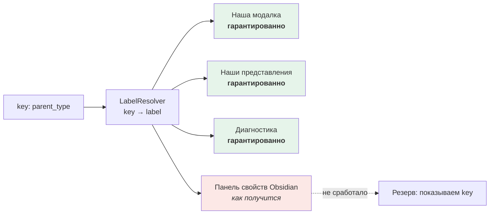

# ADR-003. Язык ключей и слой читаемых подписей

## Контекст

Все три исходных документа используют русские имена полей: `название`, `тип_объекта`, `родительский_тип`,
`кардинальность`, `обязательность`, `тип_значения`, `область_применения`, `жизненный_цикл`.

Черновик v1.1 вводит параллельно английский технический слой: `id`, `type`, `aliases`, `created_at`,
`updated_at` (§14.2), а в примере JSON — `kind`, `key`, `valueType`, `targetTypes`, `required`, `multiple` (§15.3).
Там же прямо сказано: «решение о полном переименовании `тип_объекта` в техническое поле `type` не принято».

Одновременно промпт проекта задаёт правило: **документация на русском, идентификаторы на английском**.

Дополнительное требование пользователя: выбор английского варианта допустим **при условии** создания слоя,
который перекрывает служебные ключи читаемыми подписями. В качестве ориентира названы бета-плагин Exocortex
(режимы source / view) и идея собственного виджета свойств.

## Проблема

На каком языке пишутся ключи полей в данных и как сделать так, чтобы пользователь видел русские названия?

## Рассмотренные варианты

### Вариант A — русский frontmatter
- Плюсы: совместимо со всеми черновиками; читается без перевода; Obsidian и Bases работают с любыми именами полей.
- Минусы: противоречит правилу промпта; в коде появляются имена вида `object.тип_объекта`;
  смешение кириллицы и латиницы — источник трудноразличимых опечаток, которые уже есть в черновиках
  (`CHARACTЕR` с кириллической «Е», `полиaрхическая` с латинской «a»).
- Последствия: постоянный риск «невидимых» расхождений имён.

### Вариант B — полный переход на английский
- Плюсы: соответствует правилу промпта; удобно в коде и в схеме; нет проблем с кодировками.
- Минусы: пользователь видит `parent_type` вместо «Родительский тип»; ломающее изменение.
- Последствия: нужна отдельная работа над читаемостью.

### Вариант C — английские ключи + русские подписи + слой отображения
- Суть: в данных хранится только английский ключ. Русское название — отдельное поле `label` в определении
  свойства. Слой отображения показывает `label` там, где это возможно.
- Плюсы: оба требования выполнены; ключ стабилен, подпись можно менять свободно; появляется задел для
  локализации.
- Минусы: нужно хранить и поддерживать пару «ключ ↔ подпись»; подмена подписей в чужом интерфейсе
  (стандартная панель свойств Obsidian) технически трудна.
- Последствия: требуется честная разметка — где подписи показываются гарантированно, а где как получится.

## Решение

**Принят вариант C.** Формулировка пользователя: «C при условии создания слоя, который перекрывает служебные
ключи — что-то вроде как в бета-плагине Exocortex: в source-режиме видны ключи, в view-режиме читаемые имена
свойств, либо делать кастомный виджет свойств, чтобы там читались подписи».

### Нормативная часть: два слоя имён

| Слой | Поле | Язык | Стабильность | Кто видит |
|---|---|---|---|---|
| Технический | `key` | английский, `snake_case` | **стабилен**, меняется только через ломающее изменение с миграцией | программа, файлы, схема |
| Отображаемый | `label` | русский | свободный, меняется в любой момент без последствий | человек |

Пример определения свойства:

```yaml
---
id: 01J8Z6M4K2Q7V9X3N5B0C1D2EF
type: property
title: Author
key: author
label: Автор
value_type: "[[PROPERTY-TYPE-…|object_reference]]"
cardinality: 0..N
required: false
definition: Person or organization that created the work.
---
```

> [!note] Обратите внимание: `title` и `label` — разные вещи
> `title` — системный атрибут любого объекта, его «имя» как сущности (у свойства это, например, `Author`).
> `label` — подпись, которую видит пользователь рядом со значением этого свойства в форме и в таблице
> (по-русски: «Автор»). У большинства свойств они будут различаться только языком, но это не одно поле.
> Если это окажется избыточным — упростим на шаге 5 (см. «Открытые следствия»).

### Соглашение об именах

| Что | Формат | Пример |
|---|---|---|
| Системные атрибуты | `snake_case`, закрытый список | `id`, `type`, `title`, `aliases`, `created_at`, `updated_at` |
| Ключи предметных свойств | `snake_case`, латиница, без пробелов | `parent_type`, `publication_year`, `owner` |
| Имена типов объектов (`type`) | `snake_case`, единственное число | `person`, `book`, `object_type` |
| Префиксы файлов (`TYPE_PREFIX`) | `UPPER_SNAKE_CASE` | `PERSON`, `OBJECT_TYPE` |
| Значения перечислений | `snake_case`, латиница | `in_progress`, `strict` |
| Подписи (`label`) | русский язык, с заглавной буквы | «Родительский тип» |
| Имена файлов документов | латиница, дефисы, нижний регистр | `01-classification.md` |

### Соответствие старых и новых имён (таблица миграции)

| Было (v1.0, v1.1) | Стало | Русская подпись |
|---|---|---|
| `id` | `id` | — (не отображается) |
| `название` | `title` | Название |
| `тип_объекта` | `type` | Тип объекта |
| `aliases` | `aliases` | Псевдонимы |
| `категории` | `categories` | Категории |
| `tags` | `tags` | Метки |
| `родительский_тип` | `parent_type` | Родительский тип |
| `описание` | `description` | Описание |
| `определение` | `definition` | Определение |
| `тип_значения` | `value_type` | Тип значения |
| `кардинальность` | `cardinality` | Кардинальность |
| `обязательность` | `required` | Обязательно |
| `область_применения` | `scope` | Область применения |
| `уровень` | *(объединено со `scope`, см. U-06)* | — |
| `жизненный_цикл` | `lifecycle` | Жизненный цикл |
| `прямое_название` | `forward_label` | Прямое название |
| `обратное_название` | `reverse_label` | Обратное название |
| `направление` | `direction` | Направление |
| `рекомендуемый_субъект` | `suggested_subject_types` | Рекомендуемый субъект |
| `рекомендуемый_объект` | `suggested_object_types` | Рекомендуемый объект |
| `правило_уникальности` | `uniqueness_rule` | Правило уникальности |
| `субъект` | `subject` | Субъект |
| `объект` | `object` | Объект |
| `тип_отношения` | `relation_type` | Тип отношения |
| `таксономия` | `taxonomy` | Таксономия |
| `фасет` | `facet` | Фасет |
| `родитель` | `parent` | Родитель |
| `режим_иерархии` | `hierarchy_mode` | Режим иерархии |
| `кардинальность_назначения` | `assignment_cardinality` | Кардинальность назначения |
| `допустимые_типы_объектов` | `allowed_object_types` | Допустимые типы объектов |
| `требование_корня` | `root_requirement` | Требование к корню |
| `целевые_типы_объектов` | `target_object_types` | Целевые типы объектов |
| `механизм` | `mechanism` | Механизм |
| `активное` | `enabled` | Включено |
| `триггер` | `trigger` | Триггер |
| `порядок` | `order` | Порядок |
| `основное` | `is_primary` | Основное |
| `дата_начала` | `starts_on` | Дата начала |
| `дата_окончания` | `ends_on` | Дата окончания |
| `источник` | `source` | Источник |
| `контекст` | `context` | Контекст |

> [!warning] Это изменение, требующее подтверждения, и оно ломающее (MAJOR)
> Таблица выше — **предложение**, а не утверждённый реестр. Каждое имя подтверждается на шаге 4–5,
> когда будем описывать конкретные типы и свойства. Сейчас фиксируется принцип и направление перевода.

## Слой отображения: что реально возможно в Obsidian

Пользователь предложил два ориентира: режимы source / view как в Exocortex и собственный виджет свойств.
Разбираю оба честно, включая то, что проверить не удалось.

> [!warning] Про Exocortex
> Мне **не удалось подтвердить** наличие в Exocortex именно режима «source / view» для имён свойств.
> Поиск по открытым источникам не дал результата. Поэтому ниже я опираюсь не на Exocortex, а на технические
> возможности Obsidian, а сам Exocortex предлагаю разобрать отдельно как референс (см. открытый вопрос).
> Принцип, который вы описали, при этом абсолютно рабочий — он реализован ниже как «режим источника / режим
> чтения».

### Где подписи показываются — разбор по поверхностям

| Поверхность | Показывает `label`? | Как | Устойчивость |
|---|---|---|---|
| **Наша модалка редактирования свойств** | **Да, гарантированно** | Мы полностью рисуем её сами | Высокая. Публичный API |
| **Наши представления** (таблицы, карточки, канбан — шаг 8) | **Да, гарантированно** | Мы рисуем сами | Высокая |
| **Сообщения валидации и диагностики** | **Да, гарантированно** | Текст формируем мы | Высокая |
| **Команды и меню плагина** | **Да, гарантированно** | Текст формируем мы | Высокая |
| **Стандартная панель свойств Obsidian** | **Как получится** | См. три способа ниже | Низкая |
| **Режим источника (сырой YAML)** | Нет, и не должно | Показывает данные как есть | — |
| **Таблицы Obsidian Bases** | Частично | Bases показывает имена свойств; заголовок колонки можно задать в самом `.base`-файле | Средняя, требует проверки |
| **Поиск по хранилищу** | Нет | Obsidian ищет по тексту файла, где стоит `key` | — |

### Три способа показать подпись в стандартной панели свойств

| Способ | Суть | Оценка |
|---|---|---|
| **1. CSS-подмена текста** | Стили, которые заменяют текст подписи через `::after` по селектору атрибута | **Отклонить.** Селекторы зависят от недокументированной разметки; ломаются при обновлении Obsidian; не работают для динамически добавленных свойств; текст нельзя прочитать программам (скринридеры, копирование) |
| **2. `MetadataEditor.register`** | Недокументированный механизм Obsidian, которым плагины добавляют собственные типы свойств и свои виджет-контролы | **Прототип на Фазе 5.** Это ближайший технический аналог «кастомного виджета свойств», который вы предложили. Даст и подпись, и удобный контрол. Но механизм недокументирован → те же риски, что у Front Matter Title |
| **3. DOM-подмена подписей** | Находить элементы подписей в готовой разметке и заменять текст | **Отклонить для MVP.** Максимально хрупко; конфликтует с другими плагинами; требует регрессионных тестов после каждого обновления Obsidian |

### Предлагаемая архитектура слоя отображения

Повторяет проверенный подход из [[ADR-001-identity-and-file-naming]]: resolver + изолированные адаптеры +
мягкий отказ.



**Режимы, которые вы описали, сохраняются как настройка:**

| Режим | Что показывает | Когда полезен |
|---|---|---|
| `view` (по умолчанию) | русские подписи `label` | обычная работа |
| `source` | технические ключи `key` | отладка, разбор ошибок, ручная правка, обсуждение схемы |

Переключение — команда плагина и настройка. В режиме источника наша модалка показывает `key`;
сырой YAML в редакторе Obsidian всегда показывает `key` независимо от режима.

## Обоснование

1. **Правило промпта выполняется буквально**: документация на русском, идентификаторы на английском.
2. **Устраняется источник «невидимых» опечаток.** В черновиках уже есть `CHARACTЕR` (кириллическая «Е»)
   и `полиaрхическая` (латинская «a»). В латинских ключах такая ошибка видна сразу, а автоматическая
   проверка (R-10) становится тривиальной.
3. **Условие пользователя выполнено**: слой подписей спроектирован, и в тех поверхностях, которые мы
   контролируем, он работает гарантированно.
4. **Честность вместо обещаний.** Мы заранее говорим, где подписи не покажутся, и не строим хрупкую
   DOM-подмену там, где можно обойтись без неё.
5. **Сейчас это почти бесплатно**, потому что реальных данных нет. Через год это была бы миграция
   по всему хранилищу.

## Последствия

### Положительные
- Ключи стабильны и машиночитаемы, подписи свободно меняются.
- Появляется задел на локализацию: достаточно добавить `label_en`, `label_de`.
- Один стиль именования во всём проекте.

### Отрицательные / чем платим
- **Ломающее изменение (MAJOR)** относительно всех трёх исходных документов.
- Пользователь, открывший заметку в режиме источника или в стандартной панели свойств, увидит английские ключи.
- Нужен и поддерживать реестр «ключ ↔ подпись» для каждого свойства.
- Способ 2 (`MetadataEditor.register`) требует прототипа; если он не сработает, панель свойств останется
  с английскими ключами — это надо принять заранее.

### Обязательные компенсирующие меры

| № | Мера |
|---|---|
| M1 | У каждого свойства `label` **обязателен**. Свойство без подписи не проходит валидацию |
| M2 | Резервное поведение: если `label` не найден — показываем `key`, а не пустое место |
| M3 | Режим `source`/`view` — настройка и команда плагина, переключение без перезапуска |
| M4 | Автоматическая проверка: в `key` и `type` запрещены любые символы вне `[a-z0-9_]` (закрывает U-10 и R-10) |
| M5 | Таблица соответствия старых и новых имён хранится как данные и используется будущими миграциями |
| M6 | До завершения прототипа `MetadataEditor.register` в документации не обещать русские подписи в стандартной панели свойств |
| M7 | В руководствах и примерах всегда показывать пару `key` + `label`, чтобы пользователь видел связь |

## Влияние на метамодель

| Что меняется | Было | Стало | Ломающее изменение? | Нужна миграция? |
|---|---|---|---|---|
| Все имена полей | русские | английские `snake_case` | **да** | Да; данных нет → фиксируем потребность и храним таблицу соответствия |
| Определение свойства | `название`, `тип_значения`, `обязательность` | `title`, `key`, `label`, `value_type`, `required` | **да** | То же |
| `тип_объекта` | строка с русским значением | `type` со значением-ключом типа | **да** | То же |
| Поля `область_применения` и `уровень` | два поля с одинаковым значением | одно поле `scope` (закрывает U-06) | **да** | То же |
| Подписи | отсутствовали как понятие | обязательное поле `label` у свойства | нет | нет |

## Открытые следствия

1. **Прототип `MetadataEditor.register`** — задача Фазы 5. Результат определит, появятся ли русские подписи
   в стандартной панели свойств. До результата — не обещаем.
2. **Exocortex как референс** — предлагаю завести карточку интеграции и разобрать, что именно в нём стоит
   заимствовать. Наличие режима source/view для имён свойств я подтвердить не смог.
3. **`title` против `label` у свойств** — возможно, одно из полей избыточно. Решаем на шаге 5
   (системные атрибуты и типы значений), а не сейчас.
4. **Bases и заголовки колонок** — проверить на шаге 8, можно ли задать русскую подпись колонки в `.base`-файле.
5. **Локализация подписей метамодели** (у самих определений `label` на русском) — не путать с локализацией
   интерфейса плагина. Обе задачи отложены.

## Связанные документы

- [[ADR-002-source-of-truth]] — определения живут в Markdown, значит ключи видны в файлах
- [[ADR-001-identity-and-file-naming]] — тот же архитектурный приём: resolver + адаптеры + мягкий отказ
- [[../integrations/research-front-matter-title-stability]] — урок про цену DOM-интеграции
- [[../metamodel/analysis-contradictions]] — записи C-06, C-03, U-06, U-10
- Записи в [[../decisions/decision-log]]: DL-030, DL-031, DL-032
- Запись в [[../changelog/CHANGELOG]]: версия 0.1.0

## Подтверждение

- Предложено ассистентом: 2026-10-22 (вопрос 3, три варианта, рекомендация C)
- Решение пользователя: 2026-10-22 — «C при условии создания слоя, который перекрывает служебные ключи …
  либо делать кастомный виджет свойств, чтобы там читались подписи»
- Условие выполнено: спроектирован `LabelResolver` + режимы source/view + прототип виджета свойств на Фазе 5
- Статус: **accepted**
