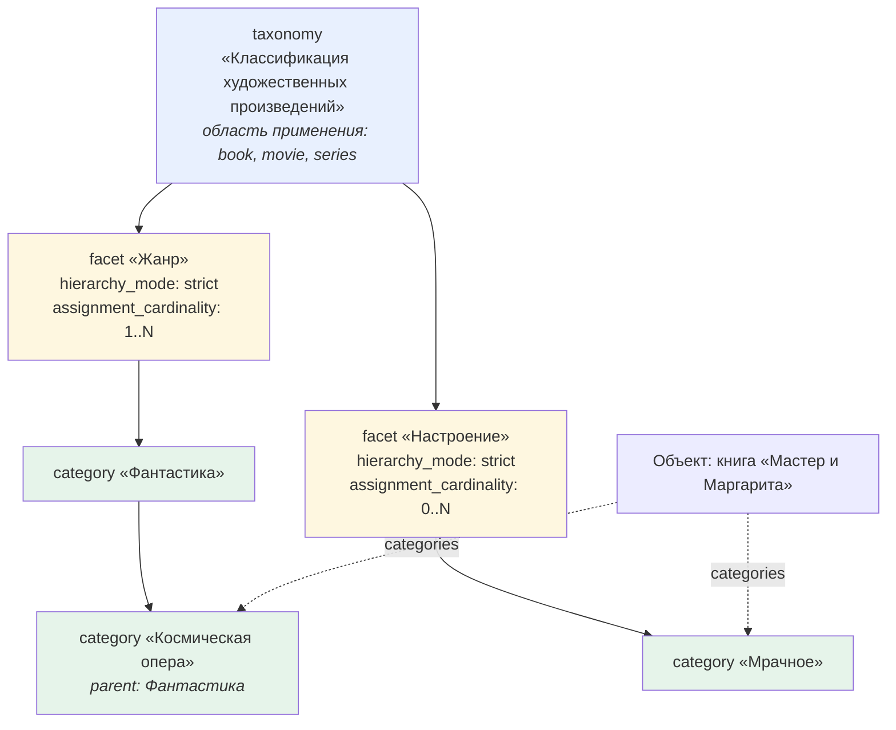

# ADR-005. Модель классификации

## Контекст

В исходных черновиках два конкурирующих механизма классификации, и граница между ними не описана:

1. **Иерархия типов** — поле `parent_type`: Контекст → Человек, Произведение → Книга.
2. **Категории** — таксономия → категория: Жанры → Фантастика → Космическая опера.

Спецификация v1.0 (§7–8) задаёт два уровня: `Таксономия → Категория`, а настройки иерархии хранит
на таксономии. Черновик v1.1 (§7) вводит третий уровень — **Фасет** — и переносит настройки на него,
но сам помечает решение как несогласованное: «допустимость такого разделения и необходимость наследовать
значения по умолчанию от таксономии остаются предметом дальнейшего согласования».

Одновременно поле `categories` объявлено обязательным в универсальном ядре (`01` §2), а формат хранения
назначений категорий «будет уточнён в спецификации реализации плагина» (v1.1 §7.4) — прямое противоречие C-05.
Поле `tags` входит в универсальное ядро, но нигде не определено (G-12).

## Проблема

1. Нужен ли уровень «Фасет»?
2. По какому критерию решать, что является подтипом, а что — категорией?
3. Обязательны ли категории и кто это определяет?
4. Что такое `tags` и чем они отличаются от категорий?
5. Как формально отличить абстрактный тип от создаваемого?

## Рассмотренные варианты

### По уровню «Фасет»

| Вариант | Суть | Плюсы | Минусы |
|---|---|---|---|
| **A** | Оставить 3 уровня: `taxonomy → facet → category` | Разные измерения требуют разных правил: «Жанр» — строгая иерархия с несколькими корнями, «Настроение» — плоский список, «Тематическая область» — полиерархия. Одной таксономией это не описать | +1 тип объекта и +1 уровень вложенности в интерфейсе |
| B | Убрать фасет, вернуться к 2 уровням | Проще | Настройки придётся задавать на таксономию, а у разных измерений они разные. Либо плодить таксономии на каждое измерение, теряя смысл группировки |
| C | Отложить решение | Не тратим время сейчас | Классификацию нельзя описать без этого решения → блокировка шага 4 |

### По критерию «подтип или категория»

| Вариант | Критерий | Плюсы | Минусы |
|---|---|---|---|
| A | Подтип, если нужен свой набор полей | Простой и проверяемый | Не покрывает случай «полей нет, но структура другая» |
| B | Подтип, если наследует поведение родителя | Учитывает поведение | «Поведение» трудно формализовать |
| **C** | Оба критерия как два последовательных теста | Воспроизводимый результат вместо интуиции | Нужно записать правило в документ |
| D | Решать по каждому случаю отдельно | Гибко | Каждый раз новый спор — именно это привело к текущим противоречиям |

### По обязательности категорий

| Вариант | `categories` | `tags` | Минусы |
|---|---|---|---|
| A | Обязательны для всех | Системный атрибут ядра | Заставляет классифицировать черновики и захваченные заметки |
| **B** | Необязательны по умолчанию; обязательность задаёт фасет через `assignment_cardinality` | Свободные метки вне метамодели | Два похожих механизма рядом — нужно правило разделения |
| C | Необязательны | Убрать из системного ядра | Теряем быстрые неформальные метки, полезные в личной базе |

## Решение

Приняты варианты **A**, **C**, **B** соответственно. Формулировки пользователя: «1. C» (состав ядра
с веткой классификации), «2. A» (оставить фасет), «3. C» (оба теста), «4. B» (обязательность через фасет
+ свободные метки).

### Нормативная часть 1. Три уровня классификации

| Уровень | Роль | Ключевые поля |
|---|---|---|
| `taxonomy` | Объединяет фасеты в согласованную систему и задаёт область применения | `facets`, `allowed_object_types` |
| `facet` | Отдельное измерение классификации. **Носитель правил** | `taxonomy`, `hierarchy_mode`, `assignment_cardinality`, `root_requirement` |
| `category` | Конкретное значение внутри ровно одного фасета | `facet`, `parent` |
| назначение | Привязка категории к объекту | `categories` в объекте |

**Правила:**

- П1. Настройки иерархии и назначения задаются **на уровне фасета**.
- П2. Фасет **наследует значения по умолчанию от таксономии** и может их переопределить
  (закрывает пункт 6 §13 v1.1).
- П3. Категория принадлежит **ровно одному** фасету. Перенос в другой фасет — контролируемая операция,
  потому что меняет смысл назначения.
- П4. Иерархия категорий строится через непосредственного родителя; предки вычисляются; корень не имеет
  родителя; искусственный объект «Корень» не создаётся.
- П5. `root_requirement` задаётся числом: `min_roots` и `max_roots`, где `max_roots: null` означает
  «без ограничения». Это заменяет неясные значения `один` / `несколько` / `не требуется` (U-13).
- П6. Команда `create-taxonomy` по умолчанию создаёт таксономию **с одним фасетом**, чтобы в простом
  случае пользователь не делал лишнее движение.
- П7. Обязательность назначения категорий задаёт **фасет** через `assignment_cardinality`,
  а не универсальное ядро объекта. По умолчанию — необязательны.

Допустимые значения `hierarchy_mode`: `strict` (строгая: у категории не более одного родителя),
`polyhierarchical` (полиерархическая: более одного родителя допустимо).
Допустимые значения `assignment_cardinality`: `0..1`, `1`, `0..N`, `1..N`.

### Нормативная часть 2. Критерий «подтип или категория»

> **Тест 1.** Нужны ли этому виду объектов **собственные свойства**, которых нет у родителя?
> **Да** → подтип. **Нет** → тест 2.
>
> **Тест 2.** Является ли это **открытым множеством значений**, которое пользователь пополняет
> без изменения метамодели? **Да** → категория. **Нет** → подтип.

Правило применяется **до** создания нового типа. Результат заносится в реестр типов с указанием,
какой тест дал ответ.

### Нормативная часть 3. `tags` против `categories`

| | `tags` | `categories` |
|---|---|---|
| Природа | Свободные метки | Управляемая классификация |
| Справочник | Нет | Да: категории фасетов |
| Валидация | Нет | Да: допустимый тип объекта, кардинальность фасета, существование категории |
| Кто создаёт | Пользователь спонтанно | Команда `create-category` |
| Часть метамодели | **Нет** | Да |
| Хранение | Системный атрибут `tags` | Системный атрибут `categories` |

**Правило жизненного цикла:** метка, которая прижилась и оказывается нужной постоянно, **повышается**
до категории соответствующего фасета. Обратное движение (категория → метка) допускается как способ
вывести значение из справочника.

### Нормативная часть 4. Абстрактные типы

Тип объекта имеет системное поле `abstract` (**термин**: признак «экземпляр создать нельзя, тип
существует только как основа для наследников»).

| Значение | Что значит | Поведение плагина |
|---|---|---|
| `abstract: true` | Экземпляр создать нельзя | Команда `create-object` не предлагает этот тип; при ручной попытке — ошибка |
| `abstract: false` | Обычный создаваемый тип | Доступен в форме создания |

Слово «абстрактный» используется вместо формулировки v1.0 «концептуальные родительские уровни,
а не обязательно создаваемые заметки» (U-09). Смысл тот же, но формально проверяемый.

### Нормативная часть 5. Ядро из 11 типов

| Тип | `type` | `TYPE_PREFIX` | Группа | `abstract` |
|---|---|---|---|---|
| Человек | `person` | `PERSON` | Контекст | false |
| Проект | `project` | `PROJECT` | Деятельность | false |
| Книга | `book` | `BOOK` | Произведение | false |
| Знание | `knowledge` | `KNOWLEDGE` | Знание | false |
| Тип объекта | `object_type` | `OBJECT_TYPE` | Системные | false |
| Свойство | `property` | `PROPERTY` | Системные | false |
| Тип отношения | `relation_type` | `RELATION_TYPE` | Системные | false |
| Отношение | `relation` | `RELATION` | Системные | false |
| Категория | `category` | `CATEGORY` | Системные | false |
| Фасет | `facet` | `FACET` | Системные | false |
| Таксономия | `taxonomy` | `TAXONOMY` | Системные | false |

`property_type` остаётся в реестре со статусом `core` и `abstract: true`, но **без детальной карточки**:
8 типов значений закрыты и заданы кодом (слой 1, см. [[ADR-002-source-of-truth]]).

## Обоснование

1. **Фасет окупается.** Три реальных измерения классификации художественного произведения — жанр,
   настроение, место действия — требуют разных режимов иерархии и разной кардинальности назначения.
   Без фасета это либо три отдельные таксономии (потеря группировки), либо одна таксономия с усреднёнными
   правилами (потеря точности).
2. **Два теста снимают повторяющийся спор.** Именно неопределённость границы «подтип или категория» породила
   ~40 типов в спецификации, часть из которых — по сути значения справочника.
3. **Обязательность через фасет использует уже существующий механизм.** Поле `assignment_cardinality`
   есть в черновиках. Не нужно изобретать новый.
4. **Свободные метки нужны в личной базе.** Жёсткая классификация не поспевает за потоком захвата;
   метки закрывают этот разрыв, а правило повышения связывает два механизма.
5. **Ядро из 11 типов покрывает все механизмы модели:** наследование (`person`), связи (`book` — автор → `person`),
   классификация (`book` — жанр), валидация, шаблоны, самоопределение (`object_type`, `property`).

## Последствия

### Положительные
- Классификация полностью формализована: можно писать схему и валидацию.
- Часть из ~40 типов переквалифицируется в категории → ядро сокращается само.
- Обязательность категорий настраивается по типам и измерениям, а не задаётся глобально.
- Устранены противоречия C-04, C-05, U-09, U-13, G-12.

### Отрицательные / чем платим
- Три уровня вложенности: чтобы назначить категорию, нужно понимать, к какому фасету она относится.
  Компенсируется правилом П6 и тем, что команда `assign-category` показывает категории с указанием фасета.
- **Ломающее изменение** относительно `01` §7–8 и `02 v1.0` §6–7: у категории поле `taxonomy` заменено
  на `facet`, настройки переехали с таксономии на фасет, значения `root_requirement` изменены на числовые.
- Два механизма меток рядом (`tags` и `categories`) — риск, что пользователь будет плодить метки
  вместо категорий. Компенсируется правилом повышения и подсказкой в интерфейсе.

### Обязательные компенсирующие меры

| № | Мера |
|---|---|
| M1 | Команда `create-taxonomy` создаёт таксономию вместе с первым фасетом |
| M2 | Команда `assign-category` показывает категорию вместе с именем фасета и таксономии |
| M3 | При назначении категории плагин проверяет: тип объекта допустим в таксономии, кардинальность фасета не превышена, категория существует и принадлежит заявленному фасету |
| M4 | При создании типа объекта команда спрашивает, является ли тип абстрактным, и объясняет последствия |
| M5 | Плагин может предложить повысить часто используемую метку до категории (этап 2, не MVP) |
| M6 | Результат применения двух тестов заносится в реестр типов — чтобы решение было видно и его не пришлось принимать заново |

## Влияние на метамодель

| Что меняется | Было | Стало | Ломающее изменение? | Нужна миграция? |
|---|---|---|---|---|
| Уровни классификации | 2 (`01`, v1.0) / 3 (v1.1, черновик) | 3, утверждено | **да** относительно `01` | Да; данных нет → фиксируем потребность |
| Поле у категории | `taxonomy` | `facet` | **да** | То же |
| Настройки иерархии | на таксономии | на фасете, с наследованием от таксономии | **да** | То же |
| Значения `root_requirement` | `один` / `несколько` / `не требуется` | `min_roots` / `max_roots` (числа) | **да** | То же |
| `categories` | обязательны для всех объектов | обязательность задаёт фасет | **да** | То же |
| `tags` | объявлены, не определены | свободные метки вне метамодели | нет | нет |
| Признак абстрактности | формулировка словами | системное поле `abstract` | нет | нет |
| Ядро типов | 8 (ADR-004) | 11 | нет | нет |

## Открытые следствия

1. **Спорный случай:** Стихотворение и Текст песни — подтип или категория? Тест 1 не даёт однозначного
   ответа: у стихотворения могут быть свои свойства (`форма`, `размер`), но они не обязательны.
   Решение за пользователем.
2. **Персонаж:** по тесту 1 — подтип `person` (свои свойства: `актёр`, `первое появление`, `произведение`).
   Префикс в исходнике содержит кириллическую «Е» — исправить на `CHARACTER`.
3. **Веб-новела, Серия фильмов, Музыкальная серия, Галерея** — предварительная переквалификация в категории
   или подтипы; полное применение тестов сделано в [[../metamodel/02-entities|реестре типов]] и требует
   вашего подтверждения построчно.
4. **Формат хранения назначений категорий** в объекте (пункт 7 §13 v1.1) — уточняется на шаге 5 вместе
   с системными атрибутами. Предложение: `categories` — список ссылок на объекты-категории.

## Связанные документы

- [[../metamodel/01-classification]] — полное описание модели классификации с примерами
- [[../metamodel/02-entities]] — реестр всех типов с применёнными тестами
- [[ADR-004-first-pass-scope-and-command-driven-authoring]] — состав ядра, команды
- [[ADR-003-bilingual-keys-and-label-layer]] — имена полей
- [[../metamodel/analysis-contradictions]] — записи C-04, C-05, U-09, U-13, G-12
- Записи в [[../decisions/decision-log]]: DL-039…DL-046
- Запись в [[../changelog/CHANGELOG]]: версия 0.2.0

## Подтверждение

- Предложено ассистентом: 2026-10-22 (шаг 4, четыре вопроса с вариантами и рекомендациями)
- Решение пользователя: 2026-10-22 — «1. C, 2. A, 3. C, 4. B»
- Статус: **accepted**
