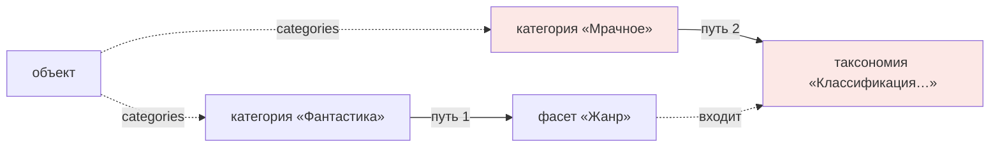

# ADR-007. Фасет как независимый объект

> [!success] Статус: **accepted**, принят пользователем 2026-10-22 (ответ «1. B»)
> Это изменение уже принятого [[ADR-005-classification-model|ADR-005]]. По нашему правилу ADR не
> переписываются, а дополняются новым ADR со ссылкой. Нормативный документ
> [[../metamodel/01-classification|01-classification.md]] обновлён в соответствии с этим решением.

## Контекст

ADR-005 утвердил трёхуровневую классификацию `taxonomy → facet → category` с обязательной принадлежностью
фасета таксономии и обязательной принадлежностью категории фасету.

После принятия решения пользователь высказал сомнение (дословно):

> «у меня вызывает сомнения фасет как промежуточное звено между таксономией и категорией, я думаю фасет
> может быть независимым объектом а может принадлежать таксономии, а так же корнем категорий может быть
> как фасет так и таксономия»

Замечание затрагивает два разных вопроса, и их нужно разделить:

1. Обязателен ли у фасета родитель-таксономия?
2. Может ли категория принадлежать таксономии напрямую, минуя фасет?

## Проблема

Насколько жёсткой должна быть иерархия классификации: три обязательных уровня или гибкая структура,
в которой таксономия нужна не всегда?

## Анализ: что в сомнении верно, а что рискованно

### Часть 1 — «фасет может быть независимым»

**Это верно, и вот почему.** Таксономия в модели несёт ровно две вещи: объединение фасетов в группу
и `allowed_object_types` (область применения). Обе могут жить на самом фасете:

- в подавляющем большинстве случаев у классификации **одно измерение**: «Жанр», «Тема», «Статус».
  Заводить таксономию ради одного фасета — лишний объект и лишний уровень в интерфейсе;
- `allowed_object_types` логичнее относится к фасету: ограничения «жанр применим к книгам и фильмам» —
  это свойство измерения, а не группы измерений.

Таксономия становится полезной только тогда, когда несколько фасетов нужно **связать общими правилами**
или показывать как единое целое (например, «Классификация художественных произведений» = жанр + настроение
+ место действия, все три применимы к одним и тем же типам).

### Часть 2 — «корнем категорий может быть как фасет, так и таксономия»

**Это рискованно, и вот почему.** Если категория может принадлежать и фасету, и таксономии напрямую,
появляются **два пути назначения классификации**:



Последствия:

| Проблема | Почему это плохо |
|---|---|
| Правила назначения теряют адресата | Кардинальность, режим иерархии и допустимые типы заданы на фасете. У категории, висящей на таксономии, их нет — значит, её назначения нечем проверять |
| Двойной учёт | Категория может одновременно входить в фасет, который входит в таксономию, и в ту же таксономию напрямую. Возникает неоднозначность: это одна категория или две роли одной категории? |
| Это ровно та проблема, которую мы только что починили | Противоречие C-04 в исходных черновиках возникло из-за двух конкурирующих путей классификации. Второй путь вернёт её обратно |
| Усложнение кода | Движку схемы придётся проверять «к чему привязана категория» в каждом правиле |

**Важное уточнение:** в принятой модели категория **уже** имеет корень-фасет в смысловом, а не
структурном смысле. Вершина цепочки — категория без `parent`, и она принадлежит фасету. То есть
«корень категорий — фасет» уже выполняется. Вопрос только в том, добавлять ли второй вариант.

## Рассмотренные варианты

### Вариант A — оставить ADR-005 без изменений
- Суть: фасет обязательно принадлежит таксономии; категория обязательно принадлежит фасету.
- Плюсы: самая простая и предсказуемая структура; все правила имеют один адресат.
- Минусы: лишний объект и лишний уровень для самого частого случая «одно измерение».

### Вариант B — фасет независим, таксономия необязательна; категория по-прежнему принадлежит только фасету
- Суть: `taxonomy` у фасета становится необязательной; `allowed_object_types` и значения по умолчанию
  дублируются на фасет; категория всегда указывает фасет.
- Плюсы: гибкость без потери единого адресата правил; частый случай «одно измерение» не требует таксономии;
  второй путь классификации не появляется.
- Минусы: `allowed_object_types` может жить в двух местах → нужно правило наследования и проверки
  согласованности; ломающее изменение относительно ADR-005.

### Вариант C — как предложил пользователь полностью: категория может указывать и на фасет, и на таксономию
- Суть: два возможных родителя у категории.
- Плюсы: максимальная гибкость; не нужно создавать фасет «по умолчанию».
- Минусы: все четыре проблемы из таблицы выше; правила назначения требуют отдельного адресата для каждого
  случая; валидация усложняется; риск вернуть противоречие C-04.

## Решение

**Принят вариант B.** Подтверждён пользователем 2026-10-22.

### Нормативная часть (при принятии)

1. **Фасет — самостоятельный объект метамодели.** Поле `taxonomy` у фасета **необязательно**.
2. **Таксономия — необязательная группировка** нескольких фасетов. Нужна, когда фасеты разделяют
   область применения или их удобно показывать вместе.
3. **`allowed_object_types` может быть задан и на фасете, и на таксономии.** Правило:
   - если задано на фасете — действует значение фасета;
   - если не задано на фасете, но фасет входит в таксономию — берётся значение таксономии;
   - если не задано нигде — ограничений нет.
4. **Значения по умолчанию** (`hierarchy_mode`, `assignment_cardinality`, `root_requirement_min/max`)
   наследуются от таксономии так же, как в ADR-005 правило П2.
5. **Категория по-прежнему принадлежит ровно одному фасету.** Поле `facet` обязательно.
   Второй путь через таксономию **не вводится**.
6. **Корень категорий** — категория с пустым `parent`. Фасет остаётся вершиной в смысловом смысле:
   он задаёт правила для всей цепочки, но сам категорией не является.
7. **Таксономия без фасетов не имеет смысла** → правило валидации: у таксономии минимум один фасет
   (уже есть в ADR-005). Обратное не требуется: фасет без таксономии допустим.

### Изменения в полях

| Объект | Поле | Было (ADR-005) | Становится |
|---|---|---|---|
| `facet` | `taxonomy` | обязательно, ровно одна таксономия | **необязательно**, `0..1` |
| `facet` | `allowed_object_types` | не было | **новое поле**, `0..N`, значение по умолчанию наследуется от таксономии |
| `taxonomy` | `facets` | обязательно, минимум один | без изменений |
| `taxonomy` | `allowed_object_types` | было | без изменений; становится значением по умолчанию для фасетов |
| `category` | `facet` | обязательно | **без изменений** |

### Примеры

**Частный случай — одно независимое измерение:**

```yaml
---
id: 01J8Z6M4K2Q7V9X3N5B0C1D2EU
type: facet
title: Topic
label: Тема
taxonomy: []
allowed_object_types:
  - "[[OBJECT_TYPE-….md|Знание]]"
hierarchy_mode: strict
assignment_cardinality: 0..N
---
```

**Группа измерений с общими правилами:**

```yaml
---
id: 01J8Z6M4K2Q7V9X3N5B0C1D2EV
type: taxonomy
title: Fiction classification
label: Классификация художественных произведений
facets:
  - "[[FACET-….md|Жанр]]"
  - "[[FACET-….md|Настроение]]"
allowed_object_types:
  - "[[OBJECT_TYPE-….md|Книга]]"
  - "[[OBJECT_TYPE-….md|Фильм]]"
---
```

Фасет «Жанр» в этом случае может не задавать `allowed_object_types` — возьмётся из таксономии.

## Обоснование рекомендации

1. **Первая часть сомнения пользователя верна.** Таксономия как обязательное звено — избыточность
   для самого частого случая. Это реальное упрощение, а не усложнение.
2. **Вторая часть сомнения опасна.** Разрешение категории указывать на таксономию создаёт второй путь
   классификации и лишает назначения правил проверяемости. Именно такая двойственность породила
   противоречие C-04 в исходных черновиках.
3. **Вариант B даёт пользователю желаемую гибкость** (независимый фасет) **без потери проверяемости**
   (единственный адресат правил).
4. Требование «корень категорий — фасет» фактически уже выполнено: вершина цепочки — категория без
   `parent`, принадлежащая фасету, и фасет задаёт правила всей цепочки.

## Последствия (при принятии варианта B)

### Положительные
- Одно измерение классификации больше не требует двух объектов.
- Команда `create-facet` не заставляет выбирать таксономию.
- Область применения можно задать там, где это действительно свойство измерения.

### Отрицательные / чем платим
- **Ломающее изменение** относительно ADR-005: обязательность `taxonomy` у фасета снята.
- `allowed_object_types` может находиться в двух местах → нужна проверка согласованности и понятное
  правило наследования (сформулировано в п. 3).
- Часть текста `01-classification.md` требует правки.

### Обязательные компенсирующие меры

| № | Мера |
|---|---|
| M1 | Команда `create-facet` спрашивает таксономию, но допускает ответ «без таксономии» |
| M2 | Правило наследования `allowed_object_types` описано в `01-classification.md` и проверяется движком схемы |
| M3 | Правило валидации `facet.allowed_types.conflict`: если значение задано и на фасете, и на таксономии, значение фасета **должно быть подмножеством** значения таксономии. Иначе — `warning` |
| M4 | В интерфейсе категория всегда показывается вместе с именем фасета; имя таксономии добавляется, если она есть |
| M5 | Пункт ADR-005 «П2 наследование от таксономии» сохраняется и расширяется на `allowed_object_types` |

## Влияние на метамодель

| Что меняется | Было | Стало | Ломающее изменение? | Нужна миграция? |
|---|---|---|---|---|
| `facet.taxonomy` | обязательно | необязательно, `0..1` | **да** относительно ADR-005 | Да, данных нет |
| `facet.allowed_object_types` | отсутствовало | новое поле `0..N` | нет | нет |
| Категория → таксономия напрямую | невозможно | **остаётся невозможным** | нет | нет |
| Правила назначения | адресат — фасет | адресат — фасет (без изменений) | нет | нет |

## Открытые следствия

1. Нужна ли команда `create-taxonomy`, если таксономия необязательна? **Предложение:** да, но она
   становится «сгруппировать существующие фасеты», а не «создать фасет вместе с таксономией».
   Правило П6 ADR-005 (таксономия создаётся сразу с одним фасетом) при этом **отменяется**.
2. Стоит ли показывать независимые фасеты и таксономии в одном представлении классификации?
   Решаем на шаге 8 (представления).
3. Если в будущем понадобится категория без фасета — это будет новый ADR, а не правка этого.

## Связанные документы

- [[ADR-005-classification-model]] — изменяемое решение
- [[../metamodel/01-classification]] — нормативный документ, требующий правки при принятии
- [[../metamodel/02-entities]] — реестр типов
- [[../metamodel/analysis-contradictions]] — запись C-04
- Записи в [[../decisions/decision-log]]: DL-067, DL-068

## Подтверждение

- Сомнение высказано пользователем: 2026-10-22
- Предложено ассистентом: 2026-10-22 — три варианта, рекомендация B
- Подтверждено пользователем: 2026-10-22 — «1. B»
- Статус: **accepted**
