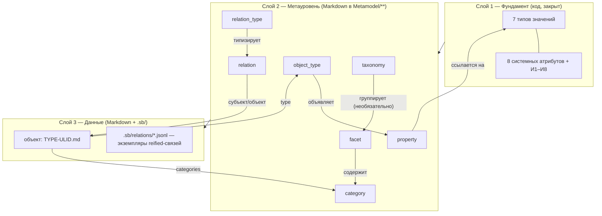

# 00. Обзор метамодели

> [!info] Назначение документа
> Входная точка для читателя: что за модель, из чего состоит, где что лежит, в каком порядке
> читать. Норм здесь нет — только ссылки на нормы. Если этот обзор расходится с ADR или
> нормативным разделом, **истина там**, а обзор подлежит правке.

## 1. Что это за модель

**Second Brain** — самоопределяющаяся объектная модель личной базы знаний внутри Obsidian.
Не «список типов заметок», а система, где **тип объекта, свойство, тип свойства, тип отношения,
отношение, таксономия, фасет, категория, представление и автоматизация — тоже объекты** со своими
`id` и `type`. Модель расширяется без изменения кода плагина: новое предметное свойство добавляется
командой, а не перекомпиляцией.

**Три слоя:**

| Слой | Что в нём | Кто задаёт |
|---|---|---|
| 1. Фундамент | 7 типов значений (`text`, `number`, `date`, `datetime`, `boolean`, `object_reference`, `media_reference`) + 8 системных атрибутов (`id`, `type`, `title`, `aliases`, `created_at`, `updated_at`, `categories`, `tags`) + инварианты И1–И8 | Код плагина, набор **закрыт** (ADR-006) |
| 2. Метауровень | Описания: типы объектов, свойства, типы отношений, отношения, таксономии, фасеты, категории, автоматизации | Пользователь, командами плагина; хранится в Markdown-заметках `Metamodel/**` (ADR-002) |
| 3. Данные | Экземпляры объектов и экземпляры отношений | Пользователь |

**Следствие — «порядок запуска» (bootstrapping):** слой 1 обязан быть закрытым и заданным кодом,
иначе модель не на что опереть; метамодель читается одним универсальным механизмом; определения
применяются только после проверки (8 шагов, v1.1 §15.4).

## 2. Модель в числах (на 2026-10-23, метамодель 0.19.0)

| Что | Значение | Где норма |
|---|---|---|
| Типов ядра | **15** (6 предметных, 2 абстрактных, 7 системных); реестр — 58 записей | `02-entities`, карточки в `entities/` (готовы 5 из 15) |
| Типов отношений ядра | **5**: `authorship`, `ownership`, `part_of`, `related_to`, `contains` | `03-relations`, карточки в `relations/` |
| Системных атрибутов | **8**, закрытый набор | ADR-006, `04-attributes` |
| Типов значений | **7**, закрытый набор; множественность — только `cardinality` | ADR-006 |
| Перечислений | **23** (21 закрыто) | `05-enumerations` |
| Правил валидации | **166** в 13 группах (A–M), 6 уровней контроля | `validation/rules`, `severity-policy` |
| Модулей плагина | **45** в MVP (12 отложенных, 12 нереализуемых), UI — Svelte (слой 5) | `09-modules` |
| Команд | **18** в MVP | `mvp-scope` |
| Представлений | **12** (В1–В12); механизмы: `base`, `plugin_view`, `code_block` | `08-views` |
| Интеграций | **7 карточек**: Bases — использовать; FMT — необязательный адаптер; Templater, Dataview, Fileclass, Metadata Menu — не зависимости; QuickAdd — отложен | `integrations/` |
| ADR | **11 принятых** (ADR-001…ADR-011) | `adr/` |

## 3. Схема целиком



## 4. Десять принципов (каждый — ссылка на норму)

1. **Источник истины — Markdown в хранилище**; `.sb/` — только служебные данные (ADR-002).
2. **Создание и правка метамодели — командами плагина**, не ручным редактированием (ADR-004, П1–П6).
3. **Идентификация непрозрачна**: `id` — голый ULID, имя файла `{TYPE_PREFIX}-{ULID}.md`;
   читаемость дают `aliases[0] == title` (И4), псевдоним в канонической ссылке (DL-186)
   и необязательный Front Matter Title (ADR-001).
4. **Ключи английские, подписи русские**: `key` стабилен, `label` свободен (ADR-003).
5. **Классификация — только через фасет**: `taxonomy → facet → category`; `tags` — свободные
   метки вне метамодели; второй путь запрещён (ADR-005, ADR-007, П8).
6. **Множественность задаёт только `cardinality`**; типов «Список» нет (ADR-006).
7. **Связи гибридные**: `link_mode` объявляется в свойстве (`direct` / `reified`); привязка
   через `origin_property`; обратная сторона вычисляется (ADR-009).
8. **Реифицированные связи — в `.sb/` (JSON Lines)**: граф Obsidian остаётся чистым; это основные
   данные — снимки обязательны (ADR-010).
9. **Система не переписывает данные молча**: четыре исключительных случая автоисправлений,
   всё остальное — диагностика + предложение; миграции — только явные (severity-policy, раздел 10).
10. **Мягкая зависимость**: ни один сторонний плагин не обязателен для ядра (шаблон интеграции,
    карточки в `integrations/`).

## 5. Жизнь объекта (жизненный цикл)

```
создание ──► заполнение ──► связи ──► проверка ──► представления ──► изменения
```

1. **Создание**: команда `create-object` **или** клик по пустой ссылке (раздел 12: перехват
   `vault.on('create')`, выбор типа по контексту К1–К5, `title` из текста ссылки).
2. **Заполнение**: контролы свойств нашей модалки/панели; условные свойства по `applies_when`
   (`04-attributes` §11); обязательные поля при создании из ссылки не требуются (диагностика позже).
3. **Связи**: `direct` — во frontmatter; `reified` — объекты `relation` в `.sb/`
   (локальные свойства `role`, `order`, `starts_on`, `ends_on`, `description`).
4. **Проверка**: 6 уровней контроля целостности; 166 правил; результат — диагностики
   (11 полей формата) + служебные метки `sb/*` + свойство `sb_issues` для представлений.
5. **Представления**: 12 штук (таблицы и карточки Bases, панель объекта, галерея медиа,
   навигация по главам…); `.base` генерируются в `Views/` с маркером и перегенерацией через вопрос.
6. **Изменения**: схемы — по 8 шагам v1.1 §15.4; данных — явные миграции (раздел 10: снимок,
   сухой прогон, журнал, откат).

## 6. Карта документов и порядок чтения

| Вы | Порядок |
|---|---|
| **Новичок** (понять модель) | Этот обзор → `analysis-01-incoming-drafts` §2 → `01-classification` → `02-entities` → карточки `entities/book`, `entities/person` |
| **Аналитик** (проверить согласованность) | ADR-001…011 по номерам → `03-relations`, `04-attributes`, `05-enumerations`, `06-time-and-intervals`, `07-hierarchy` → `validation/rules` + `severity-policy` → `12-links-and-aliases` → `analysis-contradictions` (реестр проблем и их статусы) |
| **Реализатор** (Фаза 5) | `roadmap/phases` (этапы A–E) → `roadmap/mvp-scope` → `09-modules` → `08-views` → `integrations/*` → `10-migration-rules` → `roadmap/readiness-checklist` |
| **Новая сессия с ассистентом** | `CHECKPOINT.md` целиком → этот обзор → документы по ссылкам контрольной точки |

**Разделы метамодели:** `00-overview` (этот) · `01-classification` · `02-entities` ·
`03-relations` · `04-attributes` · `05-enumerations` · `06-time-and-intervals` ·
`07-hierarchy` · `08-views` · `09-modules` · `10-migration-rules` · `11-rdf-extension` ·
`12-links-and-aliases`.

## 7. Границы MVP — коротко

В MVP: 15 типов ядра, 5 отношений, 18 команд, 45 модулей, 12 представлений, валидация,
ссылки и псевдонимы, медиа-обёртки. Вне MVP (полный список с причинами — `mvp-scope` §3):
мобильная версия, внешние API и LLM, патчи внутренностей Obsidian, свой слой подмены названий,
RDF-экспорт, автоматические миграции (движок), типы и отношения этапа 2.

## 8. История изменений

| Дата | Версия метамодели | Что изменилось | Причина | Ссылка |
|---|---|---|---|---|
| 2026-10-23 | 0.19.0 | Документ создан: три слоя и bootstrapping; модель в числах; Mermaid-схема; десять принципов со ссылками; жизненный цикл объекта; карта документов и четыре маршрута чтения; границы MVP кратко | Под-шаг 8f — входная точка обещана планом документации (`docs/README`) | все разделы и ADR |
