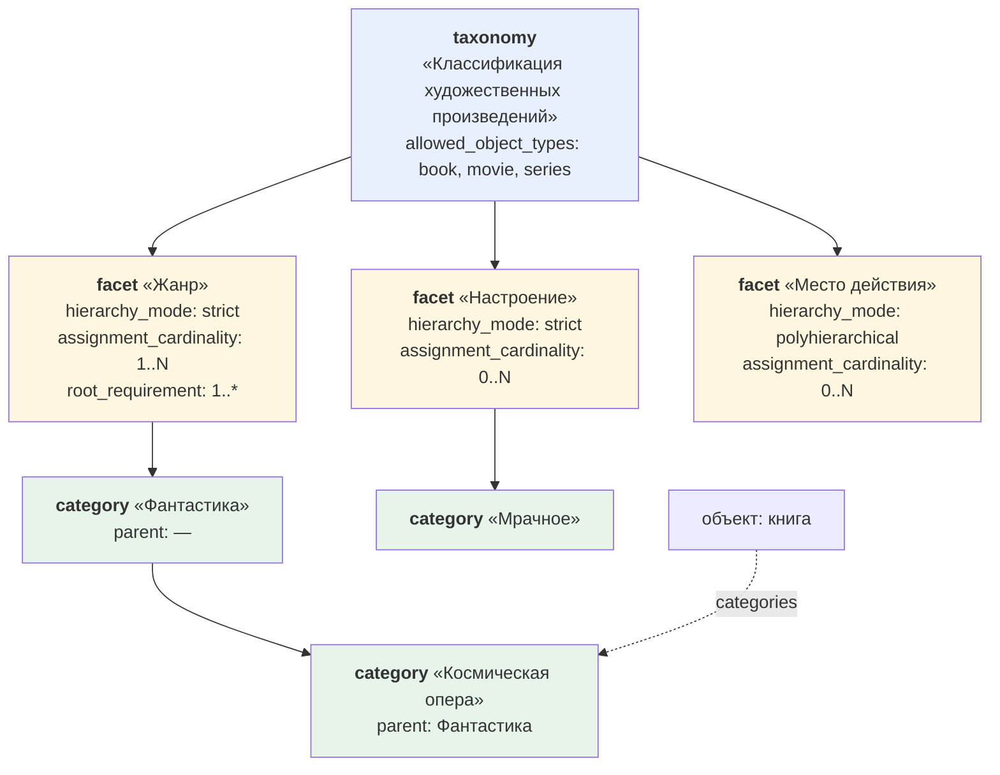

# 01. Классификация

> [!info] Статус документа
> Нормативный. Основание — [[../adr/ADR-005-classification-model|ADR-005]], принят 2026-10-22.
> Имена полей — по [[../adr/ADR-003-bilingual-keys-and-label-layer|ADR-003]]: технический ключ
> английский, подпись русская.

## 1. Два механизма, и где между ними граница

В модели есть **два независимых** механизма классификации. Путаница между ними была одной из главных
проблем исходных черновиков, поэтому граница фиксируется явно.

| Механизм | Что делает | Как хранится | Меняется | Пример |
|---|---|---|---|---|
| **Иерархия типов** | Задаёт, **чем является** объект и какие у него свойства | поле `parent_type` у типа объекта | редко, через изменение метамодели | Книга ← Произведение |
| **Категории** | Задаёт, **к каким группам относится** объект | поле `categories` у экземпляра | постоянно, пользователем | Книга → жанр «Фантастика» |

**Бытовая аналогия.** Иерархия типов — это **биологическая классификация**: волк — это млекопитающее,
и от этого у него есть шерсть и четыре лапы. Категории — это **ярлыки в приюте**: «крупный», «для семьи
с детьми», «уже привит». Ярлык можно переклеить, вид животного от этого не изменится.

### Правило выбора между механизмами: два теста

> **Тест 1.** Нужны ли этому виду объектов **собственные свойства**, которых нет у родителя?
> **Да** → подтип (иерархия типов). **Нет** → тест 2.
>
> **Тест 2.** Является ли это **открытым множеством значений**, которое пользователь пополняет
> без изменения метамодели? **Да** → категория. **Нет** → подтип.

Результат применения тестов к каждому типу из спецификации — в [[02-entities|реестре типов]], колонка
«Решение по тесту».

## 2. Три уровня классификации

```text
taxonomy   (таксономия)
  └── facet      (фасет)
        └── category   (категория)
              └── назначение категории объекту
```



### 2.1. Таксономия (`taxonomy`)

Объединяет один или несколько фасетов в согласованную систему классификации и задаёт область применения.

```yaml
---
id: 01J8Z6M4K2Q7V9X3N5B0C1D2EG
type: taxonomy
title: Fiction classification
label: Классификация художественных произведений
facets:
  - "[[FACET-01J8Z6M4K2Q7V9X3N5B0C1D2EH.md|Жанр]]"
  - "[[FACET-01J8Z6M4K2Q7V9X3N5B0C1D2EJ.md|Настроение]]"
allowed_object_types:
  - "[[OBJECT_TYPE-01J8Z6M4K2Q7V9X3N5B0C1D2EK.md|Книга]]"
  - "[[OBJECT_TYPE-01J8Z6M4K2Q7V9X3N5B0C1D2EL.md|Фильм]]"
description: Классификация художественных произведений по жанру и настроению.
---
```

| Поле | Подпись | Тип значения | Обязательно | Примечание |
|---|---|---|---|---|
| `facets` | Фасеты | список ссылок на `facet` | да | Минимум один фасет |
| `allowed_object_types` | Допустимые типы объектов | список ссылок на `object_type` | нет | Пусто = ограничений нет |
| `hierarchy_mode` | Режим иерархии по умолчанию | enum | нет | Значение по умолчанию для фасетов |
| `assignment_cardinality` | Кардинальность назначения по умолчанию | enum | нет | Значение по умолчанию для фасетов |
| `root_requirement_min` | Минимум корней по умолчанию | число | нет | Значение по умолчанию для фасетов |
| `root_requirement_max` | Максимум корней по умолчанию | число или `null` | нет | `null` = без ограничения |

### 2.2. Фасет (`facet`)

Отдельное **измерение** классификации. Носитель правил: настройки иерархии и назначения задаются здесь,
а не на таксономии, потому что у разных измерений одной таксономии правила разные.

```yaml
---
id: 01J8Z6M4K2Q7V9X3N5B0C1D2EH
type: facet
title: Genre
label: Жанр
taxonomy: "[[TAXONOMY-01J8Z6M4K2Q7V9X3N5B0C1D2EG.md|Классификация художественных произведений]]"
hierarchy_mode: strict
assignment_cardinality: 1..N
root_requirement_min: 1
root_requirement_max: null
description: Жанр произведения. У каждого произведения должен быть хотя бы один жанр.
---
```

| Поле | Подпись | Тип значения | Обязательно | Допустимые значения |
|---|---|---|---|---|
| `taxonomy` | Таксономия | ссылка на `taxonomy` | да | ровно одна |
| `hierarchy_mode` | Режим иерархии | enum | да | `strict`, `polyhierarchical` |
| `assignment_cardinality` | Кардинальность назначения | enum | да | `0..1`, `1`, `0..N`, `1..N` |
| `root_requirement_min` | Минимум корней | число | нет | ≥ 0 |
| `root_requirement_max` | Максимум корней | число или `null` | нет | `null` = без ограничения |

**Наследование значений по умолчанию:** если поле фасета не заполнено, берётся значение из таксономии.
Если и там не заполнено — действует значение по умолчанию из таблицы ниже.

| Поле | Значение по умолчанию |
|---|---|
| `hierarchy_mode` | `strict` |
| `assignment_cardinality` | `0..N` |
| `root_requirement_min` | `0` |
| `root_requirement_max` | `null` |

**Режимы иерархии:**

| Значение | Подпись | Что значит |
|---|---|---|
| `strict` | Строгая | У категории не более одного родителя. Дерево |
| `polyhierarchical` | Полиерархическая | У категории может быть несколько родителей. Не дерево, а сеть |

**Кардинальность назначения** — сколько категорий этого фасета может быть назначено одному объекту:

| Значение | Подпись | Пример |
|---|---|---|
| `0..1` | Ноль или одна | «Основной язык издания» |
| `1` | Ровно одна | «Жанр» для произведения, где жанр обязателен и единственный |
| `0..N` | Ноль или много | «Настроение» |
| `1..N` | Одна или много | «Жанр», если минимум один обязателен |

> [!note] Это закрывает противоречие C-05
> Обязательность `categories` больше **не** задаётся универсальным ядром объекта. Её задаёт фасет через
> `assignment_cardinality`. Для фасета «Жанр» с кардинальностью `1..N` жанр обязателен у книг; для фасета
> «Настроение» с `0..N` — нет. У черновика и захваченной заметки может не быть ни одной категории, и это
> не ошибка.

### 2.3. Категория (`category`)

Конкретное значение внутри ровно одного фасета.

```yaml
---
id: 01J8Z6M4K2Q7V9X3N5B0C1D2EM
type: category
title: Science fiction
label: Научная фантастика
facet: "[[FACET-01J8Z6M4K2Q7V9X3N5B0C1D2EH.md|Жанр]]"
parent: []
---
```

```yaml
---
id: 01J8Z6M4K2Q7V9X3N5B0C1D2EN
type: category
title: Space opera
label: Космическая опера
facet: "[[FACET-01J8Z6M4K2Q7V9X3N5B0C1D2EH.md|Жанр]]"
parent:
  - "[[CATEGORY-01J8Z6M4K2Q7V9X3N5B0C1D2EM.md|Научная фантастика]]"
---
```

Правила:

- категория принадлежит **ровно одному** фасету;
- иерархия строится через непосредственного родителя, предки вычисляются;
- корень — категория без родителя, `parent: []`;
- искусственный объект «Корень» не создаётся;
- перенос категории в другой фасет — **контролируемая операция**, потому что меняет смысл назначения;
- в полиерархическом фасете у категории может быть несколько родителей.

### 2.4. Назначение категорий объекту

```yaml
---
id: 01J8Z6M4K2Q7V9X3N5B0C1D2EP
type: book
title: The Master and Margarita
aliases:
  - Мастер и Маргарита
  - The Master and Margarita
categories:
  - "[[CATEGORY-01J8Z6M4K2Q7V9X3N5B0C1D2EN.md|Космическая опера]]"
  - "[[CATEGORY-01J8Z6M4K2Q7V9X3N5B0C1D2EQ.md|Мрачное]]"
---
```

Фасет назначения **вычисляется через категорию**, отдельно в объекте не хранится. Это устраняет
дублирование и расхождение.

> [!warning] Формат хранения назначений — предварительный
> Предложено: `categories` — список ссылок на объекты-категории. Утверждается на шаге 5 вместе
> с полным списком системных атрибутов (пункт 7 §13 черновика v1.1).

## 3. `tags` против `categories`

| | `tags` | `categories` |
|---|---|---|
| Природа | Свободные метки | Управляемая классификация |
| Справочник | Нет | Да: категории фасетов |
| Валидация | Нет | Да: допустимый тип объекта, кардинальность фасета, существование категории |
| Кто создаёт | Пользователь, спонтанно | Команда `create-category` |
| Часть метамодели | **Нет** | Да |

```yaml
tags:
  - срочно перечитать
  - подарок
categories:
  - "[[CATEGORY-….md|Космическая опера]]"
```

**Правило жизненного цикла:** метка, которая прижилась и оказывается нужной постоянно, **повышается**
до категории соответствующего фасета. Обратное движение допускается как способ вывести значение
из справочника.

**Рекомендация по использованию:** `tags` — для всего, что ещё не оформилось; `categories` — для того,
по чему вы будете строить отборы и представления.

## 4. Абстрактные типы

Системное поле `abstract` у типа объекта формализует то, что в спецификации v1.0 §5 было описано словами:
«Произведение и Коллекция являются концептуальными родительскими уровнями, а не обязательно создаваемыми
пользователем заметками».

| Значение | Что значит | Поведение плагина |
|---|---|---|
| `abstract: true` | Экземпляр создать нельзя; тип существует как основа для наследников | Команда `create-object` не предлагает этот тип; при ручной попытке — ошибка |
| `abstract: false` | Обычный создаваемый тип | Доступен в форме создания |

## 5. Иерархия типов

```yaml
---
id: 01J8Z6M4K2Q7V9X3N5B0C1D2ER
type: object_type
title: Person
label: Человек
type_prefix: PERSON
abstract: false
parent_type: []
description: Объект, представляющий конкретного человека.
---
```

Правила наследования (сохранены из спецификации v1.0 §14, переведены на новые ключи):

**Наследник может:**
- уточнять обязательность свойства;
- сужать кардинальность;
- добавлять ограничения;
- добавлять новые свойства.

**Наследник не может:**
- менять смысл унаследованного свойства;
- менять его фундаментальный тип значения;
- ослаблять обязательность родительского свойства.

Хранится **только непосредственный родитель**. Вышестоящие предки вычисляются.
Поле `family` отдельно не хранится.

## 6. Правила валидации классификации

Предварительный реестр; полные формулировки — на шаге 7 в `docs/validation/rules.md`.

| ID правила | Формулировка | Уровень |
|---|---|---|
| `category.facet.required` | У категории обязательно указан фасет | error |
| `category.facet.single` | Категория принадлежит ровно одному фасету | error |
| `category.parent.exists` | Родительская категория существует | error |
| `category.parent.same_facet` | Родительская категория принадлежит тому же фасету | error |
| `category.parent.no_cycle` | В цепочке родителей нет цикла | error |
| `category.parent.strict_mode` | В фасете с режимом `strict` у категории не более одного родителя | error |
| `facet.taxonomy.required` | У фасета обязательно указана таксономия | error |
| `facet.root_requirement` | Число корневых категорий фасета соответствует `root_requirement_min` / `root_requirement_max` | warning |
| `taxonomy.facets.min_one` | У таксономии минимум один фасет | error |
| `assignment.type_allowed` | Тип объекта входит в `allowed_object_types` таксономии | error |
| `assignment.cardinality` | Число назначенных категорий фасета соответствует `assignment_cardinality` | error при `1` / `1..N`, warning при превышении `0..1` |
| `object_type.parent.exists` | Родительский тип существует | error |
| `object_type.parent.no_cycle` | В цепочке родителей типов нет цикла | error |
| `object_type.abstract.no_instance` | У абстрактного типа нет экземпляров | error |
| `object_type.type_prefix.unique` | `type_prefix` уникален в реестре | error |

## 7. Примеры команд

| Действие | Команда | Что происходит |
|---|---|---|
| Создать таксономию | `create-taxonomy` | Создаётся таксономия **и сразу один фасет** в ней (правило П6 ADR-005) |
| Создать фасет | `create-facet` | Выбор таксономии, режим иерархии, кардинальность |
| Создать категорию | `create-category` | Выбор фасета, необязательный родитель |
| Назначить категорию | `assign-category` | Список категорий с указанием фасета и таксономии; проверка кардинальности |

## 8. Что осталось открытым

| Вопрос | Блокирует? | Где решаем |
|---|---|---|
| Формат хранения `categories` в объекте (предложено: список ссылок) | нет | Шаг 5 |
| Спорные случаи теста: Стихотворение, Текст песни | нет | Решение пользователя |
| Персонаж: подтип `person` или самостоятельный тип | нет | Шаг 4, реестр типов |
| Нужны ли абстрактные родители `work`, `activity` для `book` и `project` | нет | См. [[02-entities]] раздел 5 |
| Полный список enum-ов и стиль значений | нет | Шаг 7 |

## 9. История изменений

| Дата | Версия метамодели | Что изменилось | Причина | Ссылка |
|---|---|---|---|---|
| 2026-10-22 | 0.2.0 | Документ создан | Утверждена трёхуровневая классификация, два теста, судьба `tags`, признак `abstract` | [[../adr/ADR-005-classification-model\|ADR-005]] |
