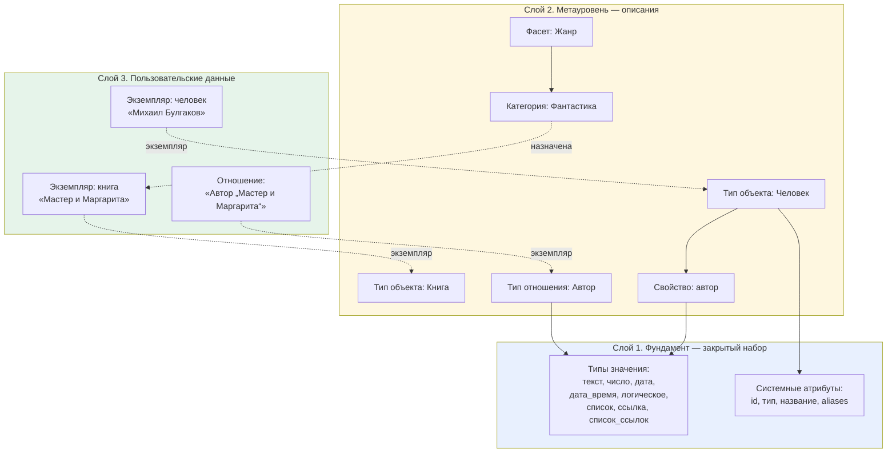
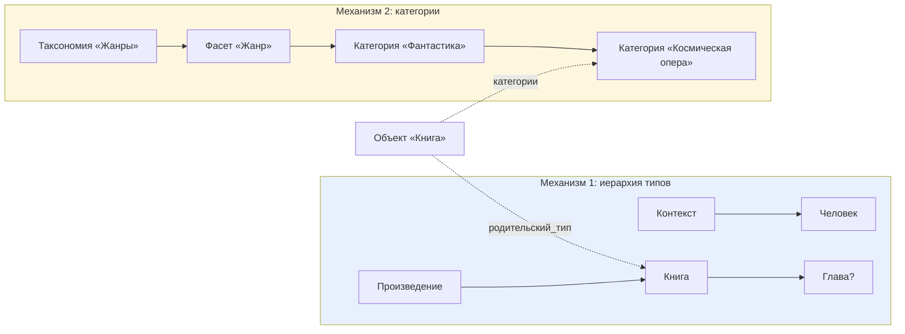
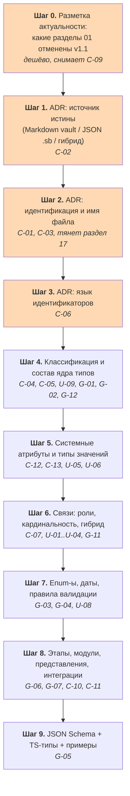

# Диагноз входящих черновиков

> [!note] Что это за документ
> Это **диагноз**, а не правка. Метамодел здесь не переписывается.
> Документ отвечает на три вопроса: что у вас есть, что с этим не так, в каком порядке чинить.
> Детальный перечень проблем с ID — в [[analysis-contradictions|реестре противоречий]].

## 1. Приём материалов

Получено три файла, все прочитаны целиком, сохранены как неизменяемые копии в `docs/inbox/`.

| Файл | Объём | Краткое содержание простыми словами |
|---|---|---|
| `01_Second_Brain_Architecture_Specification.md` | 11,8 КБ, 648 строк | «Устав» системы. Описывает, как всё устроено в целом: у каждого объекта есть номер и набор полей; типы объектов, свойства, отношения, категории — это тоже объекты; как называются файлы; как работают наследование, жизненные циклы, миграции, проверки целостности. Версия 1.0, статус «утверждён» |
| `02_Метамодель_v1.0.md` | 5,7 КБ, 264 строки | Краткий «каталог образцов»: по одному YAML-примеру на каждый элемент системы — тип объекта, свойство, тип свойства, тип отношения, отношение, таксономия, категория, представление, автоматизация. Версия 1.0, статус «утверждён» |
| `02_Метамодель_v1.1_черновик.md` | 91,8 КБ, 933 строки | Та же структура, сильно расширенная. Добавлены: единый формат номера объекта, правила ссылок и псевдонимов, новый уровень классификации «фасет», механизм картинок, создание объектов из «пустых» ссылок, скрытая служебная папка `.sb/`, подмена названий в интерфейсе, валидация и форма редактирования полей, интеграции с Bases и Fileclass. Плюс честный список из 28 нерешённых вопросов. Версия `1.1-draft`, статус «черновик» |

### Что я вижу хорошего (важно не только ругать)

1. **Есть чёткая базовая идея, и она выдержана во всех трёх файлах.** Всё — объект; у объекта есть номер, название и тип. Это последовательная архитектура, а не набор случайных заметок.
2. **Модель «самоопределяющаяся».** Тип объекта — сам объект. Свойство — сам объект. Тип отношения — сам объект. Это сильный ход: систему можно расширять, не переписывая код. Такие модели называют мета-моделями в строгом смысле, и у вас именно она, а не просто список типов заметок.
3. **Раздел 13 в v1.1 — редкая честность.** Перечислены 28 нерешённых вопросов. Большинство моих находок ниже пересекается с вашим собственным списком, то есть вы уже чувствуете проблемные места.
4. **Правильно проведена граница «метамодель ≠ реализация»** (§10.5, §11.5, §13 спецификации: «код не является частью метамодели»). Это именно то разделение, которое новички обычно не делают.
5. **Есть принципы безопасности данных**: «система не должна молча переписывать неправильные данные» (§19), «плагин не должен подставлять догадочное значение» (§1.4), «не перезаписывать пользовательские значения» (§10.4). Это зрелые требования, их обязательно сохраняем.
6. **Гибридная модель отношений** (§6 v1.1) — правильное направление: простая ссылка для простого, отдельный объект для сложного. Не хватает только критерия выбора.

---

## 2. Что это за модель: объясняю простыми словами

Прежде чем чинить, полезно увидеть, что вы построили. Сравните с привычным подходом.

### Обычный подход к базе знаний в Obsidian

«У меня есть заметки. Я придумал для них несколько полей: `тип`, `статус`, `автор`. Напишу-ка я инструкцию, какие поля у каких заметок бывают».

Это **схема данных**: список типов и список полей. Просто, понятно, легко реализовать.

### Ваш подход

«У меня есть объекты. Тип объекта — это тоже объект. Свойство — это тоже объект. Тип значения свойства — это тоже объект. Отношение — это тоже объект, и тип отношения — тоже объект. Категория — объект, таксономия — объект, представление — объект, автоматизация — объект».

Это **самоопределяющаяся модель**. Аналогия из жизни:

> Обычная схема — это **бумажная инструкция к бланку**: «в графе 3 укажите дату».
> Ваша модель — это **реестр самих бланков как документов**: каждый бланк заведён в системе, у него есть номер, версия, ответственный, и система знает, какие бланки существуют и как они устроены, потому что каждый бланк — запись в той же системе.

### Слои вашей модели

**Следствие, которое важно понять до всех решений.** У вас не «база заметок», у вас — маленькая система управления схемой данных, которая живёт внутри Obsidian. Отсюда и главные трудности:

| Что из этого следует | Почему это важно |
|---|---|
| Нужен «порядок запуска» (bootstrapping) | Чтобы прочитать объект, надо знать его тип. Чтобы знать тип, надо прочитать объект типа. Чтобы понять, как читать, — нужен слой 1, который задан кодом, а не данными |
| Один универсальный механизм чтения вместо девяти частных | Все элементы метамодели устроены одинаково — значит и парсер один. Это упрощает код, но требует жёсткого единообразия полей (а его пока нет — см. C-03, C-06) |
| Метамодель можно менять без перекомпиляции плагина | Большое преимущество, прямо заявленное в §14.3. Но оно работает только если определения читаются машиной надёжно — отсюда вопрос C-02 про JSON против Markdown |
| Объём работы больше, чем у «обычной» схемы | Поэтому критичен G-01 (какие типы реально описываем) и разметка модулей на реализуемые/отложенные |

> [!tip] Моя оценка
> Архитектурно модель сильная и внутренне связная. Проблема не в идее, а в том, что **идея описана, а данные — нет**: нет ни одного предметного типа с полями, нет enum-ов, нет примеров. И в том, что v1.1 начал менять фундамент (ID, имена файлов, классификация), не закрыв предыдущий.

---

## 3. Сравнение версий: что изменилось в v1.1

| Тема | `01` спецификация v1.0 | `02` метамодель v1.0 | `02` метамодель v1.1-draft | Характер изменения |
|---|---|---|---|---|
| Формат ID | `КОДТИПА-000001`, «возможен ULID или UUID v7» | `OBJECT-TYPE-000001` (последовательный номер) | **ULID, единственный формат**; UUID v7 не используется | **Ломающее**. Все примеры и все существующие ID теряют силу |
| Имя файла | `Название — ID.md` | — | `{TYPE_PREFIX}-{ID}.md`, название не входит в имя | **Ломающее**. Тянет за собой весь раздел 17 |
| Формат ссылки | `[[Название — ID]]` (в примерах — `[[Название категории — CATEGORY-000001]]`) | `[[Михаил Булгаков — PERSON-000001]]` | `[[{TYPE_PREFIX}-{ID}.md\|{название}]]` + правила нормализации и псевдонимов | **Ломающее**, но впервые формализовано |
| Классификация | Таксономия → Категория (2 уровня) | Таксономия → Категория | **Таксономия → Фасет → Категория** (3 уровня), настройки переехали на фасет | **Ломающее** для категорий: поле `таксономия` заменяется на `фасет` |
| Отношения | Отдельный объект «Отношение» | Отдельный объект | **Гибрид**: простая ссылка ИЛИ объект | Расширение, но без критерия выбора → C-07 |
| Системные атрибуты | `id`, `название`, `тип_объекта`, `категории` + исключения `aliases`, `tags` | — | `id`, `type` (имя не утверждено), `название`, `aliases` с инвариантом, `created_at`/`updated_at` (не утверждены) | Расширение + противоречия C-05, C-12, C-13 |
| Где хранится метамодель | Заметки vault (неявно, из примеров) | Заметки vault | **JSON в `.sb/metamodel/**`** | **Ломающее**, фундаментальное → C-02 |
| Язык полей | русский | русский | русский + английский технический слой (`kind`, `key`, `valueType`) | Противоречие → C-06 |
| Список типов объектов | ~40 типов в 8 группах | — | **отсутствует** | Регресс: v1.1 не повторяет раздел 5 спецификации, а отдельного реестра типов нет → D-01, G-01 |
| Изображения | «Обёртка изображения» + роли | — | Полноценный механизм контекстного разрешения (§10, 5 подразделов) | Сильное расширение, в MVP явно не помещается |
| Плагин | 6 уровней контроля целостности (без определений) | — | Разделы 14–18: `.sb/`, `TitleResolver`/`TitleIndex`/адаптеры, `SchemaEngine`, модалка, Bases, Fileclass, 4 этапа | Большое расширение. **Это уже архитектура плагина, а не метамодель** → см. рекомендацию R-06 |
| Открытые вопросы | — | — | 28 пунктов (§13) | Полезно, но разбросано ещё по 8 разделам → D-07 |

**Главный вывод по версиям:** v1.1 — не «улучшенная v1.0», а **частичная замена фундамента при незакрытом старом**. Документ сам это признаёт: «остальные положения исходной версии сохранены до отдельного согласования». Значит, сейчас в силе одновременно два несовместимых набора решений, и формально «утверждённый» документ (`01`) противоречит «черновику» (`v1.1`) — см. C-09.

Первое, что нужно сделать: **явно пометить, какие разделы `01` отменены v1.1**. Иначе любой следующий шаг будет опираться на противоречивую базу.

---

## 4. Пять главных проблем

Порядок именно такой: каждая следующая опирается на предыдущую.

### Проблема №1. Не решено, что является «настоящей» записью (C-01, C-02, C-03) — **блокер**

Три связанных вопроса, которые сейчас имеют два разных ответа одновременно:

- **Чем идентифицируется объект?** Номером человека-читаемым (`PERSON-000001`) или непрозрачным ULID?
- **Как называется файл?** `Михаил Булгаков — PERSON-000001.md` или `PERSON-01J8Z6….md`?
- **Где лежит метамодель?** В заметках vault или в JSON внутри `.sb/`?

Почему это проблема номер один: **от ответа зависит объём работ в разы**.

Раздел 17 v1.1 (подмена отображаемых названий в 17 областях интерфейса, адаптеры, DOM-интеграция, внутренние API, регрессионное тестирование совместимости с версиями Obsidian) существует **исключительно** потому, что в §1.3 выбрано непрозрачное имя файла. Это самый дорогой и самый хрупкий кусок всего проекта — и он не про метамодель, а про обход ограничения, которое мы сами себе поставили.

Одновременно v1.1 §15.3 предлагает хранить метамодель в JSON, а `01` и `v1.0` хранят её в заметках. Это два источника истины (**термин**: место, откуда система берёт «правильные» данные; если таких мест два, они рано или поздно начинают противоречить друг другу).

**Что делаем:** два отдельных ADR. Сначала «источник истины», потом «идентификация и имя файла». До их принятия не пишем ни схему, ни код.

### Проблема №2. Нет содержания: ни одного предметного типа с полями (G-01, D-01, G-02, G-03) — **блокер**

Раздел 5 спецификации — это список названий: Книга, Веб-новела, Глава, Человек, Проект, Задача, Цель, Идея, Гипотеза… Всего около сорока. Но **ни для одного типа не написано, какие у него поля**.

Последствие прямое: критерий стабильного ядра плагина из вашего промпта звучит как «создаёт заметку по типу из метамодели». Сейчас создать нечего — нечего подставлять в шаблон.

Дополнительно: нет реестра префиксов (а префиксы уже коллидируют — `CHARACTER`/`CATEGORY`, `PROJECT`/`PROPERTY`), нет единого списка enum-ов, хотя значения разбросаны по тексту.

**Что делаем:** решить объём первого прохода (вопрос 3) и заполнить карточки типов по [[../templates/entity-template|шаблону сущности]].

### Проблема №3. Классификация не определена: два конкурирующих механизма и незакрытый «фасет» (C-04, C-05, U-09, G-09, G-12)

У вас **две системы классификации**, и граница между ними не описана:

Не отвечает ни один документ на вопросы:

1. Когда делать **подтип** («Веб-новела» — это отдельный тип), а когда **категорию** («Фантастика» — это значение фасета)? Интуитивно понятно, но формального критерия нет, а значит каждый раз решение будет приниматься заново и по-разному.
2. Нужен ли вообще уровень «Фасет»? Это новое в v1.1, помечено как черновое, само решение ещё не принято (§7.2: «допустимость такого разделения … остаются предметом дальнейшего согласования»).
3. Обязательны ли `категории` (C-05)?
4. Что такое `tags` и чем они отличаются от категорий (G-12)?
5. Какие типы абстрактные, а какие можно создать (U-09)?

**Что делаем:** отдельный документ `01-classification.md` + ADR про фасет. Это ровно тот уровень, который по вашему правилу надо закрыть первым.

### Проблема №4. Связи описаны наполовину (U-01…U-04, G-11, C-07)

Есть правильная идея «тип отношения задаёт правила, отношение хранит конкретную связь». Но:

- кардинальность одна (`0..N`), а сторон у связи две — непонятно, про какую речь (U-01);
- `правило_уникальности: уникальная_связь` — не определено, что считается дублем (U-02);
- `направление: направленное` — enum не перечислен, симметричные связи не описаны (U-03);
- «рекомендация ≠ запрет» — а что тогда происходит при нарушении рекомендации? (U-04);
- роли (`прямое_название` / `обратное_название`) есть как поля, но правила их не описаны (G-11);
- два способа хранить связь без критерия выбора и без защиты от дубля (C-07).

Последствие: валидацию связей написать нельзя — нечего проверять.

**Что делаем:** `03-relations.md` + ADR про гибридную модель. После закрытия классификации.

### Проблема №5. Документ v1.1 смешал метамодель и архитектуру плагина, а объём не ограничен (G-06, D-06, D-07, C-11)

Разделы 10, 11, 14, 15, 17, 18 (примерно 60% объёма v1.1) — это **не метамодель**, а архитектура плагина: внутренние модули (`TitleResolver`, `TitleIndex`, `SchemaEngine`, `BasesAdapter`), точки DOM-интеграции, этапы MVP, поведение модалки, резервные копии, журналы.

Само по себе это ценный материал, и его нельзя выбрасывать. Но из-за смешения:

- невозможно понять, что уже **решено про данные**, а что **предложено про код**;
- объём работ выглядит неподъёмным: 28 открытых вопросов + 17 точек интерфейса + 4 этапа валидации + 4 этапа отображения;
- появились несогласованные зависимости: QuickAdd (`01` §13) нигде не подтверждён, Fileclass в `01` §14 упомянут как механизм, в v1.1 §18.7 — как «не обязательная зависимость», а в вашем промпте подтверждены только Bases и Templater (C-11).

**Что делаем:** рекомендация R-06 — физически разделить документ на две ветки документации, сохранив всё содержание.

---

## 5. Мелочи, которые всё равно надо починить

Отдельно, потому что они незаметны, но ломают код:

| Что | Где | Почему важно |
|---|---|---|
| `CHARACTЕR` — пятый символ кириллическая «Е» | `01` §5 | Для человека неотличимо, для программы — другое имя. Типичный источник «непонятных» багов |
| `полиaрхическая` — «a» латинская | `01` §8 | То же самое: значение enum не совпадёт само с собой |
| Нумерация `OBJECT-TYPE-nnn` в примерах не сходится: Человек и Контекст оба `000006`, Фильм `000003` в одном месте и Произведение `000003` в другом | `02 v1.0` §1, §6; `01` §10 | Примеры читаются как настоящие данные. Нужно явно объявить их иллюстративными |
| `возвожен ULID` | `01` §3 | Опечатка |
| `OBJECT-TYPE-000000` | `01` §13, `02 v1.0` §9 | Нулевой номер нигде не определён |
| `id: DOC-000002` у двух разных версий | оба файла `02` | Нарушает собственное правило «ID уникален» (C-08) |

---

## 6. Предлагаемый порядок решения

Принцип — сверху вниз, как вы и просили: сначала классификация и ядро, потом атрибуты, потом связи, потом валидация, потом код.

**Почему именно такой порядок:**

- Шаги 1–3 — это фундамент. Пока они не закрыты, любой артефакт ниже придётся переделывать. Они же самые дешёвые по объёму текста.
- Шаг 4 (классификация) стоит до атрибутов, потому что состав типов определяет, сколько атрибутов придётся описать.
- Шаг 6 (связи) после классификации, потому что связи соединяют типы: нет типов — нечего соединять.
- Шаг 9 в конце: схема и типы **выводятся** из согласованных документов, а не придумываются отдельно. Если писать их раньше — получим четвёртый источник истины.

### Оценки объёма (предположение, можно изменить)

| Шаг | Сколько сообщений диалога | Сколько артефактов |
|---|---|---|
| 0 | 1 | 1 (разметка `01`) |
| 1–3 | 3–4 | 3 ADR |
| 4 | 4–8 | 1 классификация + N карточек типов |
| 5 | 2 | 2 |
| 6 | 2–3 | 1 + M карточек связей |
| 7 | 2–3 | 3 |
| 8 | 3–4 | 4–6 |
| 9 | 2–3 | схема + типы + примеры |

Итого до «метамодель утверждена»: ориентировочно 20–30 сообщений. Это много, поэтому **шаг 4 критичен по объёму**: если описывать все ~40 типов сразу, добавится ещё 20–30. Отсюда вопрос 3.

---

## 7. Рекомендации по организации документации

| ID | Рекомендация | Обоснование | Статус |
|---|---|---|---|
| **R-01** | Сохранить исходники в `docs/inbox/` без права правки | Всегда видно, с чего начали. Уже сделано | предложено |
| **R-02** | `02_Метамодель_v1.0.md` → статус `superseded`, ссылка на v1.1 | Снимает D-05, C-08 | предложено |
| **R-03** | `01_…Specification.md` → построчно разметить: какие разделы действуют, какие отменены v1.1, какие перенесены | Снимает C-09 без переписывания «утверждённого» документа | предложено |
| **R-04** | Список ~40 типов из `01` §5 перенести в `docs/metamodel/02-entities.md` как реестр с колонкой «статус: ядро / отложено / не реализуем» | Снимает D-01, начинает закрывать G-01 и G-06 | предложено |
| **R-05** | 28 открытых вопросов из v1.1 §13 перенести в реестр (частично уже сделано в [[analysis-contradictions]] и в карте проекта), сгруппировав по темам | Снимает D-07, даёт управляемый список вместо простыни | предложено |
| **R-06** | **Разделить v1.1 на две ветки.** Разделы 1–9, 12 → `docs/metamodel/`. Разделы 10, 11, 14–18 → `docs/plugin/architecture.md` и `docs/integrations/`. Раздел 13 → реестр открытых вопросов. Ничего не выбрасываем | Метамодель отвечает на «что за данные», архитектура плагина — на «как это работает в программе». Смешение — причина проблемы №5. Плюс: фазу метамодели можно закрыть, не решая 17 вопросов про DOM | предложено |
| **R-07** | Разделы 10 (обёртки изображений) и 11 (создание из пустых ссылок) вынести в отложенные модули с пометкой «логически обозначен, в MVP не реализуем» | Это полноценные подсистемы. Требование промпта: «модули — реализуемые или нет, но логически и семантически обозначенные» — они как раз такие | предложено |
| **R-08** | QuickAdd и Fileclass вынести за рамки MVP, по каждому завести карточку интеграции с решением «отказаться / отложить» | Снимает C-11. В промпте подтверждены только Bases и Templater | предложено |
| **R-09** | Все примеры YAML в новых артефактах объявить иллюстративными и не использовать сквозную нумерацию ID | Снимает U-14 | предложено |
| **R-10** | Завести проверку «латиница/кириллица в идентификаторах» как правило валидации документации | Снимает U-10 и опечатку в `полиaрхическая`. Дешёвая автоматическая проверка, у меня в песочнице делается скриптом | предложено |

---

## 8. Что я НЕ делаю без вашего подтверждения

- Не переписываю метамодель.
- Не считаю v1.1 автоматически отменяющим `01` — формально `01` утверждён, и отмена должна быть вашим решением.
- Не выбираю за вас формат ID, источник истины, язык полей и состав ядра.
- Не начинаю писать JSON Schema и TypeScript-типы.
- Не касаюсь разделов 14–18 до решения по R-06.

## 9. Связанные документы

- [[analysis-contradictions]] — детальный реестр с ID (52 записи)
- [[../project-map/PROJECT_MAP]] — карта проекта с открытыми вопросами
- [[../decisions/decision-log]] — журнал договорённостей
- [[../roadmap/readiness-checklist]] — чек-лист готовности к реализации
