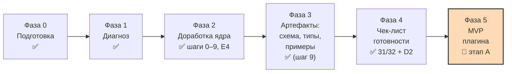

# Карта проекта

> [!important] Зачем этот файл
> Это «сохранение игры». Если диалог оборвётся или контекст переполнится, этот файл вставляют
> в новую сессию первым — и работа продолжается с той же точки. См. [[../glossary/glossary|глоссарий]]:
> «контроль контекста», «контрольная точка».

## 1. Цель

1. Доработать метамодель личной базы знаний **Second Brain**: классификация, сложные объекты,
   устранение противоречий и дублей.
2. Зафиксировать её в документации и артефактах, довести до состояния «готова к реализации».
3. Реализовать MVP плагина Obsidian со стабильным ядром.

## 2. Что за модель (кратко, чтобы не потерять суть)

**Second Brain** — самоопределяющаяся объектная модель внутри Obsidian. Не «список типов заметок»,
а система, где тип объекта, свойство, тип свойства, тип отношения, отношение, таксономия, фасет, категория,
представление и автоматизация — тоже объекты со своими `id` и `type`.

1. **Фундамент** (закрытый набор, задан кодом): 8 типов значений + системные атрибуты.
2. **Метауровень** (описания): типы объектов, свойства, типы отношений, таксономии, фасеты, категории,
   представления, автоматизации.
3. **Данные пользователя**: экземпляры объектов и экземпляры отношений.

Объяснение с диаграммой: [[../metamodel/analysis-01-incoming-drafts|диагноз, раздел 2]].

## 3. Текущая фаза

**Фазы 2–4 — ЗАВЕРШЕНЫ. Метамодель УТВЕРЖДЕНА — версия `1.0.0`, текущая **`1.3.0`** (F5-8 — 1.1.0, F5-7 — 1.2.0, П2 — 1.3.0; учётные PATCH — 1.2.1/1.2.2: нормы не менялись).** Пользователь подтвердил
2026-10-23 (**F1 = А**, DL-242): «Метамодель утверждена, переходим к реализации».
Дата внесена в CHANGELOG [1.0.0] и §10 (F3); чек-лист готовности — **32 из 32 пунктов**
(D2 закрыт 2026-10-25 — A3/DL-258: генерация TS-типов из схем, конструкция DL-222); блок F — 3/3. Зафиксированы фундамент, классификация, атрибуты, связи,
перечисления и даты — **одиннадцать принятых ADR**; единый реестр — **171 правило
валидации** в 14 группах (A–N); ядро — **15 типов** (карточки **15 из 15**), карточек
связей — 5, перечислений — **27 (26 закрыто)**, модулей MVP — **47**, команд — **21** (+`edit-object` — DL-269, ожидает подтверждения),
представлений — **12**. Машиночитаемые артефакты: **14 схем JSON Schema** (Draft 2020-12),
62 примера + 4 файла `.jsonl` (72 проверки зелёные), 14 шаблонов, прогонщик `npm run check`;
глоссарий — v1.29.1, **283 активных термина**. Репозиторий: <https://github.com/pashhha33/SB_Qwen_PKB>.
**Фаза 5 ИДЁТ — MVP плагина, этап A** ([[../roadmap/phases|phases.md]] §4): организация
решена (F5-1/F5-2 = А, DL-243: плагин **`second-brain`**, `Metamodel/`, DL-029/037/101/103;
F5-3…F5-6 = А, DL-244: монорепозиторий `plugin/`, vitest + FakeVault, под-батчи **A1/A2/A3**,
один плагин, `commands` — тонкая обёртка). **Под-батч A1 доставлен 2026-10-24** — плагин
**`0.1.0`** (применён пользователем, `c44172d`): каркас (`manifest.json`, esbuild dev/prod,
`SB_VAULT_PATH`), `obsidian-adapter` + интерфейс `VaultAdapter` + FakeVault, `identity`
(ULID, `{TYPE_PREFIX}-{ULID}.md`, И1/И2), универсальный `markdown-parser` (+ wikilink-и);
**фикс `0.1.1`** (DL-245): TZ-баг нормализации дат из YAML, vitest 4.1.12 (аудит 0);
dev-связка с хранилищем — [[../plugin/dev-setup|`docs/plugin/dev-setup.md`]].
**A2 часть 1 применена пользователем (`e8869ce`) — плагин `0.2.0`** (DL-246).
**Ответы получены (DL-250): F5-8 = А, F5-9 = А, F5-10 = Б** → метамодель **1.1.0**:
поле `object_types` у свойства (`04-attributes` §4.1) + 2 правила группы B → **169 правил**;
примеры **64 файла / 74 проверки**; в коде — `PropertyDef.objectTypes`,
`getPropertiesForType`, типобластные подписи.
**A2.5 — журналирование (требование пользователя, DL-251) — плагин `0.3.0`**:
`activity-log` (уровни **error/warning/info/debug** с выключателями; `.sb/logs/plugin-log.jsonl`;
кольцевой буфер + live-подписка), **настройки в `.sb/settings.json`** (ADR-002, не data.json)
+ вкладка настроек (первая инкарнация `settings-ui`), команда **`show-log`** (19-я) с
**живым режимом**; реестр модулей **45 → 47**; тесты **137/137** (матрица TZ).
**F5-7 = А (DL-253, метамодель `1.2.0`)**: в `TYPE_PREFIX` легализованы `_` и длина 3–20
(схема `defs#type_prefix` — включая паттерны `wikilink`/`file_link`, ADR-001 ревизия 0.2.0,
`02-entities` §6, `04-attributes` §7); зарегистрирован постоянный id `object.frontmatter.broken`
(DL-254) → **170 правил**; плагин **`0.3.1`**, тесты **137/137** (матрица TZ), прогон **74 OK**.
**Инцидент пользователя + плагин `0.3.2` (2026-10-24, DL-255/256, репозиторий 1.2.1)**:
пользователь запушил оба батча (`e59e5d9` — F5-8+журналирование, `ef313d4` — F5-7; деревья
совпадают с песочницей побайтово; сообщение `e59e5d9` ошибочно от A2 части 1 — содержимое
корректно). Отчёт из реального хранилища: журнал пишет **«не удалось сохранить кэш реестра»**,
скопировать журнал нельзя. Диагноз: `DataAdapter.write` Obsidian **не создаёт родительские
папки**, а `.sb/cache/` и `.sb/logs/` в свежем хранилище не существовали (FakeVault расхождение маскировал —
создавал папки сам). Фикс: контракт `dataWrite` (интерфейс + прод-адаптер +
юнит-тест на стабе `obsidian-stub.ts` + контракт-тест); копирование журнала — кнопка
«Скопировать» в окне `show-log` + команда **`copy-log`** (**20-я**); тесты **137 → 143**.
**0.3.2 применён и запушен пользователем (`463bdb2`), ручная проверка в Obsidian
подтверждена (2026-10-25)** — шаг (2) `next_step` закрыт.
**A2 часть 2 ДОСТАВЛЕНА (2026-10-25, DL-257) — плагин `0.4.0`: бутстрап `Metamodel/`**
(`core/bootstrap.ts`): 7 семенных OBJECT_TYPE-заметок (F5-10 = Б) с фиксированными ULID
(F5-9 = А, рецепт — SHA-256 от `second-brain/system-type/{type_key}`, время — 2026-10-23),
идемпотентность по существованию файлов, отказоустойчивость, Notice-отчёт, реестр
перечитывается после бутстрапа («типов в реестре: 7»); примечание-исключение в ADR-001
(рев. 0.2.1); **чек-бокс DoD «бутстрап в пустом хранилище» закрыт**; тесты **157/157**
(матрица TZ), прогон **74 OK**. Патч `a2-part2-bootstrap.patch` ждёт применения.
**0.4.0 применён и запушен пользователем (`4e9df19`), ручная проверка подтверждена
журналом** (бутстрап идемпотентен, реестр — 7 типов, 0 проблем); находка по выгрузке:
в папке плагина хранилища устарел `manifest.json` («версия 0.3.1» при коде 0.4.0) —
лечение в `dev-setup.md` §6 (v0.2.1). **A3 ДОСТАВЛЕН (2026-10-25, DL-258) — плагин
`0.5.0`, ЭТАП A ЗАКРЫТ**: **D2** — генератор TS-типов из схем (`json-schema-to-typescript`,
13 файлов `plugin/src/generated/` коммитятся, тест свежести «перегенерация ==
зафиксированное») — **пункт D2 чек-листа закрыт → чек-лист 32 из 32**;
`front-matter-title-adapter` (обнаружение + одноразовая рекомендация + мягкий отказ,
М1/М3/М4/М6); все 5 чек-боксов DoD этапа A ✅; тесты **165/165** (матрица TZ), прогон
**74 OK**. Патч перевыпущен как **`a3-d2-fmt-v2.patch`** (Windows-фикс теста свежести — DL-259) и
**применён и запушен пользователем (`f83ad3b`) — ЭТАП A ЗАКРЫТ В MAIN** (дерево побайтово
равно эталону; ручная проверка 0.5.0 в Obsidian — отдельного отчёта нет, не блокирует).
**Этап B — организация B1 ПРИНЯТА (2026-10-25, DL-261): B1-1…B1-4 = А/А/Б/А** — три
под-батча B1.1 «определения и валидация» (без UI; schema-engine групп B/C/G/H — 37 правил,
date-engine, applies-when, service-flags, create-property + validate-vault) → B1.2 «формы и
контролы» (Svelte 5 + `esbuild-svelte`) → B1.3 «классификация и библиотека» (сиды book+person —
статические семена с фиксированными ULID + тест согласованности со схемами; UX-проверка B3);
`phases.md` v0.10.0 — таблица под-батчей. Учётный патч DL-260 применён и запушен (`faeb7b5`);
патч `b1-answers.patch` (DL-261) применён и запушен (`a89f5e3`). Замечание пользователя
(пустые строки ломают таблицы) исправлено — **DL-262** (12 разрывов удалены + защита
`npm run check:docs`), патч применён и запушен (`fb5c6e2`). **B1.1 ЧАСТЬ 1 ДОСТАВЛЕНА
(2026-10-25, DL-263) — плагин `0.6.0`**: `date-engine` (группа H), `schema-engine`
(группа B — 16 правил определений свойств; C/G — значения и перечисления), PropertyDef
расширен, `validate-object` подключён к движку; тесты **206/206** (матрица 5 TZ), прогон
**74 OK**. Патч **применён и запушен пользователем (`3fa0699`)**; ручная проверка 0.6.0
в Obsidian подтверждена журналом (DL-264: validate-object ×7 по семенным типам — 0/0);
инцидент «не позволил создать объект» диагностирован (отказ уровня 1 в модалке без записи
в журнал; пред-чек удалён — отказы логируются) . **B1.1 ЧАСТЬ 2 ДОСТАВЛЕНА (2026-10-25,
DL-266) — плагин `0.7.0`, под-батч B1.1 ЗАКРЫТ**: движок `applies-when` (М1–М7:
обязательность только видимых условных свойств — М6, сохранённые значения скрытых
проверяются — М2), `service-flags` (метки `sb/*` + `sb_issues`, группа K; семя PROPERTY
`sb_issues` в бутстрапе — B1-4 = А), команды `create-property` и `validate-vault`
(7 из 20 команд реестра), правила группы E (`object_type.*`), правило П2
`date.all_unknown.optional_only` (rules.md v0.14.0 — **171 правило**, метамодель **1.3.0**
— Ч2-3 = А, DL-265); тесты **263/263** (матрица 5 TZ), прогон **74 OK**. Патч **применён и запушен
пользователем (`7a3267a`) — B1.1 ЗАКРЫТ В MAIN** (DL-267; песочница синхронизирована).
**B1.2 ЧАСТЬ 1 ДОСТАВЛЕНА (2026-10-25, DL-268) — плагин `0.8.0`: ПЕРВОЕ ВКЛЮЧЕНИЕ
SVELTE** (B1-2 = А: Svelte 5 runes + esbuild-svelte, тот же main.js, runtime-зависимостей
ноль): `property-editor` (форма свойств: русские подписи, условные поля с живым
пересчётом — М1, уровень 1 контроля, звёзды/прогресс — display-renderer, DL-123;
сохранение скрытых значений — М2) в оболочке Modal (DL-175); `object-service` (модель
формы, запись: title+И4, updated_at, неизвестные поля сохраняются); команды `edit-object`
(**21-я команда реестра — DL-269, подтверждена DL-275**) и `toggle-label-mode`;
`create-object` открывает форму после создания; `create-property` + `display.*`. Тесты
**299/299** (матрица 5 TZ), сборка без предупреждений. Патч применён и запушен
(`c1d34b7`, npm ci выполнен). Ручная проверка поймала два дефекта — оба исправлены:
**0.8.1** (`78b2886`, DL-270: `initialEditRows` — контрол одиночного поля рисуется
и для незаполненного свойства; подтверждён пользователем «Работает») и **0.8.2**
(`98b8bf7`, DL-271/272: `LabelResolver.setRegistry` — подписи созданных в сессии
определений не деградируют до ключей).
**B1.2 ЧАСТЬ 2 ДОСТАВЛЕНА (2026-10-25, DL-273) — плагин `0.9.0`, ПОД-БАТЧ B1.2 ЗАКРЫТ**:
подбор цели ссылки (`searchReferenceTargets` в ядре + `LinkPickerModal`-SuggestModal +
`titleByPath` в индексе readTypes; кнопка «Выбрать…» у object_reference/media_reference),
быстрые кнопки дат («Сегодня»/«Сейчас»/«Неизвестна» — П2), локальный переключатель
подписей в форме (русские/ключи). Тесты **321/321**; 0.9.0 в main — `5d9e7c1`. Ручная
проверка 0.9.0 поймала дефект подборщика ссылки (Obsidian вызывает `close()` РАНЬШЕ
`onChooseSuggestion()` — немедленный «отказ» «съедал» выбор; поле теряло фокус) — фикс
**0.9.1** (DL-274): отложенный отказ + журнал выбора/отказа + возврат фокуса; тесты
**327/327** (матрица TZ ×6); в main — `e586dab` (применён и запушен пользователем).
**РУЧНАЯ ПРОВЕРКА 0.9.1 ПРОЙДЕНА (2026-10-26, DL-275) — ПОД-БАТЧ B1.2 ПОДТВЕРЖДЁН
ЦЕЛИКОМ (критерий B1 закрыт)**; П1 = «да» (диагноз «потеря фокуса» подтверждён);
**В1 = А** — DL-269 принят (`edit-object` — 21-я команда); **В2** — DL-264 закрыт по
умолчанию. **Дальше — B1.3 «классификация и библиотека»**: вопросы Ч3-1 (разбивка),
Ч3-2 («установить основные типы» — 22-я команда), Ч3-3 (сиды фасетов и категорий)
вынесены пользователю. **Ответы получены (2026-10-26, DL-276): Ч3-1 = А, Ч3-2 = А,
Ч3-3 = Б** (все по рекомендациям) — две части: часть 1 «библиотека» (сиды системных
PROPERTY + OBJECT_TYPE/PROPERTY `book`/`person` + FACET `genre`/`literary_form` +
команда `install-base-types` + тест согласованности со `schema/**`) → часть 2
«классификация» (`classification-service`, `assign-category`, правила `facet.genre.*`
уровня 4, UX-проверка B3); **`install-base-types` — 22-я команда реестра** (mvp-scope
v0.16.0, 00-overview v0.9.0, README v0.12.0); категории не сеются — создаёт
пользователь (до первой категории жанра книга даёт error
`facet.genre.required_for_book` — норма). **B1.3 ЧАСТЬ 1 «БИБЛИОТЕКА» ДОСТАВЛЕНА
(2026-10-26, DL-277) — плагин `0.10.0`**: модуль `seed-library` (сиды — статические
данные плагина, B1-4 = А; 135 фиксированных ULID по рецепту SHA-256, генератор
`generate-seed-ulids.mjs` + тест воспроизведения); OBJECT_TYPE `book`/`person`
(+структурные `work`, `media` — граница B1.3-5), FACET `genre`/`literary_form`/
`country`/`language`/`sport` (БЕЗ категорий — Ч3-3 = Б), 126 PROPERTY-сидов (системные
62 + book 22 + person 42, условные `applies_when` по `format`/`role`); команда
`install-base-types` (22-я реестра; идемпотентность — пропуск по ключу: существующие
определения пользователя не дублируются, ссылки сидов разрешаются в их ULID). Тесты
**327 → 368** (+41), матрица TZ ×6; согласованность «сиды == `schema/**`» — тест;
валидационная чистота: 143 заметки `Metamodel/` — validate-object 0 ошибок; критерий B1
подтверждён на модели формы (web_novel → 4 условных, file → 2). Границы B1.3-1…6 —
architecture §5 (сиды relation — C; display/applies_when; не-snake enum-ы;
writing_genres 4 против 7 — вопрос части 2; media — ULID-обязательство этапа D; label
у фасетов). Патч `b1-3-part1-library.patch` ждёт применения (npm ci не нужен);
**Windows-фиксы переноса (урок DL-259)** — в среде пользователя (autocrlf, медленный диск)
2 теста из 368 покраснели, данные не затронуты: свежесть `seed-ulids` (CRLF против
LF-эталона — нормализация в генераторе `--check`) и валидационный тест 143 заметок
(таймаут 20 с — общий индекс хранилища на прогон + таймаут 120 с); патч
`b1-3-part1-fix-windows.patch` — четвёртый по порядку, ЕДИНЫЙ коммит с частью 1.
**Дальше — B1.3 часть 2 «классификация»** (classification-service, assign-category,
правила `facet.genre.*` уровня 4, UX-проверка B3).

> [!tip] Быстрый старт новой сессии
> [[../CHECKPOINT|Контрольная точка]] — самодостаточное состояние проекта. Скопировать целиком
> в новое сообщение + ссылка на репозиторий.

### Положение внутри шагов Фазы 2

| Шаг | Что делаем | Закрывает | Статус |
|---|---|---|---|
| 0 | Разметить актуальность разделов спецификации 01 | C-09 | ✅ **выполнен на аудите A9** (DL-219/220): [[../metamodel/analysis-01-spec-relevance\|`analysis-01-spec-relevance.md`]] — 19 разделов размечены |
| 1 | ADR «Источник истины» | C-02 | ✅ [[../adr/ADR-002-source-of-truth\|ADR-002]] |
| 2 | ADR «Идентификация и имя файла» | C-01, C-03, C-16 | ✅ [[../adr/ADR-001-identity-and-file-naming\|ADR-001]] |
| 3 | ADR «Язык идентификаторов» | C-06, U-06 | ✅ [[../adr/ADR-003-bilingual-keys-and-label-layer\|ADR-003]] |
| 3b | ADR «Объём первого прохода и командное создание» | G-01, D-01, G-02 | ✅ [[../adr/ADR-004-first-pass-scope-and-command-driven-authoring\|ADR-004]] |
| 4 | Классификация и реестр типов | C-04, C-05, U-09, G-12, G-09 | ✅ ADR-005, ADR-007 |
| 5 | Системные атрибуты и типы значений | C-12, C-13, U-05 | ✅ ADR-006, ADR-008 |
| 6 | Связи: роли, кардинальность, гибрид | C-07, U-01…U-04, G-11 | ✅ ADR-009, ADR-010 |
| 7 | Enum-ы, даты, правила валидации | G-03, G-04, U-08 | ✅ ADR-011 |
| 7b | **Требования пользователя по книге и главам** | DL-113…DL-136 | ✅ закрыты (ответы A / B / A / A) |
| 7c | **Требования пользователя по `person` и обёртке `media`** | DL-137…DL-152, DL-088 | ✅ закрыты; составы перечислений ждут подтверждения |
| **8** | **Этапы, модули, представления, интеграции** | G-06, G-07, C-10, C-11 | ✅ **завершён целиком** (8a–8g, DL-160…DL-212): этапы и границы MVP, 12 представлений, 45 модулей, 7 карточек интеграций, правила миграций (G-08), раздел 12, обзор/иерархия/RDF (G-09) |
| **8g** | **Пустые ссылки и псевдонимы** (вставной, по требованию пользователя) | DL-177…DL-188, черновик v1.1 §11 и §1.4 | ✅ **раздел 12 принят** (ответы Б / А / А / А): 3 точки запуска создания в MVP, контекст К1–К5, поле `create_from_link`, правила сбора С1–С12, 11 правил группы M, 5 модулей, 3 команды → 45 модулей и 18 команд |
| 9 | JSON Schema + TS-типы + примеры | G-05 | ✅ **завершён целиком** (батчи 1–6, DL-222…DL-237): **14 схем** (Draft 2020-12; common + 6 метамодели + 6 предметных типов + строка `.jsonl`), **62 примера + 4 файла `.jsonl`** (72 проверки зелёные), **14 шаблонов** (D5), прогонщик `npm run check`; D1/D3/D4/D5 закрыты, D2 — Фаза 5 (конструкция DL-222) |
| **E4 → F** | Прогон глоссария → итоговый отчёт → подтверждение | E4, F1–F3 | ✅ **ЗАВЕРШЕНО**: E4 (А/А/А, DL-238…DL-240; глоссарий v1.18.0 — 282 записи); отчёт ([[../roadmap/readiness-report\|readiness-report.md]], DL-241); **F1 = А — метамодель УТВЕРЖДЕНА, `1.0.0`** (2026-10-23, DL-242); чек-лист — 31/32 + D2 (Фаза 5) |

## 4. Утверждённые решения

| Дата | Решение | ADR | Версия метамодели |
|---|---|---|---|
| 2026-10-22 | Рамки проекта: русский язык документации, английские идентификаторы, офлайн, стек TypeScript + Svelte/vanilla + esbuild, Bases и Templater подтверждены, без мобильной поддержки, миграции отложены, semver | — (DL-001…007) | — |
| 2026-10-22 | Структура `docs/`, шаблоны, карта проекта как страховка от потери контекста | — (DL-008, DL-009) | — |
| 2026-10-22 | **`id` = голый ULID; имя файла = `{TYPE_PREFIX}-{ULID}.md`; ссылка = `[[{TYPE_PREFIX}-{ULID}.md\|{title}]]`** | [[../adr/ADR-001-identity-and-file-naming\|ADR-001]] | 0.1.0 |
| 2026-10-22 | **Читаемость: инвариант `aliases[0] == title` → Front Matter Title как необязательная интеграция → свои адаптеры вне MVP. Раздел 17 v1.1 вынесен за границы MVP** | ADR-001 | 0.1.0 |
| 2026-10-22 | **Определения метамодели — Markdown-заметки в хранилище; `.sb/` — только служебные данные** | [[../adr/ADR-002-source-of-truth\|ADR-002]] | 0.1.0 |
| 2026-10-22 | **Ключи полей — английские `snake_case`; русская подпись в поле `label`; слой `LabelResolver` с режимами `view`/`source`** | [[../adr/ADR-003-bilingual-keys-and-label-layer\|ADR-003]] | 0.1.0 |
| 2026-10-22 | **Русские подписи в стандартной панели свойств — только после прототипа `MetadataEditor.register`; CSS- и DOM-подмена отклонены** | ADR-003 | 0.1.0 |
| 2026-10-22 | **Первый проход: реестр всех ~40 типов + детальное описание ядра** | [[../adr/ADR-004-first-pass-scope-and-command-driven-authoring\|ADR-004]] | 0.1.0 |
| 2026-10-22 | **Классификация: `taxonomy → facet → category`; настройки на фасете; обязательность категорий задаёт фасет; `tags` — свободные метки; критерий «подтип или категория» из двух тестов; поле `abstract`** | [[../adr/ADR-005-classification-model\|ADR-005]] | 0.2.0 |
| 2026-10-22 | **Ядро — 11 типов**: `person`, `project`, `book`, `knowledge` + `object_type`, `property`, `relation_type`, `relation` + `taxonomy`, `facet`, `category`. `property_type` — в реестре без карточки | ADR-005 | 0.2.0 |
| 2026-10-22 | **Контрольная точка** `docs/CHECKPOINT.md` обновляется после каждого сообщения с решениями; старт новой сессии — по ссылке на репозиторий + копирование файла | — (DL-048) | — |
| 2026-10-22 | **Семь типов значений** (убраны «Список» и «Список ссылок», добавлен `media_reference`); множественность задаётся только `cardinality` | [[../adr/ADR-006-system-attributes-value-types-media\|ADR-006]] | 0.3.0 |
| 2026-10-22 | **8 системных атрибутов и 6 инвариантов**; `created_at` и `updated_at` обязательны, заполняет плагин | ADR-006 | 0.3.0 |
| 2026-10-22 | **Даты в локальном времени без смещения**, точность до минут; представление задаётся настройкой плагина. Ограничение G-04-1 зафиксировано | ADR-006 | 0.3.0 |
| 2026-10-22 | **Словарь** выражается перечислением или ссылкой на категорию фасета; новый механизм не вводится | ADR-006 | 0.3.0 |
| 2026-10-22 | **Тип `media`** вместо `image_wrapper`; миниатюры в нашей модалке через публичный API; механизм разрешения v1.1 §10 отложен | ADR-006 | 0.3.0 |
| 2026-10-22 | **Ядро — 14 типов**: добавлены `media`, `work` (abstract), `activity` (abstract) | ADR-006 | 0.3.0 |
| 2026-10-22 | **Реестр типов приведён к решениям пользователя**: 7 типов → категории, `poem` и `lyrics` → подтипы, `series` объединён, «Источник» — подтипы + фасет «Носитель», `documentation` вне модели | ADR-006 | 0.3.0 |
| 2026-10-22 | **Фасет — самостоятельный объект**: `taxonomy` необязательна, у фасета есть `allowed_object_types`, второй путь классификации запрещён (правило П8), правило П6 ADR-005 отменено | [[../adr/ADR-007-facet-independence\|ADR-007]] | 0.3.0 |
| 2026-10-22 | **Тип свойства `media_reference`**: цель ссылки настраивается (`object` / `file` / `both`), семь настроек, миниатюры через публичный API `getResourcePath()`, отдельного «мульти»-типа нет | [[../adr/ADR-008-media-property-type\|ADR-008]] | 0.3.0 |
| 2026-10-22 | **Тип `guide`** (префикс `GUIDE`, `phase2`) — сущность для инструкций, памяток, справок и хелперов | — (DL-075) | 0.3.0 |
| 2026-10-22 | **Модель связей**: `link_mode` объявляется в свойстве; привязка через `origin_property`; двусторонняя кардинальность; `uniqueness_rule` = `triple`; `direction` = `directed` / `symmetric`; `allowed_*` против `suggested_*`; роли — свободный текст, оба обязательны; локальные свойства — 5 в ядре; собственного текста у связи нет; системные атрибуты связи сокращены; обратная сторона вычисляется; каскад при удалении; защита от дубля | [[../adr/ADR-009-relations-model\|ADR-009]] | 0.4.0 |
| 2026-10-22 | **Хранение связей**: экземпляры в `.sb/relations/relations.jsonl` (JSON Lines), Obsidian их не индексирует → чистый граф и поиск. `direct`-связи остаются во frontmatter. Критерий ADR-002 уточнён: в Markdown живёт то, с чем работает человек | [[../adr/ADR-010-relation-storage\|ADR-010]] | 0.4.0 |
| 2026-10-22 | **Реестр типов отношений ядра**: `authorship`, `ownership`, `part_of` (reified), `related_to` (symmetric). Этап 2: `employment`, `sourced_from`, `member_of`, `depicts`, `co_authorship`, `conflicts_with` | — (DL-101) | 0.4.0 |
| 2026-10-22 | **Адрес репозитория**: `https://github.com/pashhha33/SB_Qwen_PKB` | — (DL-096) | — |
| 2026-10-22 | **Значения перечислений** — английский `snake_case` + русская подпись; 13 закрытых перечислений в реестре | [[../adr/ADR-011-enumerations-dates-lifecycle\|ADR-011]] | 0.5.0 |
| 2026-10-22 | **Частичные даты** через `00` в неизвестных компонентах, правила П1–П6, нормализация в диапазон; **интервалы** И1–И4 | ADR-011 | 0.5.0 |
| 2026-10-22 | **Редактируемый шаблон вывода даты и времени**: 17 токенов, 5 пресетов, отдельные шаблоны для частичных и относительных дат | ADR-011 (предложение пользователя) | 0.5.0 |
| 2026-10-22 | **`lifecycle` получил поведение**: четыре стадии, у `deprecated` обязательно `superseded_by` | ADR-011 | 0.5.0 |
| 2026-10-22 | **Шесть уровней контроля целостности** из `01` §19 получили определения | ADR-011 | 0.5.0 |
| 2026-10-22 | **Единый реестр правил валидации: 87 правил** в 8 группах (72 error, 12 warning, 3 info) + политика уровней и формат диагностики из 11 полей | — (DL-108, DL-109) | 0.5.0 |
| 2026-10-22 | **Два образца карточек типов ядра**: `book` и `person`. **Форма утверждена пользователем** | — (DL-110, DL-113) | 0.6.0 |
| 2026-10-22 | **`forbid_overlap`** у типа отношения, по умолчанию `false` | — (DL-111, DL-114) | 0.6.0 |
| 2026-10-22 | **Тип объекта `chapter`** (`CHP`) в ядре → 15 типов; правило наименования «Глава {N}» при пропуске названия (инвариант И7) | — (DL-124, DL-130) | 0.6.0 |
| 2026-10-22 | **Тип отношения `contains`** (`reified`, `0..n` / `0..1`); `part_of` — его вычисляемая обратная сторона | — (DL-125) | 0.6.0 |
| 2026-10-22 | **Фасет `genre`** отдельный от `literary_form`: форма и жанр ортогональны | — (DL-119, DL-126) | 0.6.0 |
| 2026-10-22 | **`format` книги — закрытое перечисление** и триггер условных свойств; `chapter_count` вычисляется, не хранится | — (DL-118, DL-120) | 0.6.0 |
| 2026-10-22 | **Механизм условных свойств `applies_when`** (М1–М6): только показ и проверка обязательности, никогда хранение | — (DL-128) | 0.6.0 |
| 2026-10-22 | **Настройки отображения `number`**: `display.unit`, `display.scale_max`, `display.renderer`; символы ⭐ в данных не хранятся | — (DL-117, DL-123) | 0.6.0 |
| 2026-10-22 | **Блок навигации по главам** — собственный `code_block_processor`, а не подмена DOM Obsidian; нет соседней главы → кнопка создаёт её | — (DL-129, DL-131) | 0.6.0 |
| 2026-10-22 | **Перечисления данных** (§3.17): `book_format`, `publication_status`, `chapter_role`, `file_format` — всего 19 перечислений | — (DL-127) | 0.6.0 |
| 2026-10-22 | **Реестр валидации 87 → 102 правила** | — (DL-132) | 0.6.0 |
| 2026-10-22 | **`rating` — целое 1–10, показ звёздами** (`★★★★★★★☆☆☆ 7/10`); шкала единая для всех типов, задаётся `display.renderer` и `display.scale_max` | — (DL-115, DL-116) | 0.7.0 |
| 2026-10-22 | **`book_format` закрыто, пять значений**: `file`, `card`, `web_novel`, `print`, `audio`. `online_literature` не введено — надмножество веб-новелы | — (DL-121, DL-135) | 0.7.0 |
| 2026-10-22 | **10 условных свойств книги** утверждены; недостающие добавляются командами плагина | — (DL-122) | 0.7.0 |
| 2026-10-22 | **Автоперенумерации глав нет**: разрыв — warning, перенумерация — явная команда на этапе 2 | — (DL-133) | 0.7.0 |
| 2026-10-22 | **`person_role`**: 34 значения, 9 групп; `person.role` — мультивыбор и триггер **27 условных свойств**; фасет «Род занятий» не вводится | — (DL-137, DL-138) | 0.8.0 |
| 2026-10-22 | **Операция `includes_any`** в `applies_when` + правило М7 (одно свойство на несколько групп значений) | — (DL-139) | 0.8.0 |
| 2026-10-22 | **Три поля псевдонимов**: `birth_name`, `pen_name`, `also_known_as` (+ `original_name`); все варианты обязаны попадать в `aliases` | — (DL-151) | 0.8.0 |
| 2026-10-22 | **Дедупликация свойств профессий** по вики-инфобоксам и Wikidata; исследование вынесено в отдельный файл | — (DL-152) | 0.8.0 |
| 2026-10-22 | **Карточка типа `media`**: 16 базовых + 19 условных свойств; `creation_method` (8 значений, мультивыбор) как триггер; `role` — мультивыбор из 13 значений. DL-088 закрыт | — (DL-140…DL-142) | 0.8.0 |
| 2026-10-22 | **Инвариант И8**: встраивание файла в теле обёртки — показ работает и без плагина | — (DL-143) | 0.8.0 |
| 2026-10-22 | **Теневое свойство `{key}_file`** для `media_reference` — единственный способ показать обложку в карточном виде Bases | — (DL-144) | 0.8.0 |
| 2026-10-22 | **Кнопки у изображений** («создать обёртку» / «открыть обёртку») + **индекс `путь → id`** в `.sb/cache/media-index.json` | — (DL-147, DL-148) | 0.8.0 |
| 2026-10-22 | **Мастер `sb-create-media`**: имя + 4 источника; буфер обмена читается двумя способами (`clipboard.read()` + `paste`-fallback) | — (DL-145, DL-146) | 0.8.0 |
| 2026-10-22 | **Реестр валидации 102 → 133 правила** (группы I «person» и J «media»); исправлен пересчёт перечислений (17 из 19, а не 16) | — (DL-149, DL-150) | 0.8.0 |
| 2026-10-22 | **Ответы пользователя A / C / A / B**: `person_role` закрыто (34 значения, добавлено `other_occupation`), **`person.role` обязателен** (`1..N`, правило `person.role.required`), ключ `role` сохранён; `media_creation_method` закрыто (8 значений, 8 полей `ai_*`); суффикс теневого свойства **`_file`**; `media.file.single_wrapper` остаётся `error` | — (DL-153…DL-157) | 0.9.0 |
| 2026-10-22 | **Элементы метамодели создаются командами плагина, не ручным редактированием** | ADR-004 | 0.1.0 |
| 2026-10-22 | Рекомендации R-01…R-10 приняты пакетом | — (DL-011…DL-022) | — |

## 5. Исходные материалы

| Файл | Версия | Статус в исходнике | Наша трактовка |
|---|---|---|---|
| `docs/inbox/01_Second_Brain_Architecture_Specification.md` | 1.0 | утверждён | Действует, кроме разделов, отменённых v1.1 и ADR-001…004. Разметка — шаг 0 |
| `docs/inbox/02_Метамодель_v1.0.md` | 1.0 | утверждён | `superseded` → v1.1 (DL-013) |
| `docs/inbox/02_Метамодель_v1.1_черновик.md` | 1.1-draft | черновик | Основной источник; разделы 15.2–15.3 (JSON) и 17 (свой слой подмены) отклонены ADR |

## 6. Открытые вопросы

### Текущие — требуют ответа

| ID | Вопрос | Варианты | Рекомендация |
|---|---|---|---|
| — | ~~Состав `person_role`, обязательность `role`, состав `media_creation_method`, имя теневого свойства, одна обёртка на файл~~ | — | **Закрыто** пользователем 2026-10-22 (DL-153…DL-157) |
| — | ~~Вопросы 12.1–12.4 раздела «Пустые ссылки и псевдонимы»~~ | — | **Закрыто** пользователем 2026-10-22 (ответы Б / А / А / А, DL-184…DL-187) |
| — | ~~Состав `project_status`~~ — **закрыто** (DL-234, ответ А: 5 значений без `blocked`/`backlog`); остались вопросы 9.2–9.6 карточки `project` | — | Не блокируют; разбираются в блоке F |
| — | Остальные вопросы карточки `person` (9.4–9.8) и `media` (10.4, 10.6–10.8) | — | Не блокируют шаг 8 |
| — | Нужен ли `print` как отдельный формат, если печатная книга — это `file` или `card` | Оставить / убрать | Оставить, проверить на этапе 2 по экземплярам |
| — | Обязателен ли `author` у книги; нужен ли `read_status`; какие поля наследуются от `work` | — | Как в карточке `book` §9 |
| — | ~~Перечисление `object_status`~~ | — | **Закрыто** (DL-163: не вводится; жизненный цикл — статусы предметных типов) |
| — | ~~Реестр типов отношений ядра (DL-101), команды по связям (DL-103), имя плагина~~ | — | **Закрыто** (2026-10-23, DL-243): реестр — 5 типов с `contains` (DL-125); команды — как в `03-relations` §10; имя — `second-brain` |
| — | ~~Уточнения пользователя по обёртке `media` (DL-088)~~ | — | **Закрыто** DL-140…DL-149: карточка `media` создана |
| — | Франшиза и Галерея: подтипы `collection` или категории | A / B | Отложить до этапа 2 |
| — | Нужен ли `media_target: both` в MVP или оставить только `object` и `file` | A: оставить `both` / B: сократить | A, но можно сократить |
| — | `wrap-on-select`: автоматическое создание обёртки `media` при выборе файла | MVP / этап 2 | этап 2 |
| — | `music_track` против `media` вида `audio` | A: трек наследует `work` и ссылается на `media` / B: только `media` | A, на этапе 2 |
| DL-029, DL-037 | ~~Имя папки `Metamodel/` и набор команд MVP~~ | — | **Подтверждено** (2026-10-23, DL-243) |
| — | ~~Имя плагина для `manifest.json`~~ | — | **Решено** (F5-1 = А, DL-243): `second-brain`; вопрос 9.4 `09-modules` закрыт |
| — | ~~Монорепозиторий или отдельный репозиторий плагина; тесты; разбивка этапа A; один плагин и `commands`~~ | — | **Закрыто** (F5-3…F5-6 = А, 2026-10-24, DL-244): `plugin/` в монорепозитории; vitest + FakeVault; под-батчи A1/A2/A3; один плагин, `commands` — тонкая обёртка; вопросы 9.2/9.3/9.5 `09-modules` закрыты |
| ✅ **Ч3-1 — решено: А (DL-276)** | **Разбивка B1.3 «классификация и библиотека» на части** | **А (рекомендация)** — две части: часть 1 «библиотека» (PROPERTY-сиды системных типов + OBJECT_TYPE/PROPERTY-сиды `book`+`person` + FACET `genre`/`literary_form`, команда «установить основные типы», тест согласованности со `schema/**`) → часть 2 «классификация» (`classification-service`, команда `assign-category`, правила `facet.genre.*` уровня 4 в runner, UX-проверка B3) · **Б** — один батч · **В** — сначала классификация, потом библиотека | **А**: прецедент B1.1/B1.2 (части); ручная проверка меньше и целенаправленнее; Б — тяжёлая проверка (~120 сидов + сервис + команды разом); В — `assign-category` нечего назначать до появления категорий |
| ✅ **Ч3-2 — решено: А (DL-276)** | **Команда «установить основные типы» — 22-я в реестре MVP** (запланирована обоснованием F5-10 = Б «дух ADR-004» и phases B1.3, но в реестре §2.3 `mvp-scope` её нет; прецедент — DL-269) | **А (рекомендация)** — подтвердить (предложение id — `install-base-types`; охват — B1-3 = Б: `book` + `person` + PROPERTY системных типов + фасеты; идемпотентность как у бутстрапа) · **Б** — отклонить (установка не командой) | **А**: критерий B1.3 «book и person целиком: ставятся одной командой»; ADR-004 — элементы метамодели создаются командами; Б оставляет библиотеку ручной установкой, что противоречит DL-261 |
| ✅ **Ч3-3 — решено: Б (DL-276)** | **Сиды классификации в «установить основные типы»**: фасеты `genre`/`literary_form` нормативно упомянуты (правила `facet.genre.required_for_book` — error, `facet.genre.not_form` — warning; карточка `book` §categories) | **А** — фасеты + стартовый набор категорий (содержимое согласовать отдельно) · **Б (рекомендация)** — только фасеты (системные определения, фиксированные ULID); категории — содержимое хранилища, пользователь создаёт сам (`create-object`), первые 2–3 категории — шаг UX-проверки B3 · **В** — пользователь диктует стартовый список жанров сейчас | **Б**: граница «определения = плагин, содержимое = пользователь» (дух F5-10 = Б); цена — первая книга получит error `facet.genre.required_for_book`, пока не создана первая категория жанра (честное поведение нормы); А угадывает вкусы пользователя, В — переносит решение на потом |
| ✅ **B1-1 — решено: А (DL-261)** | **Разбивка B1 «схема и свойства» на под-батчи** (12 модулей + семенная библиотека + UX-проверка B3) | **А (рекомендация)** — три под-батча: B1.1 «определения и валидация» без UI (property-definitions, schema-engine групп B/C/G, validation-runner, date-engine, applies-when М1–М7, service-flags, команды create-property + validate-vault) / B1.2 «формы и контролы» — первое включение Svelte (plugin-ui, property-editor, display-renderer, object-service, toggle-label-mode) / B1.3 «классификация и библиотека» (taxonomy/facet/category, assign-category, `genre`, PROPERTY-сиды системных типов, «установить основные типы», B3) · **Б** — два под-батча · **В** — один батч | **А**: прецедент A1/A2 (части); каждый под-батч проверяем отдельно; Svelte-зависимость включается точечно в B1.2; этап B уже дробили из-за тяжести (09-modules §4) |
| ✅ **B1-2 — решено: А (DL-261)** | **Способ интеграции Svelte** (стек утверждён DL-175; способ сборки не выбран) | **А (рекомендация)** — Svelte 5 + `esbuild-svelte` в существующей конфигурации esbuild (+2 dev-зависимости, тот же main.js, runtime-зависимостей ноль, Svelte внутри оболочки `Modal`) · **Б** — vanilla-модалки на весь B1 (пересмотр DL-175) · **В** — переход на Vite | **А**: минимальная перестройка каркаса A1; Б — много рукописного кода условных форм; В — перестройка сборки не оправдана в MVP |
| ✅ **B1-3 — решено: Б (DL-261)** | **Охват команды «установить основные типы»** (предметная библиотека — DL-250/F5-10 = Б) | **А** — все 6 предметных типов сразу (~120 заметок) · **Б (рекомендация)** — поэтапно: в B1.3 — book + person (критерий B1 «book и person целиком») + PROPERTY системных типов; chapter — этап C, media — этап D, project/knowledge — по потребности · **В** — только системные PROPERTY, предметные — этап E | **Б**: точно по критерию B1; не забегает вперёд перед 22 отложенными вопросами карточек и этапами C–D; механизм переиспользуется (демо-хранилище этапа E) |
| ✅ **B1-4 — решено: А (DL-261)** | **Источник PROPERTY-сидов** (определения свойств системных типов и book/person) | **А (рекомендация)** — статические семена как данные плагина (прецедент бутстрапа: фиксированные ULID — SHA-256 от `second-brain/system-property/{type_key}.{property_key}`; байт-стабильность; идемпотентность по существованию) + тест согласованности со схемами (key/value_type/cardinality/required/перечисления/applies_when сверяются с `schema/**`); подписи — из карточек · **Б** — генерация из схем на сборке + отдельный реестр русских подписей · **В** — без сидов, всё командами вручную | **А**: проще и с прецедентом; дрейф «сиды ↔ схемы» ловится тестом; Б — подписей в схемах нет, появится ещё один рукописный артефакт; В — противоречит DL-250 и критерию B1 |
| ✅ **F5-8 — решено: А (DL-250, метамодель 1.1.0, DL-252 доставлен)** | **Привязка свойства к типу не кодировалась в данных**: `scope: specific/family` без поля-носителя; правила `property.key.unique_in_type`, `applies_when.property_exists` и формы этапа B предполагают принадлежность (находка DL-247) | **А** — поле `object_types` у свойства (wikilink-и на OBJECT_TYPE; пусто+universal = все; family = абстрактный предок, DL-208) + правило согласованности + примеры; MINOR 1.1.0 / **Б** — список `properties` у object_type / **В** — отложить до этапа B | **А**: свойство — независимый объект (ADR-004), привязка на его стороне соответствует `target_types`; тип не тащит список; **блокирует этап B** |
| ✅ **F5-9 — решено: А (DL-250; реализовано в A2 части 2 — плагин 0.4.0, DL-257)** | **Стратегия ULID бутстрап-определений** 7 системных типов (DL-248) | **А** — фиксированные «известные» ULID (статичные семенные файлы, идемпотентность по имени файла, исключение из «id не переиспользуется» для системных констант — примечанием в ADR-001) / **Б** — генерация в каждом хранилище (семя = шаблоны {ULID}, id в `.sb/state.json`) | **А**: бутстрап проще и тестируемее; прецедент — примеры репозитория уже на фиксированных ULID |
| ✅ **F5-10 — решено: Б (DL-250; реализовано в A2 части 2 — плагин 0.4.0, DL-257)** | **Объём семенных данных бутстрапа** (DL-249) | **А** — 7 типов + их свойства (~45 заметок) / **Б** — 7 OBJECT_TYPE-заметок (свойства системных типов — в B1 со schema-engine) / **В** — + предметная библиотека (~120 заметок) | **Б**: буквально DoD этапа («7 системных типов»); предметная библиотека — командой «установить основные типы» в B1 (дух ADR-004) |
| ✅ **F5-7 — решено: А (DL-253, метамодель 1.2.0; батч DL-254 доставлен)** | **Префиксы реестра `02-entities` против схемы `defs#type_prefix`**: 12 префиксов с `_` (core: `OBJECT_TYPE`, `PROPERTY_TYPE`, `RELATION_TYPE`) и 4 длиннее 12 — схема и ADR-001 запрещают `_` и длину вне 3–12; ADR-001 сам говорит «UPPER_SNAKE_CASE»; дополнительно (находка A2): схемы `link_object_type`/`link_property` уже содержат `OBJECT_TYPE-`/`PROPERTY-` — переименование затронет 14 схем и примеры | **А** — легализовать `_`, длина 3–20 (MINOR: паттерн `defs#type_prefix`, правило ADR-001/`02-entities` §6, код identity) / **Б** — переименовать 12 префиксов реестра под схему (3–12, без `_`) / **В** — гибрид: `_` разрешить, длину не менять, 4 длинных префикса укоротить | **А**: префикс = upper(type_key) — механическое правило; расширение схемы ничего не ломает; переименование (Б) задевает 12 строк реестра, `07-hierarchy`, карточки без функционального выигрыша. **Блокировало A2** (бутстрап пишет `OBJECT_TYPE-{ULID}.md`). Находка DL-244. **Реализовано (DL-253/254)**: паттерн `defs#type_prefix` — `^[A-Z][A-Z0-9_-]*$`, 3–20; ADR-001 ревизия 0.2.0; `02-entities` §6 v0.11.0; `04-attributes` §7; код identity/creation/модалка (плагин 0.3.1); переименование префиксов не понадобилось |

### Следующие по порядку — шаг 8

| ID | Вопрос | Статус |
|---|---|---|
| G-06 | Разбиение на этапы реализации с критериями готовности каждого | **Закрыто** (8a, DL-161; `phases.md` accepted) |
| G-07, C-10 | Представления и закрытый список `mechanism` | **Закрыто** (8b, DL-171; `08-views.md` accepted) |
| — | Модули: реализуемые, отложенные, нереализуемые (`09-modules.md`) | **Закрыто** (8c, DL-174…DL-176; статус accepted — DL-192) |
| — | Границы MVP (`mvp-scope.md`) | **Закрыто** (8a, DL-162, DL-163) |
| C-11 | Интеграции: карточки по семи позициям | **Закрыто** (8d, DL-189…DL-198): Bases — использовать; FMT — необязательный адаптер; Templater, Dataview, Fileclass, Metadata Menu — не зависимости; QuickAdd — отложен |
| G-08 | Правила миграций: формат записи, версии схемы, журнал | **Закрыто** (8e, DL-201…DL-205; `10-migration-rules.md` accepted) |
| — | RDF-расширение и общий обзор метамодели (+ иерархия) | **Закрыто** (8f, А/А/А/А, DL-208…DL-212): `00-overview` — actual, `07-hierarchy` — accepted (G-09, A8), `11-rdf-extension` — accepted |

Соответствие шагов и проблем: шаг 6 — C-07, U-01…U-04, G-11 (закрыт); шаг 7 — G-03, G-04, U-08
(закрыт); шаг 8 — G-06, G-07, G-08, C-10, C-11 (закрыты); шаг 9 — G-05 (закрыт — шаг 9 завершён, DL-237).

### Отложено до Фазы 5

Прототип `MetadataEditor.register`; разбор Exocortex как референса. (Имя плагина — решено:
`second-brain`, DL-243.)

> [!note] Пересмотрено на аудите A9 (DL-220)
> Прежний список «отложенного» (разделы 10, 11, 14–18 v1.1; U-10…U-12, U-14, G-10, G-13, G-15;
> C-14, C-15) устарел: все перечисленные записи реестра **решены** (U-10 — реестр префиксов
> и автопроверка латиницы; U-11/U-14 — ADR-001; U-12 — пустой `allowed_*`; G-10 —
> `11-rdf-extension`; G-13 — карточка `media`; G-15 — имя продукта закреплено, открыто только
> имя плагина; C-14 — ADR-005/007; C-15 — утратило предмет). Разделы v1.1 размечены шагом 0
> и карточками интеграций.

## 7. Риски

| Риск | Вероятность | Последствие | Мера |
|---|---|---|---|
| Потеря контекста в длинном диалоге | Высокая | Повторные обсуждения | Карта проекта + глоссарий + decision log (счётчики — в самих файлах) + CHECKPOINT |
| **Подмена отображения сломается после обновления Obsidian** | Высокая | Пользователь видит технические имена файлов | ADR-001: три уровня, мягкий отказ, резервное имя файла, M1–M7. Данные исследования: [[../integrations/research-front-matter-title-stability]] |
| **`MetadataEditor.register` не даст русские подписи в панели свойств** | Средняя | Пользователь видит английские ключи в стандартном интерфейсе | ADR-003 мера M6: не обещать до прототипа; наша модалка показывает подписи гарантированно |
| **Переход на английские ключи — ломающее изменение** | Уже случилось | Старые черновики не соответствуют новой схеме | Данных нет → цена близка к нулю. Таблица соответствия имён сохранена в ADR-003 для будущих миграций |
| Объём модели не соответствует силам одного новичка | Средняя | Проект не доходит до кода | ADR-004: ядро из 8 типов, остальные в реестре; R-07: обёртки изображений отложены |
| Ручная правка YAML сломает определения метамодели | Средняя | Некорректная схема | ADR-002 M1–M5 + ADR-004 П1–П3: создание только командами, строгая валидация, последняя корректная версия |
| Уход в детали до согласования ядра | Средняя | Переделка | Порядок шагов 0→9 зафиксирован и виден в разделе 3 |
| Противоречия между «утверждённым» `01` и решениями ADR | Уже случилось | Опора на недействующие правила | Шаг 0 — построчная разметка актуальности спецификации 01 |
| Новичок в TypeScript и Obsidian API | Высокая | Замедление Фазы 5 | Глоссарий, пошаговые объяснения, минимум зависимостей, тесты в песочнице ассистента |
| **Bases не рисует картинку из ссылки на заметку** | Уже подтверждено документацией | Обложки в карточном виде не появляются | Теневое свойство `{key}_file` + команда `sb-resync-media-shadows` + правило `media.referrers.shadow_synced` (DL-144) |
| **Буфер обмена ненадёжен для файлов из проводника** | Высокая | Мастер создания обёртки «молча» не работает | Два механизма чтения + внятный отказ + три запасных источника (DL-146) |
| Рассинхрон кэша и индекса медиа | Средняя | Кнопки показывают неверное состояние | Кэш — не источник истины; правила уровня 6; перестроение командой `sb-rebuild-media-index` |
| Потеря разделов нормативных документов в рабочей копии | Уже случилось | Ссылки ведут в пустоту | Сверка в начале сообщения; восстановлено (DL-140); пользователю предложено сверить копию репозитория |

## 8. Что дальше

1. ~~Ответить на вопросы 12.1–12.4~~ → **получено** (Б / А / А / А, DL-184…DL-187): раздел 12
   принят, пометки сняты, 45 модулей и 18 команд.
2. ~~Под-шаг 8d — карточки интеграций~~ → **закрыт** (7 из 7 карточек, DL-189…DL-198):
   C-11 закрыто, пункт C5 чек-листа закрыт (блок C — 5/5). Следующий — **под-шаг 8e**:
   `10-migration-rules.md` (формат записи миграции, версии схемы, журнал; образец —
   `person.role.required` с автоподстановкой `other_occupation`, DL-159).
3. ~~Подтверждение составов~~ → получено (DL-153…DL-157). ~~Подтверждение **этапов A–E** и **границ MVP**~~ → получено (DL-161…DL-163).
4. ~~Описать остальные карточки типов ядра~~ → **закрыто** (DL-213/214/216/217): карточки
   **15 из 15** созданы; пункты чек-листа **A2/A3 закрыты**. Расхождение состава команд
   классификации закрыто: **DL-218 принято (ответ «А»)** — экземпляры фасетов и категорий
   создаёт `create-object`, выделенные обёртки — этап 2 (`mvp-scope` §3.2), реестр 18 команд не меняется.
5. ~~Остаток шага 8~~ → **шаг 8 завершён** (8f принят: А / А / А / А, DL-208…DL-212;
   G-09 и A8 закрыты). Порядок выбран (DL-213): ~~карточки~~ → **аудит A9 + шаг 0** →
   **шаг 9** (JSON Schema, TypeScript-типы, примеры — блок D).
6. ~~Подтвердить состав `project_status`~~ → **закрыто** (DL-234, ответ А: 5 значений
   без `blocked`/`backlog`; блокировка = `paused` + `paused_reason`). Вопросы карточек
   (person 9.4…, media 10.4…, project 9.2…) не блокируют — разбираются в блоке F.
7. ~~Завершить шаг 0~~ → **выполнен** в составе аудита A9 (DL-220/221).
8. ~~Провести **E4**~~ → **выполнен** (2026-10-23, ответы А/А/А, DL-238…DL-240): 13 пар
   дублей сняты, 3 устаревшие записи исправлены, +13 терминов; глоссарий v1.18.0 (265
   активных + 17 исторических); блок E — 5/5.
9. ~~Подготовить **блок F**~~ → **отчёт создан** (DL-241): [[../roadmap/readiness-report|`readiness-report.md`]] —
   32 пункта с доказательствами, явный список отложенного (§8 отчёта), формулировка
   подтверждения (§11); долги документации возвращены (строки истории `00-overview`
   0.24.0–0.29.0, сводка `05-enumerations`, `rel_part_of`, колонка версий этого инвентаря).
   **Ответ получен: А — «Метамодель утверждена, переходим к реализации»** (2026-10-23, DL-242).
10. **F2/F3 выполнены — метамодель `1.0.0`**: CHANGELOG [1.0.0], дата в §10, чек-лист v0.25.0
    (F1–F3 → [x], блок F — 3/3, итог **31/32** + D2, статус `actual`), отчёт v0.2.0 (запись
    закрытия), README v0.3.2 и docs/README v0.3.10 (рамка после утверждения). Далее —
    **Фаза 5, этап A** (phases.md §4 — каркас и бутстрап); организационные вопросы старта
    **решены** (F5-1/F5-2 = А, DL-243): имя плагина — `second-brain`,
    DL-029/DL-037/DL-101/DL-103 подтверждены; **D2** — генератор TS-типов из схем + тест «сгенерированное == зафиксированное».
11. **Этап A стартовал: организация решена (F5-3…F5-6 = А, DL-244), под-батч A1 доставлен**
    (2026-10-24): плагин `0.1.0` в `plugin/` — каркас, `obsidian-adapter` + FakeVault,
    `identity`, `markdown-parser`; `docs/plugin/dev-setup.md` + `docs/plugin/architecture.md`.
    Пользователь применил и запушил A1 (`c44172d`; сообщение коммита случайно содержит
    текст плашки F5-7 — предложено `git commit --amend` + `--force-with-lease`).
    **Фикс 0.1.1** (DL-245): TZ-баг нормализации дат из YAML (js-yaml разбирает некавычные
    метки как UTC; на машине пользователя UTC+3 даты съезжали на +3 часа) — лексическая
    нормализация из сырого текста; vitest 2.1.9 → 4.1.12 (аудит: 6 уязвимостей → 0);
    тесты **84/84** в четырёх часовых поясах.
12. **A2 часть 1 доставлена (2026-10-24, DL-246, плагин 0.2.0)**: `type-registry` + кэш,
    `label-resolver`, validate-object (группа A, 11 полей), команды create-object-type /
    create-object / validate-object; тесты **118/118** (матрица TZ); DoD «book из Markdown
    без перекомпиляции» и «BOOK-{ULID}.md с И4» — выполнены в тестах. **Применён
    пользователем (`e8869ce`)**.
13. **Ответы F5-8 = А, F5-9 = А, F5-10 = Б (DL-250) + журналирование (DL-251) + норм-батч
    F5-8 (DL-252) доставлены (2026-10-24)**: метамодель **1.1.0** (поле `object_types`,
    169 правил, примеры 64/74), плагин **0.3.0** (activity-log, show-log + live,
    настройки `.sb/settings.json`, вкладка настроек; тесты **137/137**; 47 модулей,
    19 команд). **Открыт только F5-7** — A2 часть 2 (бутстрап: фиксированные ULID,
    7 OBJECT_TYPE-заметок) ждёт его. Затем **A3**: D2 + `front-matter-title-adapter` +
    закрытие DoD этапа.
14. **F5-7 = А принят пользователем и доставлен норм-батч (2026-10-24, DL-253/254)**:
    метамодель **1.2.0** — `_` и длина 3–20 в `TYPE_PREFIX` легализованы (`defs#type_prefix`
    + паттерны `wikilink`/`file_link`, ADR-001 ревизия 0.2.0, `02-entities` §6 v0.11.0,
    `04-attributes` §7 v0.9.0); постоянный id `object.frontmatter.broken` зарегистрирован
    (rules v0.13.0, группа A) → **170 правил**; примеры valid-03/invalid-02 приведены к новой
    норме (прогон **74 OK**); плагин **0.3.1** (identity: паттерн/длины/сообщения; creation;
    модалка create-object-type; тесты — реестровые snake_case-префиксы легальны, **137/137**,
    матрица TZ). Инцидент у пользователя: `npm ci` — `EPERM … esbuild.exe` (файл заблокирован
    watch-процессом) — инструкция добавлена в `dev-setup.md` §6. **Открытых вопросов этапа A
    не осталось; следующий батч — A2 часть 2 (бутстрап `Metamodel/`).**
15. **0.3.2 применён и запушен пользователем (`463bdb2`); ручная проверка в Obsidian
    подтверждена (2026-10-25). A2 часть 2 ДОСТАВЛЕНА (DL-257) — плагин `0.4.0`:
    бутстрап `Metamodel/`** — `core/bootstrap.ts`: 7 семенных OBJECT_TYPE-заметок
    (F5-10 = Б) с фиксированными ULID (F5-9 = А; рецепт: SHA-256 от
    `second-brain/system-type/{type_key}`, временная часть — 2026-10-23), идемпотентность
    по существованию файлов, отказоустойчивость, Notice-отчёт, перечитывание реестра
    после бутстрапа; примечание-исключение в ADR-001 (рев. 0.2.1); чек-бокс DoD
    «бутстрап в пустом хранилище» закрыт; тесты **157/157** (матрица TZ), прогон
    **74 OK**; метамодель остаётся **1.2.0** — CHANGELOG **[1.2.2]**. Патч
    `a2-part2-bootstrap.patch` применён и запушен пользователем (`4e9df19`), ручная
    проверка подтверждена журналом (7 типов, 0 проблем, идемпотентность).
16. **A3 доставлен (2026-10-25, DL-258) — плагин `0.5.0`, ЭТАП A ЗАКРЫТ**: **D2** —
    генератор TS-типов из JSON Schema (`plugin/scripts/generate-schema-types.mjs`,
    `json-schema-to-typescript`; 13 файлов в `plugin/src/generated/` коммитятся; тест
    свежести «перегенерация == зафиксированное») — **пункт D2 чек-листа закрыт, чек-лист
    32 из 32**; **`front-matter-title-adapter`** (`core/front-matter-title.ts` + защитное
    обнаружение в `main.ts`; одноразовая рекомендация, флаг `fmtAdviceShown` в настройках;
    мягкий отказ М3/М4); все 5 чек-боксов DoD этапа A ✅ (phases v0.9.0); находка: устаревший
    `manifest.json` в хранилище пользователя — symptom в `dev-setup.md` §6 (v0.2.1); тесты
    **165/165** (матрица TZ), прогон **74 OK**; метамодель **1.2.0** без изменений —
    CHANGELOG **[1.2.3]**. **Windows-инцидент при переносе (DL-259)**: тест свежести падал
    у пользователя — git `core.autocrlf=true` (CRLF в рабочей копии) против побайтовой сверки
    с LF (класс DL-232); исправлено (нормализация CRLF→LF в `--check` и тесте), патч
    перевыпущен как **`a3-d2-fmt-v2.patch`** — **применён и запушен пользователем
    (`f83ad3b`): ЭТАП A ЗАКРЫТ В MAIN** (дерево побайтово равно эталону).
17. **Вопросы организации B1 вынесены (2026-10-25, DL-260)**: B1-1 разбивка на под-батчи
    (рекомендация А — B1.1/B1.2/B1.3), B1-2 интеграция Svelte (рекомендация А — Svelte 5 +
    `esbuild-svelte`), B1-3 охват «установить основные типы» (рекомендация Б — book+person
    в B1.3), B1-4 источник PROPERTY-сидов (рекомендация А — статические семена + тест
    согласованности со схемами). Учётный патч `b1-org-questions.patch` применён и запушен
    пользователем (`faeb7b5`).
18. **Ответы B1-1…B1-4 получены (2026-10-25, DL-261) — все по рекомендациям (А/А/Б/А)**:
    три под-батча B1 (таблица — `phases.md` v0.10.0); Svelte 5 + `esbuild-svelte` (B1.2);
    библиотека поэтапно — book+person в B1.3; PROPERTY-сиды — статические семена
    (фиксированные ULID, рецепт SHA-256 от `second-brain/system-property/{type_key}.{property_key}`)
    + тест согласованности со `schema/**`. Патч `b1-answers.patch` **применён и запушен
    пользователем (`a89f5e3`)**.
19. **Замечание пользователя исправлено (2026-10-25, DL-262)**: пустые строки внутри
    Markdown-таблиц ломают рендер — скан нашёл **12 разрывов** (глоссарий 8, decision-log 4;
    происхождение — долг прежних батчей, проверено по дереву `463bdb2`); удалены + защита
    `scripts/check-docs-tables.cjs` (`npm run check:docs`; 187 файлов, 0 разрывов); включена
    в dev-setup §5 (v0.2.2). Патч `docs-tables-fix.patch` **применён и запушен (`fb5c6e2`)**.
20. **B1.1 часть 1 доставлена (2026-10-25, DL-263) — плагин `0.6.0`**: `date-engine`
    (группа H уровня 2: форматы, частичные даты П1, `00`-заполнители, високосные,
    секунды-warning; нормализация в диапазон П4/M4 ADR-011; сравнение П3); `schema-engine`
    (группа B — 16 правил определений свойств, включая И6 и F5-8-пару `object_types.*`;
    группы C/G — значения экземпляров: type_conformance по 7 типам, cardinality,
    reference.exists/target_type через индекс хранилища, перечисления
    no_mixed_script→format→in_set); PropertyDef расширен (allowedValues, targetTypeKeys,
    appliesWhen…); `validate-object` усилен (опциональный общий индекс — задел для
    validate-vault). Границы части 1 (architecture §5): условные свойства пропускаются
    (движок — часть 2), псевдонимы — B2, вложения `file` — D, `period.*` — C,
    `display_template.*` — B1.2; пробел правила П2 (нет id) — зафиксирован. Тесты
    **165 → 206** (+41), матрица TZ ×5, прогон **74 OK**, check:docs — 0 разрывов;
    метамодель **1.2.0** — CHANGELOG **[1.2.5]**. Патч **применён и запушен
    пользователем (`3fa0699`)** — см. пункт 21.
21. **Часть 1 в main, ручная проверка 0.6.0 подтверждена, инцидент диагностирован
    (2026-10-25, DL-264)**: `3fa0699` побайтово равен эталону; журнал copy-log —
    7 прогонов validate-object по семенным OBJECT_TYPE, везде 0/0. «Плагин не позволил
    создать последний объект» — отказ уровня 1 (формат `type_key`) в единственной
    нелогируемой точке: пред-чек модалки create-object-type; команды намеренно не
    создают некорректные данные (ADR-004). Фикс наблюдаемости: пред-чек удалён —
    отказ идёт через ядро и пишется в журнал (error/creation).
22. **B1.1 часть 2 доставлена (2026-10-25, DL-265/266) — плагин `0.7.0`; B1.1 ЗАКРЫТ**:
    ответы Ч2-2 = «Да», Ч2-3 = «А» → правило П2 зарегистрировано как
    `date.all_unknown.optional_only` (warning, 2) — rules.md **v0.14.0**, **171 правило**,
    метамодель **1.3.0** (новое правило-warning = MINOR по 10-migration-rules §3 —
    поправка к первоначальной оценке «патч-версия»). Код: `applies-when` (М1–М7:
    equals/includes_any — пересечение со списком, in_category — ULID из `categories`;
    М6 — обязательность только видимых; М2 — значения скрытых проверяются),
    `service-flags` (метки `sb/error|warning|info` + `sb_issues` «{rule_id}: {severity}»
    — запись парой через processFrontMatter; группа K: readonly/synced/declared;
    `diagnostics.*` не попадают в sb_issues — сходимость; `updated_at` не трогается;
    только SB-объекты), семя PROPERTY `sb_issues` в бутстрапе (ULID
    `01M5K0XB00T6WT7SFWZBG4M9NB` — рецепт B1-4 = А), `create-property` (vanilla-модалка;
    required выводится из cardinality; проверки уровня 1 зеркалят группу B),
    `validate-vault` (общий индекс readTypes, область — заметки с `id`/`type`, сводка +
    топ-10, одна журнальная запись), группа E (`object_type.parent.exists/no_cycle`,
    `type_prefix.unique`, `abstract.no_instance` — только в validate-vault). Границы —
    architecture §5 (B1.1-4…9). Тесты **206 → 263** (+57), матрица TZ ×5 — 263/263,
    прогон **74 OK**, check:docs — 0 разрывов. Патч
    `b1-1-part2-applies-when-service-flags.patch` (база — `3fa0699`) ждёт применения.
    **Дальше — B1.2 «формы и контролы»** (Svelte 5 + `esbuild-svelte`).
23. **Часть 2 применена и запушена пользователем (`7a3267a`) — B1.1 ЗАКРЫТ В MAIN
    (2026-10-25, DL-267)**: песочница синхронизирована (дерево побайтово равно эталону);
    ручная проверка 0.7.0 отдельным отчётом не подтверждалась — не блокирует (прецедент
    DL-260); вопрос о диагнозе инцидента «не позволил создать» (DL-264) открыт до ответа.
24. **B1.2 часть 1 доставлена (2026-10-25, DL-268) — плагин `0.8.0`: ПЕРВОЕ ВКЛЮЧЕНИЕ
    SVELTE 5** (B1-2 = А): `property-editor` (форма: русские подписи LabelResolver,
    условные поля — живой пересчёт видимости М1, уровень 1 — некорректное значение не
    записывается, неполный объект сохранить можно — DL-183, звёзды/прогресс
    `display-renderer` — DL-123/DL-117, множественные значения, сохранение скрытых
    значений — М2) в оболочке Modal (DL-175); `object-service` (модель формы, запись:
    title + И4, updated_at, неизвестные поля сохраняются; service/archived исключены из
    ввода); команды `edit-object` (**21-я — DL-269, ожидает подтверждения**: mvp-scope
    v0.15.0, 00-overview v0.8.0 — долги счётчиков «19» исправлены) и `toggle-label-mode`;
    `create-object` открывает форму после создания; `create-property` + `display.*`
    (B1.1-9 сужена). Границы — architecture §5 (B1.2-1…5). Тесты **263 → 299** (+36),
    матрица TZ ×5, сборка без предупреждений, 74 OK, check:docs 0. **npm ci ОБЯЗАТЕЛЕН
    при переносе** (+svelte, esbuild-svelte, svelte-preprocess). Патч
    `b1-2-part1-forms.patch` (база — `7a3267a`) применён и запушен (`c1d34b7`).
25. **Ручная проверка 0.8.0 поймала дефект формы — фикс 0.8.1 в main (`78b2886`,
    2026-10-25, DL-270)**: пустые одиночные поля рисовали подпись без контрола
    (`{#each []}`); логика строк ввода вынесена в ядро (`initialEditRows` + 4 теста,
    303). Подтверждён пользователем: «Работает».
26. **Вопрос о toggle-label-mode вскрыл дефект устаревшего реестра LabelResolver —
    фикс 0.8.2 в main (`98b8bf7`, 2026-10-25, DL-271/272)**: `setRegistry()` +
    переподключение в `reloadRegistry` (+5 тестов, 308); конвенция architecture §4 —
    сервисы-долгожители со снимком реестра переподключаются. Перенос подтверждён:
    песочница побайтово равна `origin/main`.
27. **B1.2 часть 2 доставлена (2026-10-25, DL-273) — плагин `0.9.0`, ПОД-БАТЧ B1.2
    ЗАКРЫТ**: подбор цели ссылки (`searchReferenceTargets` + `titleByPath` +
    `LinkPickerModal`/SuggestModal + кнопка «Выбрать…»), быстрые кнопки дат
    («Сегодня»/«Сейчас»/«Неизвестна» — П2), локальный переключатель подписей в форме;
    границы B1.2-1 закрыта, +B1.2-6/7 (architecture §5). Тесты **308 → 321** (+13:
    `reference-search.test.ts`), матрица TZ — 321/321, сборка 0 предупреждений.
    Патч `b1-2-part2-reference-picker.patch` (база — `98b8bf7`) ждёт применения;
    критерий B1 подтверждается ручной проверкой пользователя. **Дальше — B1.3**.
28. **0.9.0 в main (`5d9e7c1`); ручная проверка поймала дефект подборщика — фикс 0.9.1
    в main (`e586dab`, DL-274); РУЧНАЯ ПРОВЕРКА 0.9.1 ПРОЙДЕНА — B1.2 ПОДТВЕРЖДЁН
    ЦЕЛИКОМ (2026-10-26, DL-275)**: Obsidian вызывает `close()` РАНЬШЕ
    `onChooseSuggestion()` — немедленный «отказ» в `onClose` «съедал» выбор; поле после
    окна теряло фокус («мёртвое поле»). Фикс: отложенный отказ (`setTimeout 0`) + журнал
    выбора/отказа + возврат фокуса в инпут; контракт-тесты на стабе SuggestModal
    (321 → **327**, матрица TZ ×6). Песочница синхронизирована с `e586dab`: 327/327,
    typecheck/build чистые, 74 OK, check:docs 0 разрывов. Ответы пользователя: сценарий
    пройден без замечаний (критерий B1 закрыт); **П1 = «да»** (в 0.9.0 при клике в поле
    текст появлялся — диагноз «фокус» подтверждён); **В1 = А** (DL-269 → принят,
    mvp-scope v0.15.1); **В2 = «не уверен»** (DL-264 закрыт по умолчанию — наблюдаемость
    отказов обеспечена). Учётный патч `dl-275-answers.patch` (база — `e586dab`, docs-only)
    ждёт применения. **Дальше — B1.3**: вопросы Ч3-1 (разбивка), Ч3-2 («установить
    основные типы» — 22-я команда), Ч3-3 (сиды фасетов/категорий) вынесены.
29. **Ответы B1.3 получены — организация подтверждена (2026-10-26, DL-276): Ч3-1 = А,
    Ч3-2 = А, Ч3-3 = Б** (все по рекомендациям): две части — часть 1 «библиотека»
    (PROPERTY-сиды системных типов + OBJECT_TYPE/PROPERTY `book`/`person` по карточкам и
    схемам + FACET `genre`/`literary_form` + команда `install-base-types` + тест
    согласованности со `schema/**` + идемпотентность) → часть 2 «классификация»
    (`classification-service`, `assign-category`, правила `facet.genre.*` уровня 4,
    UX-проверка B3). **`install-base-types` — 22-я команда реестра MVP** (реестр 21 → 22:
    mvp-scope v0.16.0, 00-overview v0.9.0, README v0.12.0); семантика — как у бутстрапа:
    идемпотентность, пропуск существующих **по ключу** (в хранилище пользователя уже могут
    быть book/person, созданные командами при ручных проверках). **Категории не сеются**
    (Ч3-3 = Б): CATEGORY — содержимое хранилища, создаёт пользователь (`create-object`;
    первые 2–3 — шаг B3); до первой категории жанра книга даёт error
    `facet.genre.required_for_book` — норма, не дефект. Учётный патч
    `b1-3-answers.patch` (база — дерево после `dl-275-answers.patch`; docs-only) ждёт
    применения — **порядок: сначала dl-275, затем b1-3-answers**. **Дальше — поставка
    B1.3 части 1 «библиотека»** (плагин 0.10.0); дополнительных решений до поставки не
    требуется.
30. **B1.3 ЧАСТЬ 1 «БИБЛИОТЕКА» ДОСТАВЛЕНА (2026-10-26, DL-277) — плагин 0.10.0**:
    `seed-library` + `seeds/` (спецификации + генерируемые ULID; 135 рецептов SHA-256,
    тест воспроизведения и свежести --check); OBJECT_TYPE book/person + структурные
    work/media (B1.3-5: этап D обязан использовать тот же ULID media), 5 FACET без
    категорий (Ч3-3 = Б), 126 PROPERTY (системные 62 — долг F5-10 = Б; book 22;
    person 42); команда `install-base-types` (Notice + журнал + перечитывание реестра;
    идемпотентность по ключу — проверена тестами на «живом» хранилище с пользовательскими
    book/rating/фасетом). Тесты **368/368** (матрица TZ ×6); согласованность сидов со
    схемами — `seed-consistency.test.ts` (состав, enum-ы, required, applies_when);
    валидационная чистота — 143 заметки Metamodel/ без ошибок; критерий B1 на модели
    (web_novel → 4, file → 2, role [author, physician] → две группы). Архитектурные
    решения внутри границ DL-276: media — структурная заметка (иначе target_types
    медиа-ссылок висячие — value.reference.exists); не-snake enum-ы кардинальностей без
    allowed_values (enum.value.format); writing_genres — по явному списку карточки
    (расхождение с 05-enum §3.17.5 зарегистрировано — B1.3-4, вопрос части 2). Учётный
    патч `b1-3-part1-library.patch` (база — дерево после `b1-3-answers.patch`; npm ci НЕ
    нужен) ждёт применения. **Дальше — часть 2 «классификация»** + ручная проверка
    части 1 (сценарий в handoff).

## 9. Инвентарь артефактов

> [!note] Колонка «Версия» — семантика уточнена в блоке F (DL-241)
> Для документов с `version` в frontmatter — версия самого документа. Для карточек типов
> (у них вместо `version` — `metamodel_version`), схем, примеров и скриптов собственной
> версии нет: указана **версия метамодели, в которой файл последний раз менялся** (сверка
> по CHANGELOG). Раньше колонка смешивала оба смысла и часть строк отставала от факта —
> приведено к факту; handoff-документы сведены в одну строку (их 24, по одному на перенос).

| Путь | Тип | Статус | Версия |
|---|---|---|---|
| `docs/README.md` | навигация по docs: дерево (включая `plugin/` и `docs/plugin/`), шаблоны документов, соглашения (язык, версии, семантика колонок); версионирование — рамка после утверждения | actual (DL-008 принят) | 0.3.12 |
| `docs/inbox/README.md` + 3 копии исходников | индекс и неизменяемое сырьё | frozen | — |
| `docs/metamodel/analysis-01-incoming-drafts.md` | диагноз черновиков | actual | 0.1.0 |
| `docs/metamodel/analysis-01-spec-relevance.md` | **шаг 0**: пораздельная разметка актуальности спецификации 01 (19 разделов; закрывает C-09) | actual | 0.1.0 |
| `docs/metamodel/analysis-contradictions.md` | реестр 52 проблем; **аудит A9 (DL-220)**: 51 решена, G-05 → шаг 9; отчёт §6 | actual | 0.2.0 |
| `docs/adr/ADR-001-identity-and-file-naming.md` | ADR: идентификация и имя файла; **ревизия 0.2.0** — формат `TYPE_PREFIX`: 3–20, `A–Z`/`0–9`/дефис/`_` (F5-7 = А, DL-253); **ревизия 0.2.1** — примечание-исключение: фиксированные ULID бутстрапа как системные константы (F5-9 = А, DL-250/257) | accepted | 0.2.1 |
| `docs/adr/ADR-002-source-of-truth.md` | ADR | accepted | 0.1.0 |
| `docs/adr/ADR-003-bilingual-keys-and-label-layer.md` | ADR | accepted | 0.1.0 |
| `docs/adr/ADR-004-first-pass-scope-and-command-driven-authoring.md` | ADR | accepted | 0.1.0 |
| `docs/adr/ADR-005-classification-model.md` | ADR | accepted | 0.1.0 |
| `docs/adr/ADR-006-system-attributes-value-types-media.md` | ADR | accepted | 0.1.0 |
| `docs/adr/ADR-007-facet-independence.md` | ADR | accepted | 0.1.0 |
| `docs/adr/ADR-008-media-property-type.md` | ADR | accepted | 0.1.0 |
| `docs/metamodel/01-classification.md` | нормативный раздел метамодели | actual, обновлён по ADR-007 и DL-126 | 0.2.4 |
| `docs/metamodel/02-entities.md` | реестр **53 записей** (ядро 15; пересчёт A9, DL-220) + реестр `TYPE_PREFIX` (45 префиксов; **§6: `_` и 3–20 легализованы — F5-7 = А, DL-253**); `chapter` приведён к DL-124; **ссылки на карточки всех 15 типов** | actual | 0.11.0 |
| `docs/metamodel/03-relations.md` | нормативный раздел: связи, реестр типов отношений (+`contains`), команды; `related_to` урегулирован (DL-233/234), путь схемы строки `.jsonl` (DL-236) | actual | 0.3.1 |
| `docs/metamodel/relations/*.md` (5 файлов) | карточки связей: authorship, ownership, part_of (устаревшие вопросы закрыты — DL-241, v0.2.1), related_to (4 типа ядра — DL-234, v0.2.0), **contains** (пример приведён к ADR-010 — DL-236) | actual | 0.1.0–0.2.1 |
| `docs/metamodel/04-attributes.md` | атрибуты, типы значений, **§4.1 привязка свойства к типу (`object_types`, F5-8 = А)**, `media_reference`, даты, **`applies_when` (М1–М7, `includes_any`)**, `display.*` (§12; `precision` не определяет — DL-237), признак `service`; **§7: `TYPE_PREFIX` 3–20 с `_` (F5-7 = А)** | actual | 0.9.0 |
| `docs/metamodel/05-enumerations.md` | реестр **27 перечислений** (**26 закрыто**, 1 предварительное — `media_origin`); батчи 2–4: +`read_status`, +`gender` (DL-226), +`draft_status` (DL-231), `project_status` закрыт (DL-234); батч 6: §3.18 `display.renderer` (DL-237); `person_role` — 40 (DL-228); сводка §4 исправлена (DL-241) | actual | 0.15.1 |
| `docs/metamodel/06-time-and-intervals.md` | даты, частичные даты, интервалы, шаблон вывода | actual | 0.1.0 |
| `docs/metamodel/entities/book.md` | карточка типа — форма утверждена, состав полей закрыт; 4 открытых вопроса (§9) — не блокируют (отчёт блока F, §8.2) | actual | 0.25.0 |
| `docs/metamodel/entities/person.md` | карточка типа **переработана**: `role` обязателен, мультивыбор (40 значений — DL-228), 27 условных свойств, псевдонимы; открытые вопросы 9.4/9.5/9.7/9.8 — этап 2 | actual | 0.25.0 |
| `docs/metamodel/entities/media.md` | карточка типа `media`: 16 + 19 свойств, инвариант И8, поведение обёртки (§7), 6 модулей плагина | actual | 0.9.0 |
| `docs/metamodel/research/person-role-properties.md` | исследование свойств профессий в вики-инфобоксах и Wikidata | actual | 0.2.0 |
| `docs/metamodel/entities/chapter.md` | карточка типа `chapter`: свойства, навигация Н1–Н8, валидация; условный required номера (DL-230), вопрос 1 закрыт; №2–№5 — рекомендации (отчёт блока F, §8.2) | actual | 0.26.0 |
| `docs/metamodel/entities/knowledge.md` | карточка типа `knowledge`: атомарная заметка; `source` (text, K1 закрыт), фасет «Вид знания» (0..1), `related_to`; правило `knowledge.body.not_empty` (K2 закрыт — утверждено) | actual (K1/K2 закрыты, А/А) | 0.27.0 |
| `docs/metamodel/entities/work.md` | сокращённая карточка абстрактного корня `work`: потомки, «свойств не объявляет», И3, семантика в `allowed_*` | actual | 0.21.0 |
| `docs/metamodel/entities/activity.md` | сокращённая карточка абстрактного корня `activity`: потомки (`project`, позже task/goal/problem), «свойств не объявляет» | actual | 0.21.0 |
| `docs/metamodel/entities/object_type.md` | сокращённая карточка системного типа: самоопределяемость (ADR-004), состав полей — ссылки на нормы, создание только командами | actual | 0.22.0 |
| `docs/metamodel/entities/property.md` | сокращённая карточка системного типа: `key`/`label`, **`object_types` (§4.1)**, 7 типов значений, `cardinality`, `applies_when`, `create_from_link`, `target_types` — ссылки на `04-attributes` §4/§4.1/§10/§11 и раздел 12 | actual | 1.1.0 |
| `docs/metamodel/entities/relation_type.md` | сокращённая карточка системного типа: метки сторон, `uniqueness_rule`, `allowed_*` (семантика потомков DL-208/209), `suggested_*`; 5 типов ядра + 6 этапа 2; §5 закрыт — DL-101/103 подтверждены (DL-243) | actual | 1.0.1 |
| `docs/metamodel/entities/relation.md` | сокращённая карточка системного типа: `.sb/relations/*.jsonl` (ADR-010), локальные свойства, сокращённый набор системных атрибутов, вычисляемая обратная сторона, каскады; +`schema_ref` (DL-236) | actual | 0.28.0 |
| `docs/metamodel/entities/taxonomy.md` | сокращённая карточка системного типа: необязательная группировка фасетов (ADR-007), `facets` ≥ 1, `allowed_object_types` как умолчание для фасетов, П8 | actual | 0.23.0 |
| `docs/metamodel/entities/facet.md` | сокращённая карточка системного типа: измерение классификации, носитель правил (`hierarchy_mode`, `assignment_cardinality`, `root_requirement_*`), наследование умолчаний, закрытие C-05 | actual | 0.23.0 |
| `docs/metamodel/entities/category.md` | сокращённая карточка системного типа: значение ровно одного фасета, иерархия через родителя, граница с `tags`, назначение через `assign-category` | actual | 0.23.0 |
| `schema/common/defs.json` | **общие `$defs` схем** (Draft 2020-12): ULID, системная шапка, канонические ссылки (5 префиксов метамодели + 4 слоя 3 — DL-225), `file_link` и `service_props` (DL-229), `link_project` (DL-235), даты (включая частичные `00`), `cardinality`, `lifecycle`, `value_type`, `scope`, `applies_when`; **26 `$defs`**; **`type_prefix`: `_` и 3–20 + minLength/maxLength, паттерны `wikilink`/`file_link` синхронизированы (F5-7 = А, DL-253)** | actual | 0.28.0 |
| `schema/metamodel/*.schema.json` (6) | **схемы метамодели** (слой 2): `object_type` (`superseded_by` → `link_object_type`), `property` (**11 условных блоков**, +`object_types` — 1.1.0; батч 6: +`allowed_values` §5, +`display.*` §12 — только у `number`), `relation_type`, `taxonomy`, `facet`, `category` (П8 зашит через not) | actual | 0.30.0 |
| `examples/instances/object_type/valid-01-book.md` | пример-эталон экземпляра слоя 2 (определение типа «Книга»); конвенции: YAML-значения с двоеточием в кавычках, `parent_type` → файл определения `OBJECT_TYPE-….md` | actual | 0.24.0 |
| `schema/entities/book.schema.json`, `person.schema.json` | **схемы слоя 3** (батч 2, DL-228): `book` — 15+10 свойств + `cover_file`; `person` — 16+27 свойств + `portrait_file`; обязательны `author`/`read_status`/`format` и `role` (40 значений enum — DL-224); конвенция: даты в YAML — в кавычках | actual | 0.25.0 |
| `schema/entities/media.schema.json`, `chapter.schema.json` | **схемы слоя 3** (батч 3, DL-229/231): `media` — 16+19+2 теневых, обязательны `file`/`media_kind`, enum'ы 5/13/8/7; `chapter` — условный required `chapter_number` (if/then/else — DL-230), `draft_status` enum 4; связь `contains` — в `.jsonl`, не во frontmatter | actual | 0.26.0 |
| `schema/entities/project.schema.json`, `knowledge.schema.json` | **схемы слоя 3** (батч 4, DL-235): `project` — 10+4, обязательны `status` (enum 5, закрыто DL-234) и `owner` (`link_person`), `progress` integer 0–100; `knowledge` — `source` (text), `related_to` (4 типа ядра), `categories` без minItems (фасет 0..1) | actual | 0.27.0 |
| `schema/relations/relation-line.schema.json`, `examples/relations/*` | **схема строки `.jsonl`** (батч 5, DL-236): 14 полей ядра обязательны (пустые — `null`, ADR-010), ссылки — голые ULID; примеры: contains (глава/интерлюдия 7.5/пролог order null — предложение по Н2), свободно стоящая, 6 невалидных строк + README с разбором «схема/runner» | actual | 0.28.0 |
| `examples/instances/*` (64 файла, 13 типов) | примеры D3/D4 (DL-227…DL-237) + **F5-8 (DL-252)**: valid-05 +`object_types`, valid-06 (family), invalid-03; **минимумы чек-листа выполнены** — ≥3 корректных + ≥2 некорректных на каждый инстанцируемый тип (6 предметных + 6 слоя 2 + `object_type`); некорректные — с разбором «правило → кто ловит (схема/runner)»; у media — И8 в теле, у knowledge — тезис в теле; интерлюдия 7.5 согласована со строкой `.jsonl`; **прогон — 74 проверки** | actual | 0.30.0 |
| `examples/templates/*` (14 файлов) | **шаблоны заметок (D5, DL-237; property +`object_types` — DL-252)**: 12 заготовок Markdown-типов + `relation-row.json` + README; плейсхолдеры `{ULID}`/`{NOW}`/`{TITLE}`/`{PREFIX}` подставляют команды создания (ADR-004, Фаза 5); прогонщик каталог не проверяет (плейсхолдеры — не данные) | actual | 0.29.0 |
| `scripts/check-examples.cjs`, `scripts/check-docs-tables.cjs`, `package.json`, `.gitignore` | прогонщик примеров (`npm run check`, ajv + js-yaml): Markdown+YAML и построчно `.jsonl` (+BOM); `pathToFileURL` — Windows-фикс (DL-232); **защита таблиц** (`npm run check:docs`, чистый Node): пустые строки внутри Markdown-таблиц ломают рендер — 12 разрывов исправлено по замечанию пользователя (DL-262) | actual | 0.29.0 |
| `docs/validation/rules.md` | единый реестр **170 правил** валидации в 14 группах (A–N); +2 правила `property.object_types.*` (F5-8 = А, DL-250/252); +`object.frontmatter.broken` (группа A — DL-254); И7 уточнено (DL-230) | actual | 0.13.0 |
| `docs/validation/severity-policy.md` | политика уровней и формат диагностики; **4 случая автоисправления** | actual | 0.2.0 |
| `docs/adr/ADR-009-relations-model.md` | ADR: модель связей | accepted | 0.1.0 |
| `docs/adr/ADR-010-relation-storage.md` | ADR: хранение связей | accepted | 0.1.0 |
| `docs/adr/ADR-011-enumerations-dates-lifecycle.md` | ADR: перечисления, даты, `lifecycle`, уровни контроля | accepted | 0.1.0 |
| `docs/CHECKPOINT.md` | контрольная точка для новой сессии (самодостаточная) | actual | 51.0.0 |
| `README.md` | точка входа репозитория; стадия — Фаза 5: **этап A закрыт** (плагин 0.5.0, чек-лист 32/32), следующий — этап B (B1) | actual | 0.7.0 |
| `docs/integrations/research-front-matter-title-stability.md` | исследование | actual | 0.1.0 |
| `docs/integrations/obsidian-bases.md` | карточка интеграции: **использовать** (факты проверены 2026-10-23) | actual | 0.1.0 |
| `docs/integrations/templater.md` | карточка интеграции: **отклонён как зависимость**, сосуществование совместимо (DL-190) | actual | 0.1.0 |
| `docs/integrations/front-matter-title.md` | карточка интеграции: **необязательный рекомендуемый адаптер** (ADR-001, M1–M7) | actual | 0.1.0 |
| `docs/integrations/dataview.md` | карточка интеграции: **отклонён** (DL-191/195); свои запросы не поддерживаются; `.sb/` невидим | actual | 0.1.0 |
| `docs/integrations/fileclass.md` | карточка интеграции: **референс, не зависимость**; зафиксирована смена плагина (старый mmalecot — 404, новый mdelobelle 0.2.15 на Bases) | actual | 0.1.0 |
| `docs/integrations/metadata-menu.md` | карточка интеграции: **референс, не зависимость** (ориентир ADR-006/008); 0.8.12 (2026-02) | actual | 0.1.0 |
| `docs/integrations/quickadd.md` | карточка интеграции: **deferred** (DL-194/197); этап 2 — «быстрый захват» | actual | 0.1.0 |
| `docs/project-map/PROJECT_MAP.md` | карта проекта (этот файл) | actual | 1.38.0 |
| `docs/glossary/glossary.md` | глоссарий — **300 записей = 283 активных + 17 исторических** (v1.29.1 — правка представления: 8 разрывов таблицы удалены, DL-262; +«Переводы строк (LF / CRLF)» — DL-259; +«Хеш-функция (SHA-256)» — DL-257) | actual | 1.29.1 |
| `docs/decisions/decision-log.md` | decision log — **263 записи** (DL-001…DL-263) + раздел отменённых и пересмотренных | draft | 1.47.0 |
| `docs/handoff/*.md` (35 файлов) | handoff-документы: списки файлов патча, команды PowerShell построчно, сообщения коммита, проверки E2E; по каждому переносу (включая **b1-1-part1-schema-engine**) | actual |
| `docs/plugin/dev-setup.md` | **dev-связка плагина с хранилищем**: вариант А — junction (рекомендуется), вариант Б — `SB_VAULT_PATH`; цикл разработки, troubleshooting Windows/PS 5.1 (§6 — EPERM esbuild; **+ устаревший `manifest.json` в хранилище → старая версия в Notice**), §7 — что уже есть (0.5.0) | actual | 0.2.1 |
| `docs/plugin/architecture.md` | **архитектура плагина**: слои, соответствие «модуль `09-modules` → файлы `plugin/src/`» (этапы A–B: +property-definitions/schema-engine/date-engine/validation-runner), тесты и отклонения М4, конвенции кода, реестр расхождений норм (+3 границы B1.1 части 1) | actual | 0.9.0 |
| `plugin/**` (код) | **плагин Obsidian `second-brain` 0.9.0** (этап A закрыт + **B1.1 закрыт** + **B1.2 закрыт**): `src/adapter/`, `src/core/` (ulid, identity, datetime, markdown-parser, model, errors, registry + кэш, label-resolver, diagnostics, validation (+schema-engine, date-engine), creation, activity-log, settings, bootstrap, front-matter-title, applies-when, service-flags, object-service (+searchReferenceTargets), display-renderer), `src/commands/` (9 команд + context), `src/ui/` (property-editor-modal, **link-picker-modal**, svelte/property-editor + shim, settings-tab, show-log, vanilla-модалки, clipboard), `src/generated/` (13 файлов D2), `scripts/`, `src/main.ts`; `tests/` — **321 тест** (32 файла: юнит + интеграционные на FakeVault); dev-зависимости: svelte, esbuild-svelte, svelte-preprocess (B1-2 = А); runtime-зависимостей ноль | actual (DL-244…DL-273) | 0.9.0 |
| `docs/changelog/CHANGELOG.md` | changelog: история метамодели **0.1.0 → 1.2.0** + учётные [1.2.1]…[1.2.5] (0.3.2 / 0.4.0 бутстрап / 0.5.0 D2+FMT / таблицы+check:docs / 0.6.0 schema-engine) | draft | 0.38.0 |
| `docs/roadmap/readiness-checklist.md` | чек-лист готовности — **ВЫПОЛНЕН ЦЕЛИКОМ: 32 из 32** (D2 закрыт 2026-10-25 — A3/DL-258: генератор TS-типов из схем + тест свежести) | **actual** | 0.26.0 |
| `docs/roadmap/readiness-report.md` | **итоговый отчёт блока F** (DL-241): 32 пункта чек-листа с доказательствами, метамодель в числах, явный список отложенного (§8), последствия 1.0.0 (§10); v0.2.1 — закрытие F1–F3 (DL-242) и орг-позиции §8.3 решены (DL-243) | actual | 0.2.1 |
| `docs/roadmap/phases.md` | этапы реализации A–E с критериями готовности (этап A ЗАКРЫТ; **разбивка B1 — DL-261**; **B1.1 часть 1 ✅ — DL-263**) | **accepted** | 0.11.0 |
| `docs/roadmap/mvp-scope.md` | границы MVP: входит / не входит / серые зоны; **20 команд** (+`show-log`, +`copy-log`), механизм «Журналирование» (DL-251), **170 правил** (F5-7 = А, DL-254) | **accepted** | 0.14.0 |
| `docs/metamodel/09-modules.md` | реестр модулей плагина: **47 MVP** (+`activity-log`, +`log-viewer` — DL-251; `settings-ui` — начало в A), 12 отложенных, 12 нереализуемых; §4.1 стек UI — Svelte; имя плагина — `second-brain` (вопрос 9.4 закрыт, DL-243) | **accepted** | 0.7.0 |
| `docs/metamodel/entities/project.md` | карточка типа `project`: `status`-триггер (вопрос 9.1 закрыт — DL-234), `owner`, `progress`, канбан; открытые вопросы 9.2–9.7 — этап 2 (отчёт блока F, §8.2) | actual | 0.27.0 |
| `docs/metamodel/08-views.md` | представления: 12 штук, `mechanism`, `.base` в `Views/`, ограничения Bases, метки + `sb_issues`; Dataview отклонён (DL-191) | **accepted** | 0.4.0 |
| `docs/metamodel/12-links-and-aliases.md` | **раздел 12**: создание объекта из пустой ссылки, `title` из текста ссылки, контекст К1–К8, поле `create_from_link`, сбор псевдонимов С1–С12, фильтр мусора, поиск дублей, 11 правил группы M | **accepted** | 0.2.0 |
| `docs/metamodel/10-migration-rules.md` | **раздел 10**: принципы МГ1–МГ8, классификация изменений и semver, правило двух фаз, `.sb/state.json`, запись миграции в `.sb/migrations/` (8 операций), журнал, сухой прогон, откат «снимок + undo», четыре образца | **accepted** (А/А/А/А, DL-201…DL-205) | 0.2.0 |
| `docs/metamodel/00-overview.md` | **обзор**: три слоя, модель в числах (1.2.0), Mermaid-схема, десять принципов, жизненный цикл объекта, четыре маршрута чтения; история изменений полная (0.19.0–1.2.0) | **actual** (DL-212) | 0.6.0 |
| `docs/metamodel/07-hierarchy.md` | **раздел 07**: три уровня иерархии, полное дерево типов (G-09 закрыта), правила абстрактных типов, наследование свойств, семантика потомков в `allowed_*`, смена типа (механизм принят, реализация этап 2) | **accepted** (А/А/А, DL-208…DL-210) | 0.2.0 |
| `docs/metamodel/11-rdf-extension.md` | **раздел 11** (информационный): RDF простыми словами, сопоставление «наше → RDF/SKOS» (19 строк), 5 жёстких границ, 3 критерия запуска; объём — объяснительный минимум (DL-211) | **accepted** | 0.2.0 |
| `docs/templates/*.md` (9 файлов) | шаблоны | actual (DL-008 принят) | 0.1.0 |

## 10. Версии

| Что | Текущая версия | Комментарий |
|---|---|---|
| **Метамодель** | **`1.3.0`** | Зафиксированы одиннадцатью ADR: фундамент, классификация, атрибуты, связи, перечисления, даты. Дополнительно: карточками описаны **все 15 типов ядра** (DL-217), **27 перечислений (26 закрыто** — §3.18 `display.renderer` зарегистрирован, DL-237), **167 правил** (14 групп A–N), **45 модулей MVP** (`accepted`), **18 команд**, UI на Svelte; **аудит A9 выполнен и закрыт** (DL-220/221): реестр противоречий 51/52, реестр типов — 53 записи; **шаг 9 ЗАВЕРШЁН** (батчи 1–6, DL-222…DL-237): Draft 2020-12 — 14 схем (common + 6 метамодели + 6 предметных типов + строка `.jsonl`), **62 файла примеров + 4 файла связей (72 проверки)** и шаблоны D5 (14 файлов), прогонщик `npm run check` + ad-hoc 153 (7 фикстур) — все зелёные; **блок D чек-листа — 4/5** (D2 — генерация TS-типов из схем в Фазе 5, конструкция DL-222); `related_to` урегулирован (4 типа ядра), `project_status` закрыт (DL-234); **DL-218 принято** (команды классификации). **УТВЕРЖДЕНА пользователем 2026-10-23** (F1 = А, DL-242): с `1.0.0` ломающее изменение = MAJOR + ADR + миграция (раздел 10); **E4 выполнен** (DL-238…DL-240): глоссарий v1.18.0 — 282 записи, блок E — 5/5; **блок F ЗАКРЫТ** (DL-241/242): отчёт [[../roadmap/readiness-report|`readiness-report.md`]] v0.2.0, чек-лист — **31 из 32** (D2 — Фаза 5); дата утверждения — 2026-10-23; **1.0.1** (DL-243) — орг-решения старта Фазы 5: плагин `second-brain`, DL-029/037/101/103 подтверждены; **1.0.2** (DL-244) — организация этапа A (F5-3…F5-6 = А) + доставлен под-батч A1 (код плагина — отдельная версия); нормы/схемы/примеры не менялись; найдено расхождение F5-7 (префиксы против `defs#type_prefix`); **1.0.3** (DL-246…DL-249) — A2 часть 1 (плагин 0.2.0: реестр, валидация группы A, 3 команды; тесты 118/118); найдена F5-8 (привязка свойства к типу), вопросы F5-9/F5-10 (бутстрап); **1.1.0** (DL-250…DL-252) — F5-8 = А: поле `object_types` у свойства + 2 правила (**169**), примеры **64 файла / 74 проверки**; F5-9 = А (фиксированные ULID бутстрапа), F5-10 = Б (7 OBJECT_TYPE-заметок); **журналирование** (DL-251, требование пользователя): +`activity-log`/`log-viewer` → **47 модулей**, +`show-log` → **19 команд**, настройки в `.sb/settings.json` (ADR-002); **1.2.0** (DL-253/254) — **F5-7 = А**: `_` и длина 3–20 в `TYPE_PREFIX` легализованы (`defs#type_prefix` + `wikilink`/`file_link`, ADR-001 рев. 0.2.0, `02-entities` §6, `04-attributes` §7), зарегистрирован `object.frontmatter.broken` → **170 правил**; **1.2.1** (DL-255/256) — нормы не менялись (метамодель остаётся **1.2.0**); плагин **0.3.2**: контракт `dataWrite` (папки `.sb/` — фикс «не удалось сохранить кэш реестра») + копирование журнала (команда `copy-log` → **20 команд**); **[1.2.2]** (DL-257) — нормы не менялись (метамодель остаётся **1.2.0**): реализованы принятые F5-9 = А/F5-10 = Б — бутстрап `Metamodel/` в плагине **0.4.0**; примечание-исключение в ADR-001 (рев. 0.2.1) ; **[1.2.3]** (DL-258) — нормы не менялись (метамодель остаётся **1.2.0**): плагин **0.5.0** — D2 (генератор TS-типов из схем, **чек-лист 32/32**) и `front-matter-title-adapter`; **этап A закрыт** ; **[1.2.5]** (DL-263) — нормы не менялись: плагин **0.6.0** — B1.1 часть 1 (schema-engine: группы правил B/C/G, date-engine: группа H) ; **1.3.0** (DL-265/266) — **Ч2-3 = А**: зарегистрировано правило П2 `date.all_unknown.optional_only` (warning, 2; rules.md v0.14.0 — **171 правило**, 06-time-and-intervals v0.2.0); миграция не нужна (старые заметки корректны); плагин **0.7.0** — B1.1 часть 2: applies-when (М1–М7), service-flags (метки + `sb_issues`, группа K), create-property, validate-vault, группа E (`object_type.*`); **B1.1 закрыт** ; **[1.3.1]** (DL-268/269) — нормы не менялись (метамодель **1.3.0**): плагин **0.8.0** — B1.2 часть 1 (формы на Svelte 5, object-service, display-renderer, edit-object + toggle-label-mode); реестр команд **20 → 21** (mvp-scope v0.15.0; DL-269 ожидает подтверждения) |
| Документация проекта | `1.48.0` | Каркас + диагностика + 11 ADR + **12 разделов метамодели (все приняты)** + 2 анализа + 5 карточек связей + **15 карточек типов (все)** + 2 исследования + **7 карточек интеграций** + 2 документа дорожной карты + реестр модулей (**47 в MVP**) + реестр валидации (**171 правило**) + **машиночитаемые артефакты: 14 схем JSON Schema (батчи 1–5 шага 9), 19 примеров-заметок + 10 строк `.jsonl`, прогонщик `npm run check`** + **итоговый отчёт блока F** (`readiness-report` v0.2.1, DL-241/242) + **орг-решения старта Фазы 5** (DL-243) + **документы плагина** (`docs/plugin/`: dev-setup, architecture) |
| Плагин | **`0.9.1`** | **Текущее состояние: этап A закрыт (0.5.0); B1.1 закрыт (0.7.0); B1.2 закрыт и ПОДТВЕРЖДЁН ручной проверкой (0.9.1 — в main `e586dab`, DL-274/275); B1.3 ЧАСТЬ 1 «БИБЛИОТЕКА» ДОСТАВЛЕНА (0.10.0, DL-277 — патч ждёт применения); тесты 368/368 (матрица TZ ×6); 10 реализованных команд из 22 реестра; следующий — B1.3 часть 2 «классификация».** История: **Под-батч A1 доставлен (2026-10-24), фикс 0.1.1 — в тот же день**: каркас `plugin/` (монорепозиторий, F5-3), `manifest.json` id `second-brain` (minAppVersion 1.9.0), esbuild dev/prod + `SB_VAULT_PATH`, `obsidian-adapter` + интерфейс `VaultAdapter` + FakeVault, `identity` (ULID, имя файла, И1/И2), `markdown-parser`, `main.ts`; vitest **84/84** (в 0.1.1: TZ-фикс нормализации дат — лексический уровень из сырого YAML, DL-245; vitest 4.1.12 — аудит 0 уязвимостей). **0.2.0**: A2 часть 1 (DL-246) — type-registry + кэш `.sb/cache/registry.json`, label-resolver, validate-object (группа A, 11-польные диагностики), creation-сервис, команды create-object-type/create-object/validate-object (vanilla-модалки). **0.3.0** (DL-251/252): `activity-log` (уровни error/warning/info/debug, `.sb/logs/plugin-log.jsonl`, live-подписка), настройки `.sb/settings.json` + вкладка (`ui/settings-tab`), команда `show-log` (живой режим), `object_types`/`getPropertiesForType` в реестре; тесты **137/137**, `tsc --noEmit` чисто, `npm run build` → main.js; runtime-зависимостей ноль. **0.3.1** (F5-7 = А, DL-253/254): identity — паттерн `TYPE_PREFIX` с `_`, длины 3–20, сообщения creation/identity/модалки приведены к норме; реестровые snake_case-префиксы проходят валидацию; тесты **137/137** (матрица TZ). **0.3.2** (DL-255/256): `dataWrite` прод-адаптера создаёт родительские папки — фикс «не удалось сохранить кэш реестра» в свежем хранилище (`DataAdapter.write` Obsidian папки не создаёт; FakeVault расхождение маскировал); копирование журнала — кнопка «Скопировать» в `show-log` + команда `copy-log` (весь буфер; `ui/clipboard.ts` — Clipboard API + запасной путь); юнит-тест прод-адаптера (`obsidian-stub.ts`, алиас vitest) — исключение M4/DL-244; тесты **143/143** (матрица TZ). **0.4.0** (A2 часть 2, DL-257): бутстрап `Metamodel/` — `core/bootstrap.ts` (7 семенных OBJECT_TYPE-заметок, фиксированные ULID — системные константы, ADR-001 рев. 0.2.1), идемпотентность по существованию файлов, отказоустойчивость, Notice-отчёт, перечитывание реестра после бутстрапа; чек-бокс DoD «бутстрап в пустом хранилище» закрыт; тесты **157/157** (матрица TZ) . **0.5.0** (A3, DL-258): **D2** — генератор TS-типов из JSON Schema (`json-schema-to-typescript`; 13 файлов `src/generated/` коммитятся; тест свежести «перегенерация == зафиксированное») — чек-лист готовности **32 из 32**; `front-matter-title-adapter` (обнаружение + одноразовая рекомендация + мягкий отказ); **этап A закрыт**; тесты **165/165** (матрица TZ) . **0.6.0** (B1.1 часть 1, DL-263): `date-engine` (группа H — форматы, частичные даты, високосные, нормализация П4/сравнение П3) + `schema-engine` (группа B — 16 правил определений свойств; C/G — значения экземпляров, перечисления, ссылки через индекс хранилища); PropertyDef расширен; `validate-object` усилен; тесты **206/206** (матрица TZ). **0.7.0** (B1.1 часть 2, DL-266): `applies-when` (движок условий М1–М7), `service-flags` (служебные метки + `sb_issues`, группа K), команды `create-property` и `validate-vault` (7 из 20 реализовано), группа E (`object_type.*`), правило П2 `date.all_unknown.optional_only`; семя PROPERTY `sb_issues` в бутстрапе; фикс наблюдаемости отказов create-object-type (DL-264); тесты **263/263** (матрица TZ); в main — `7a3267a` (DL-267). **0.8.0** (B1.2 часть 1, DL-268): **первое включение Svelte 5** (property-editor в оболочке Modal — DL-175), `object-service` (модель формы, уровень 1, запись с И4/updated_at/М2), `display-renderer` (звёзды/прогресс — DL-123), команды `edit-object` (21-я — DL-269) и `toggle-label-mode`, `create-object` открывает форму, `create-property` + `display.*`; тесты **299/299** (матрица 5 TZ) |

## 11. Прогресс по чек-листу готовности

[[../roadmap/readiness-checklist|Чек-лист]] — 32 пункта в 6 блоках. **ИТОГ: 32 из 32 —
ВЫПОЛНЕНО ЦЕЛИКОМ** (31 из 32 — 2026-10-23, DL-242; последний пункт **D2 закрыт
2026-10-25** — A3/DL-258: генератор TS-типов из схем + тест свежести, конструкция DL-222).

| Блок | Выполнено | Комментарий |
|---|---|---|
| A. Ядро метамодели | **10 / 10 (100%)** | **A9 закрыт** — аудит выполнен (DL-220), закрытие **подтверждено пользователем** (DL-221): реестр 51/52 (G-05 → шаг 9), шаг 0 выполнен; A2/A3 — карточки **15 из 15** (DL-214/216/217). **Гейт «A+B 100%» выполнен** |
| B. Правила и ограничения | **4 / 4 (100%)** | B1: [[../validation/rules\|реестр 167 правил]] (14 групп A–N); B2: [[../validation/severity-policy\|политика уровней]]; B3 закрыт по содержанию (DL-200; формальная UX-проверка — Фаза 5); **B4 закрыт** — раздел 10 принят (А/А/А/А, DL-201…DL-205) |
| C. Представления и модули | **5 / 5** | C1–C4 закрыты (C2 — `09-modules.md` **accepted**, 45 модулей, стек UI Svelte); **C5 закрыт** — 7 из 7 карточек интеграций (под-шаг 8d, DL-189…DL-198) |
| D. Машиночитаемые артефакты | **5 / 5 (100%)** | **D1/D3/D4/D5 закрыты по факту** (батчи 1–6: 14 схем; 62 файла примеров + 4 файла `.jsonl` — 72 проверки; 14 файлов шаблонов; подтверждены пользователем — DL-241/242). **D2 закрыт 2026-10-25** (A3, DL-258): генератор TS-типов из схем + тест свежести — расхождение «схема ↔ типы» исключено конструкцией (DL-222) |
| E. Учёт решений | **5 / 5 (100%)** | E1–E3 и E5 выполнены; **E4 закрыт** — прогон глоссария 2026-10-23 (А/А/А, DL-238…DL-240): 13 пар дублей → `заменён`, 3 устаревшие записи исправлены, +13 терминов; глоссарий v1.18.0 (265 активных + 17 исторических) |
| F. Подтверждение | **3 / 3 (100%)** | ✅ **2026-10-23**: F1 = А — «Метамодель утверждена, переходим к реализации» (DL-242; основание — [[../roadmap/readiness-report\|отчёт]] v0.2.0); F2 — версия `1.0.0`; F3 — дата в CHANGELOG [1.0.0] и §10 |
