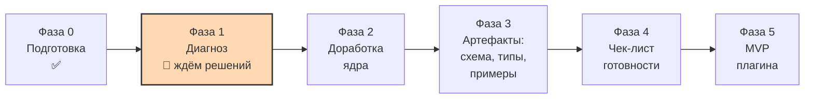

# Карта проекта

> [!important] Зачем этот файл
> Это «сохранение игры». Если диалог оборвётся или контекст переполнится, этот файл вставляют
> в новую сессию первым — и работа продолжается с той же точки. См. [[../glossary/glossary|глоссарий]]:
> «контроль контекста», «контрольная точка».

## 1. Цель

1. Доработать существующую метамодель личной базы знаний «Second Brain»: классификация, сложные объекты,
   устранение противоречий и дублей.
2. Зафиксировать метамодель в документации и артефактах и довести до состояния «готова к реализации».
3. Реализовать MVP плагина Obsidian со стабильным ядром.

## 2. Что за модель (кратко, чтобы не потерять суть)

**Second Brain** — самоопределяющаяся объектная модель внутри Obsidian. Не «список типов заметок»,
а система, где сам тип объекта, свойство, тип свойства, тип отношения, отношение, таксономия, фасет,
категория, представление и автоматизация — тоже объекты со своими `id` и `тип_объекта`.

Три слоя:

1. **Фундамент** (закрытый набор, задаётся кодом): 8 типов значений + системные атрибуты.
2. **Метауровень** (описания): типы объектов, свойства, типы отношений, таксономии, фасеты, категории,
   представления, автоматизации.
3. **Данные пользователя**: экземпляры объектов и экземпляры отношений.

Полное объяснение с диаграммой: [[../metamodel/analysis-01-incoming-drafts|диагноз, раздел 2]].

## 3. Текущая фаза

**Фаза 1 — Диагноз. Выполнен.** Черновики получены, прочитаны, проанализированы.
Диагноз и реестр проблем выданы. Ждём решений по четырём вопросам.

## 4. Исходные материалы

| Файл | Версия | Статус в исходнике | Наша трактовка |
|---|---|---|---|
| `docs/inbox/01_Second_Brain_Architecture_Specification.md` | 1.0 | утверждён | Действует, кроме разделов, отменённых v1.1 (разметка — шаг 0, ждёт подтверждения) |
| `docs/inbox/02_Метамодель_v1.0.md` | 1.0 | утверждён | Предлагаем `superseded` → v1.1 (R-02) |
| `docs/inbox/02_Метамодель_v1.1_черновик.md` | 1.1-draft | черновик | Основной источник по метамодели, по словам пользователя |

## 5. Утверждённые решения

| № | Дата | Решение | Версия метамодели | Где зафиксировано |
|---|---|---|---|---|
| DL-001…007 | 2026-10-22 | Рамки из промпта: русский язык документации, английские идентификаторы, офлайн, стек TS + Svelte/vanilla + esbuild, Bases и Templater подтверждены, без мобильной поддержки, миграции отложены, semver | — | [[../decisions/decision-log]] |
| — | — | Содержательных решений по метамодели пока нет | 0.0.0 | — |

## 6. Открытые вопросы (актуальный список)

### Блокеры — нельзя двигаться дальше без ответа

| ID | Вопрос | Что блокирует | Варианты | Рекомендация |
|---|---|---|---|---|
| **C-02** | Где источник истины для определений метамодели: заметки vault, JSON в `.sb/`, или гибрид | Шаги 1–9, формат всех артефактов | A: Markdown в vault / B: JSON в `.sb/` / C: гибрид | A для MVP |
| **C-01** | Формат ID и имя файла: ULID + непрозрачное имя, ULID + читаемое имя, или старый `ТИП-000001` | Нужен ли раздел 17 v1.1 (17 адаптеров интерфейса) | A / B / C | B: ULID + читаемое имя файла |
| **C-06** | Язык ключей: русский frontmatter, английский, или гибрид (ключ английский + подпись русская) | Вид схемы, типов и всех заметок | A / B / C | C: гибрид, но это ломающее изменение |
| **G-01** | Объём первого прохода по типам: все ~40, ядро 6–8, или все типы без свойств | Срок Фазы 2 и 3 | A / B / C | B: ядро 6–8 типов |

### Высокий приоритет — сразу после блокеров

| ID | Вопрос |
|---|---|
| C-04 / U-09 | Нужен ли уровень «Фасет»? Критерий «подтип или категория»? Какие типы абстрактные? |
| C-05 / G-12 | Обязательны ли `категории`? Что такое `tags` и нужны ли они? |
| C-07 / U-01…U-04 / G-11 | Критерий «ссылка или объект-отношение», двусторонняя кардинальность, уникальность, направление, роли |
| C-03 | Один механизм ссылок на тип вместо трёх |
| G-02 / G-03 | Реестр `TYPE_PREFIX`, единый список enum-ов |

### Средний приоритет

C-08, C-09, C-10, C-11, C-12, C-13, U-05, U-06, U-07, U-08, U-13, G-04…G-09, R-01…R-10.

### Отложено до Фазы 5

C-14, C-15, C-16, U-10…U-12, U-14, G-10, G-13, G-15, разделы 10, 11, 14–18 v1.1.

## 7. Результаты Фазы 1 (что уже есть)

| Артефакт | Что в нём |
|---|---|
| [[../metamodel/analysis-01-incoming-drafts]] | Диагноз: приём, объяснение модели, сравнение версий, 5 главных проблем, порядок решения, 10 рекомендаций |
| [[../metamodel/analysis-contradictions]] | Реестр: 16 противоречий (C), 7 дублей (D), 14 неясностей (U), 15 пробелов (G) — всего 52 записи с ID и критичностью |
| `docs/inbox/` | Неизменяемые копии исходников + README с правилом папки |

## 8. Риски

| Риск | Вероятность | Последствие | Мера |
|---|---|---|---|
| Потеря контекста в длинном диалоге | Высокая | Повторные обсуждения | Карта проекта + глоссарий + decision log; артефакты сразу |
| Уход в детали до согласования ядра | Средняя | Переделка | Порядок шагов 0→9 зафиксирован в диагнозе |
| **Объём модели не соответствует силам одного новичка** | **Высокая** | Проект не доходит до кода | G-01: ограничить первый проход 6–8 типами; R-07: вынести обёртки изображений и создание из пустых ссылок в отложенные модули |
| **Раздел 17 v1.1 (подмена названий) — самая дорогая и хрупкая часть** | Высокая, если выбран ULID-вариант имени файла | DOM-интеграция, внутренние API, поломки после обновлений Obsidian | Решение C-01 в пользу читаемого имени файла снимает большую часть раздела 17 |
| Два источника истины (Markdown и JSON) | Высокая при варианте C в C-02 | Расхождение данных, сложная синхронизация | Рекомендован вариант A в MVP |
| Противоречия между «утверждённым» `01` и «черновым» v1.1 | Уже случилось | Опора на недействующие правила | Шаг 0 — построчная разметка актуальности |
| Несогласованные зависимости от сторонних плагинов (QuickAdd, Fileclass, Dataview) | Уже зафиксировано в C-11 | Скрытая обязательность чужого кода | R-08: карточки интеграций, «мягкая зависимость» |
| Новичок в TypeScript и Obsidian API | Высокая | Замедление Фазы 5 | Глоссарий, пошаговые объяснения, минимум зависимостей |

## 9. Что дальше

1. Получить ответы на 4 вопроса (C-02, C-01, C-06, G-01) + подтверждение рекомендаций R-01…R-10.
2. Шаг 0: разметить актуальность разделов `01` спецификации.
3. Шаги 1–3: три ADR по фундаменту.
4. Шаг 4: классификация и реестр типов ядра.

## 10. Инвентарь артефактов

| Путь | Тип | Статус | Версия |
|---|---|---|---|
| `docs/README.md` | навигация по docs | draft (ждёт подтверждения, DL-008) | 0.1.0 |
| `docs/inbox/README.md` | индекс исходников | actual | 0.1.0 |
| `docs/inbox/*.md` (3 файла) | копии исходников | frozen | — |
| `docs/metamodel/analysis-01-incoming-drafts.md` | диагноз | actual | 0.1.0 |
| `docs/metamodel/analysis-contradictions.md` | реестр проблем | actual | 0.1.0 |
| `docs/project-map/PROJECT_MAP.md` | карта проекта | actual | 0.2.0 |
| `docs/glossary/glossary.md` | глоссарий | actual | 0.2.0 |
| `docs/decisions/decision-log.md` | decision log | actual | 0.2.0 |
| `docs/changelog/CHANGELOG.md` | changelog | draft | 0.1.0 |
| `docs/roadmap/readiness-checklist.md` | чек-лист готовности | draft | 0.1.0 |
| `docs/templates/*.md` (9 файлов) | шаблоны | draft (ждут подтверждения, DL-008) | 0.1.0 |

## 11. Версии

| Что | Текущая версия | Комментарий |
|---|---|---|
| Метамодель | `0.0.0` | Ещё ничего не утверждено. Исходники: v1.0 (утверждён), v1.1-draft (черновик) |
| Документация проекта | `0.2.0` | Каркас + диагностика |
| Плагин | — | Не начинался |
