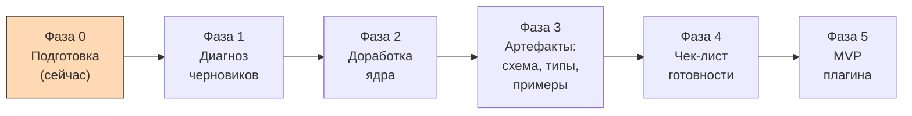

# Карта проекта

> [!important] Зачем этот файл
> Это «сохранение игры». Если диалог оборвётся или контекст переполнится, этот файл вставляют
> в новую сессию первым — и работа продолжается с той же точки. См. [[glossary|глоссарий]]:
> «контроль контекста», «контрольная точка».

## 1. Цель

1. Доработать существующую метамодель личной базы знаний: классификация, сложные объекты,
   устранение противоречий и дублей.
2. Зафиксировать метамодель в документации и артефактах и довести до состояния «готова к реализации».
3. Реализовать MVP плагина Obsidian со стабильным ядром.

## 2. Текущая фаза

**Фаза 0 — Подготовка.** Каркас документации предложен, ждёт подтверждения.
Файлы существующей метамодели ещё не получены.

## 3. Утверждённые решения

| № | Дата | Решение | Версия метамодели | Где зафиксировано |
|---|---|---|---|---|
| — | — | Пока нет утверждённых решений | — | — |

## 4. Открытые вопросы

| № | Вопрос | Блокирует | Предложенный вариант по умолчанию |
|---|---|---|---|
| Q1 | Как передать файлы существующей метамодели | Фазу 1 | Все файлы одним сообщением |
| Q2 | Формат первичного анализа | Фазу 1 | Полный диагноз до любых правок |
| Q3 | Насколько жёстко сохранять текущие имена типов и полей | Фазу 2 | Переименования разрешены с обоснованием и отметкой «требует подтверждения» |
| Q4 | Состав ядра (какие сущности обязательны) | Фазу 2 | Определяется после анализа черновиков |
| Q5 | Приоритеты функций MVP плагина | Фазу 5 | Отложен до утверждения метамодели |

## 5. Риски

| Риск | Вероятность | Последствие | Мера |
|---|---|---|---|
| Потеря контекста в длинном диалоге | Высокая | Повторные обсуждения, расхождение решений | Карта проекта + глоссарий + decision log; артефакты сразу после решения |
| Уход в детали до согласования ядра | Средняя | Переделка документов | Порядок «сверху вниз»: классификация → атрибуты → связи → валидация → код |
| Противоречия и дубли в черновиках | Высокая (заявлено) | Невозможность валидации | Фаза 1 — отдельная таблица противоречий |
| Новичок в TypeScript и Obsidian API | Высокая | Замедление фазы 5 | Глоссарий, пошаговые объяснения, минимальное число зависимостей |

## 6. Что дальше

1. Получить подтверждение по структуре `docs/` и шаблонам.
2. Получить файлы существующей метамодели.
3. Сделать первичный анализ (диагноз) и представить таблицу проблем.

## 7. Инвентарь артефактов

| Путь | Тип | Статус | Версия |
|---|---|---|---|
| `docs/project-map/PROJECT_MAP.md` | карта проекта | draft | 0.1.0 |
| `docs/glossary/glossary.md` | глоссарий | draft | 0.1.0 |
| `docs/README.md` | навигация по docs | draft | 0.1.0 |
| `docs/decisions/decision-log.md` | decision log | draft | 0.1.0 |
| `docs/changelog/CHANGELOG.md` | changelog | draft | 0.1.0 |
| `docs/roadmap/readiness-checklist.md` | чек-лист готовности | draft | 0.1.0 |
| `docs/templates/*` | шаблоны | draft | 0.1.0 |
