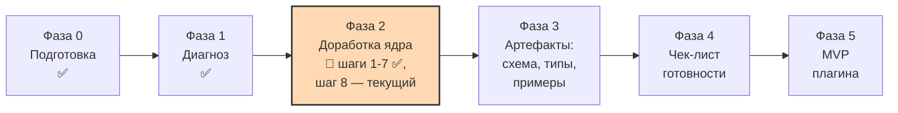

# Карта проекта

> [!important] Зачем этот файл
> Это «сохранение игры». Если диалог оборвётся или контекст переполнится, этот файл вставляют
> в новую сессию первым — и работа продолжается с той же точки. См. [[../glossary/glossary|глоссарий]]:
> «контроль контекста», «контрольная точка».

## 1. Цель

1. Доработать метамодель личной базы знаний **Second Brain**: классификация, сложные объекты,
   устранение противоречий и дублей.
2. Зафиксировать её в документации и артефактах, довести до состояния «готова к реализации».
3. Реализовать MVP плагина Obsidian со стабильным ядром.

## 2. Что за модель (кратко, чтобы не потерять суть)

**Second Brain** — самоопределяющаяся объектная модель внутри Obsidian. Не «список типов заметок»,
а система, где тип объекта, свойство, тип свойства, тип отношения, отношение, таксономия, фасет, категория,
представление и автоматизация — тоже объекты со своими `id` и `type`.

1. **Фундамент** (закрытый набор, задан кодом): 8 типов значений + системные атрибуты.
2. **Метауровень** (описания): типы объектов, свойства, типы отношений, таксономии, фасеты, категории,
   представления, автоматизации.
3. **Данные пользователя**: экземпляры объектов и экземпляры отношений.

Объяснение с диаграммой: [[../metamodel/analysis-01-incoming-drafts|диагноз, раздел 2]].

## 3. Текущая фаза

**Фаза 2 — доработка ядра.** Закрыты фундамент, классификация, атрибуты, связи, перечисления и даты —
**одиннадцать принятых ADR**. Метамодель — версия **`0.21.0`**. Единый реестр — **167 правил валидации** в 14 группах (A–N; одно предварительное — K2). Ядро — **15 типов**, карточек типов — **8** (`book`, `person`, `chapter`,
`media`, `project`, `knowledge`, `work`, `activity`), карточек связей — 5, перечислений — **23**, модулей MVP — **45**, команд — **18**.
Репозиторий: <https://github.com/pashhha33/SB_Qwen_PKB>.
Текущее состояние: **шаг 8 завершён целиком** (8a–8g, DL-160…DL-212). Порядок дальше выбран
пользователем (DL-213): **карточки типов → аудит A9 (+ шаг 0) → шаг 9**. Первая партия карточек
готова (DL-214): `knowledge` (детальная), `work`, `activity` (сокращённые); группа правил N
(1 правило †); глоссарий **258**.
**Ждём ответов на вопросы K1/K2** карточки `knowledge`; далее вторая партия — 7 системных
карточек сокращённо (`object_type`, `property`, `relation_type`, `relation`, `taxonomy`,
`facet`, `category`).

> [!tip] Быстрый старт новой сессии
> [[../CHECKPOINT|Контрольная точка]] — самодостаточное состояние проекта. Скопировать целиком
> в новое сообщение + ссылка на репозиторий.

### Положение внутри шагов Фазы 2

| Шаг | Что делаем | Закрывает | Статус |
|---|---|---|---|
| 0 | Разметить актуальность разделов спецификации 01 | C-09 | ⏳ выполняется вместе с шагом 4 |
| 1 | ADR «Источник истины» | C-02 | ✅ [[../adr/ADR-002-source-of-truth\|ADR-002]] |
| 2 | ADR «Идентификация и имя файла» | C-01, C-03, C-16 | ✅ [[../adr/ADR-001-identity-and-file-naming\|ADR-001]] |
| 3 | ADR «Язык идентификаторов» | C-06, U-06 | ✅ [[../adr/ADR-003-bilingual-keys-and-label-layer\|ADR-003]] |
| 3b | ADR «Объём первого прохода и командное создание» | G-01, D-01, G-02 | ✅ [[../adr/ADR-004-first-pass-scope-and-command-driven-authoring\|ADR-004]] |
| 4 | Классификация и реестр типов | C-04, C-05, U-09, G-12, G-09 | ✅ ADR-005, ADR-007 |
| 5 | Системные атрибуты и типы значений | C-12, C-13, U-05 | ✅ ADR-006, ADR-008 |
| 6 | Связи: роли, кардинальность, гибрид | C-07, U-01…U-04, G-11 | ✅ ADR-009, ADR-010 |
| 7 | Enum-ы, даты, правила валидации | G-03, G-04, U-08 | ✅ ADR-011 |
| 7b | **Требования пользователя по книге и главам** | DL-113…DL-136 | ✅ закрыты (ответы A / B / A / A) |
| 7c | **Требования пользователя по `person` и обёртке `media`** | DL-137…DL-152, DL-088 | ✅ закрыты; составы перечислений ждут подтверждения |
| **8** | **Этапы, модули, представления, интеграции** | G-06, G-07, C-10, C-11 | **🔶 выполняется**: 8a ✅ принято (DL-161…DL-163), 8b представления — **принято** (DL-164…DL-172), 8c модули — **закрыт** (DL-173…DL-176, создан тип `project`), далее 8d интеграции, 8e миграции |
| **8g** | **Пустые ссылки и псевдонимы** (вставной, по требованию пользователя) | DL-177…DL-188, черновик v1.1 §11 и §1.4 | ✅ **раздел 12 принят** (ответы Б / А / А / А): 3 точки запуска создания в MVP, контекст К1–К5, поле `create_from_link`, правила сбора С1–С12, 11 правил группы M, 5 модулей, 3 команды → 45 модулей и 18 команд |
| 9 | JSON Schema + TS-типы + примеры | G-05 | ⏳ |

## 4. Утверждённые решения

| Дата | Решение | ADR | Версия метамодели |
|---|---|---|---|
| 2026-10-22 | Рамки проекта: русский язык документации, английские идентификаторы, офлайн, стек TypeScript + Svelte/vanilla + esbuild, Bases и Templater подтверждены, без мобильной поддержки, миграции отложены, semver | — (DL-001…007) | — |
| 2026-10-22 | Структура `docs/`, шаблоны, карта проекта как страховка от потери контекста | — (DL-008, DL-009) | — |
| 2026-10-22 | **`id` = голый ULID; имя файла = `{TYPE_PREFIX}-{ULID}.md`; ссылка = `[[{TYPE_PREFIX}-{ULID}.md\|{title}]]`** | [[../adr/ADR-001-identity-and-file-naming\|ADR-001]] | 0.1.0 |
| 2026-10-22 | **Читаемость: инвариант `aliases[0] == title` → Front Matter Title как необязательная интеграция → свои адаптеры вне MVP. Раздел 17 v1.1 вынесен за границы MVP** | ADR-001 | 0.1.0 |
| 2026-10-22 | **Определения метамодели — Markdown-заметки в хранилище; `.sb/` — только служебные данные** | [[../adr/ADR-002-source-of-truth\|ADR-002]] | 0.1.0 |
| 2026-10-22 | **Ключи полей — английские `snake_case`; русская подпись в поле `label`; слой `LabelResolver` с режимами `view`/`source`** | [[../adr/ADR-003-bilingual-keys-and-label-layer\|ADR-003]] | 0.1.0 |
| 2026-10-22 | **Русские подписи в стандартной панели свойств — только после прототипа `MetadataEditor.register`; CSS- и DOM-подмена отклонены** | ADR-003 | 0.1.0 |
| 2026-10-22 | **Первый проход: реестр всех ~40 типов + детальное описание ядра** | [[../adr/ADR-004-first-pass-scope-and-command-driven-authoring\|ADR-004]] | 0.1.0 |
| 2026-10-22 | **Классификация: `taxonomy → facet → category`; настройки на фасете; обязательность категорий задаёт фасет; `tags` — свободные метки; критерий «подтип или категория» из двух тестов; поле `abstract`** | [[../adr/ADR-005-classification-model\|ADR-005]] | 0.2.0 |
| 2026-10-22 | **Ядро — 11 типов**: `person`, `project`, `book`, `knowledge` + `object_type`, `property`, `relation_type`, `relation` + `taxonomy`, `facet`, `category`. `property_type` — в реестре без карточки | ADR-005 | 0.2.0 |
| 2026-10-22 | **Контрольная точка** `docs/CHECKPOINT.md` обновляется после каждого сообщения с решениями; старт новой сессии — по ссылке на репозиторий + копирование файла | — (DL-048) | — |
| 2026-10-22 | **Семь типов значений** (убраны «Список» и «Список ссылок», добавлен `media_reference`); множественность задаётся только `cardinality` | [[../adr/ADR-006-system-attributes-value-types-media\|ADR-006]] | 0.3.0 |
| 2026-10-22 | **8 системных атрибутов и 6 инвариантов**; `created_at` и `updated_at` обязательны, заполняет плагин | ADR-006 | 0.3.0 |
| 2026-10-22 | **Даты в локальном времени без смещения**, точность до минут; представление задаётся настройкой плагина. Ограничение G-04-1 зафиксировано | ADR-006 | 0.3.0 |
| 2026-10-22 | **Словарь** выражается перечислением или ссылкой на категорию фасета; новый механизм не вводится | ADR-006 | 0.3.0 |
| 2026-10-22 | **Тип `media`** вместо `image_wrapper`; миниатюры в нашей модалке через публичный API; механизм разрешения v1.1 §10 отложен | ADR-006 | 0.3.0 |
| 2026-10-22 | **Ядро — 14 типов**: добавлены `media`, `work` (abstract), `activity` (abstract) | ADR-006 | 0.3.0 |
| 2026-10-22 | **Реестр типов приведён к решениям пользователя**: 7 типов → категории, `poem` и `lyrics` → подтипы, `series` объединён, «Источник» — подтипы + фасет «Носитель», `documentation` вне модели | ADR-006 | 0.3.0 |
| 2026-10-22 | **Фасет — самостоятельный объект**: `taxonomy` необязательна, у фасета есть `allowed_object_types`, второй путь классификации запрещён (правило П8), правило П6 ADR-005 отменено | [[../adr/ADR-007-facet-independence\|ADR-007]] | 0.3.0 |
| 2026-10-22 | **Тип свойства `media_reference`**: цель ссылки настраивается (`object` / `file` / `both`), семь настроек, миниатюры через публичный API `getResourcePath()`, отдельного «мульти»-типа нет | [[../adr/ADR-008-media-property-type\|ADR-008]] | 0.3.0 |
| 2026-10-22 | **Тип `guide`** (префикс `GUIDE`, `phase2`) — сущность для инструкций, памяток, справок и хелперов | — (DL-075) | 0.3.0 |
| 2026-10-22 | **Модель связей**: `link_mode` объявляется в свойстве; привязка через `origin_property`; двусторонняя кардинальность; `uniqueness_rule` = `triple`; `direction` = `directed` / `symmetric`; `allowed_*` против `suggested_*`; роли — свободный текст, оба обязательны; локальные свойства — 5 в ядре; собственного текста у связи нет; системные атрибуты связи сокращены; обратная сторона вычисляется; каскад при удалении; защита от дубля | [[../adr/ADR-009-relations-model\|ADR-009]] | 0.4.0 |
| 2026-10-22 | **Хранение связей**: экземпляры в `.sb/relations/relations.jsonl` (JSON Lines), Obsidian их не индексирует → чистый граф и поиск. `direct`-связи остаются во frontmatter. Критерий ADR-002 уточнён: в Markdown живёт то, с чем работает человек | [[../adr/ADR-010-relation-storage\|ADR-010]] | 0.4.0 |
| 2026-10-22 | **Реестр типов отношений ядра**: `authorship`, `ownership`, `part_of` (reified), `related_to` (symmetric). Этап 2: `employment`, `sourced_from`, `member_of`, `depicts`, `co_authorship`, `conflicts_with` | — (DL-101) | 0.4.0 |
| 2026-10-22 | **Адрес репозитория**: `https://github.com/pashhha33/SB_Qwen_PKB` | — (DL-096) | — |
| 2026-10-22 | **Значения перечислений** — английский `snake_case` + русская подпись; 13 закрытых перечислений в реестре | [[../adr/ADR-011-enumerations-dates-lifecycle\|ADR-011]] | 0.5.0 |
| 2026-10-22 | **Частичные даты** через `00` в неизвестных компонентах, правила П1–П6, нормализация в диапазон; **интервалы** И1–И4 | ADR-011 | 0.5.0 |
| 2026-10-22 | **Редактируемый шаблон вывода даты и времени**: 17 токенов, 5 пресетов, отдельные шаблоны для частичных и относительных дат | ADR-011 (предложение пользователя) | 0.5.0 |
| 2026-10-22 | **`lifecycle` получил поведение**: четыре стадии, у `deprecated` обязательно `superseded_by` | ADR-011 | 0.5.0 |
| 2026-10-22 | **Шесть уровней контроля целостности** из `01` §19 получили определения | ADR-011 | 0.5.0 |
| 2026-10-22 | **Единый реестр правил валидации: 87 правил** в 8 группах (72 error, 12 warning, 3 info) + политика уровней и формат диагностики из 11 полей | — (DL-108, DL-109) | 0.5.0 |
| 2026-10-22 | **Два образца карточек типов ядра**: `book` и `person`. **Форма утверждена пользователем** | — (DL-110, DL-113) | 0.6.0 |
| 2026-10-22 | **`forbid_overlap`** у типа отношения, по умолчанию `false` | — (DL-111, DL-114) | 0.6.0 |
| 2026-10-22 | **Тип объекта `chapter`** (`CHP`) в ядре → 15 типов; правило наименования «Глава {N}» при пропуске названия (инвариант И7) | — (DL-124, DL-130) | 0.6.0 |
| 2026-10-22 | **Тип отношения `contains`** (`reified`, `0..n` / `0..1`); `part_of` — его вычисляемая обратная сторона | — (DL-125) | 0.6.0 |
| 2026-10-22 | **Фасет `genre`** отдельный от `literary_form`: форма и жанр ортогональны | — (DL-119, DL-126) | 0.6.0 |
| 2026-10-22 | **`format` книги — закрытое перечисление** и триггер условных свойств; `chapter_count` вычисляется, не хранится | — (DL-118, DL-120) | 0.6.0 |
| 2026-10-22 | **Механизм условных свойств `applies_when`** (М1–М6): только показ и проверка обязательности, никогда хранение | — (DL-128) | 0.6.0 |
| 2026-10-22 | **Настройки отображения `number`**: `display.unit`, `display.scale_max`, `display.renderer`; символы ⭐ в данных не хранятся | — (DL-117, DL-123) | 0.6.0 |
| 2026-10-22 | **Блок навигации по главам** — собственный `code_block_processor`, а не подмена DOM Obsidian; нет соседней главы → кнопка создаёт её | — (DL-129, DL-131) | 0.6.0 |
| 2026-10-22 | **Перечисления данных** (§3.17): `book_format`, `publication_status`, `chapter_role`, `file_format` — всего 19 перечислений | — (DL-127) | 0.6.0 |
| 2026-10-22 | **Реестр валидации 87 → 102 правила** | — (DL-132) | 0.6.0 |
| 2026-10-22 | **`rating` — целое 1–10, показ звёздами** (`★★★★★★★☆☆☆ 7/10`); шкала единая для всех типов, задаётся `display.renderer` и `display.scale_max` | — (DL-115, DL-116) | 0.7.0 |
| 2026-10-22 | **`book_format` закрыто, пять значений**: `file`, `card`, `web_novel`, `print`, `audio`. `online_literature` не введено — надмножество веб-новелы | — (DL-121, DL-135) | 0.7.0 |
| 2026-10-22 | **10 условных свойств книги** утверждены; недостающие добавляются командами плагина | — (DL-122) | 0.7.0 |
| 2026-10-22 | **Автоперенумерации глав нет**: разрыв — warning, перенумерация — явная команда на этапе 2 | — (DL-133) | 0.7.0 |
| 2026-10-22 | **`person_role`**: 34 значения, 9 групп; `person.role` — мультивыбор и триггер **27 условных свойств**; фасет «Род занятий» не вводится | — (DL-137, DL-138) | 0.8.0 |
| 2026-10-22 | **Операция `includes_any`** в `applies_when` + правило М7 (одно свойство на несколько групп значений) | — (DL-139) | 0.8.0 |
| 2026-10-22 | **Три поля псевдонимов**: `birth_name`, `pen_name`, `also_known_as` (+ `original_name`); все варианты обязаны попадать в `aliases` | — (DL-151) | 0.8.0 |
| 2026-10-22 | **Дедупликация свойств профессий** по вики-инфобоксам и Wikidata; исследование вынесено в отдельный файл | — (DL-152) | 0.8.0 |
| 2026-10-22 | **Карточка типа `media`**: 16 базовых + 19 условных свойств; `creation_method` (8 значений, мультивыбор) как триггер; `role` — мультивыбор из 13 значений. DL-088 закрыт | — (DL-140…DL-142) | 0.8.0 |
| 2026-10-22 | **Инвариант И8**: встраивание файла в теле обёртки — показ работает и без плагина | — (DL-143) | 0.8.0 |
| 2026-10-22 | **Теневое свойство `{key}_file`** для `media_reference` — единственный способ показать обложку в карточном виде Bases | — (DL-144) | 0.8.0 |
| 2026-10-22 | **Кнопки у изображений** («создать обёртку» / «открыть обёртку») + **индекс `путь → id`** в `.sb/cache/media-index.json` | — (DL-147, DL-148) | 0.8.0 |
| 2026-10-22 | **Мастер `sb-create-media`**: имя + 4 источника; буфер обмена читается двумя способами (`clipboard.read()` + `paste`-fallback) | — (DL-145, DL-146) | 0.8.0 |
| 2026-10-22 | **Реестр валидации 102 → 133 правила** (группы I «person» и J «media»); исправлен пересчёт перечислений (17 из 19, а не 16) | — (DL-149, DL-150) | 0.8.0 |
| 2026-10-22 | **Ответы пользователя A / C / A / B**: `person_role` закрыто (34 значения, добавлено `other_occupation`), **`person.role` обязателен** (`1..N`, правило `person.role.required`), ключ `role` сохранён; `media_creation_method` закрыто (8 значений, 8 полей `ai_*`); суффикс теневого свойства **`_file`**; `media.file.single_wrapper` остаётся `error` | — (DL-153…DL-157) | 0.9.0 |
| 2026-10-22 | **Элементы метамодели создаются командами плагина, не ручным редактированием** | ADR-004 | 0.1.0 |
| 2026-10-22 | Рекомендации R-01…R-10 приняты пакетом | — (DL-011…DL-022) | — |

## 5. Исходные материалы

| Файл | Версия | Статус в исходнике | Наша трактовка |
|---|---|---|---|
| `docs/inbox/01_Second_Brain_Architecture_Specification.md` | 1.0 | утверждён | Действует, кроме разделов, отменённых v1.1 и ADR-001…004. Разметка — шаг 0 |
| `docs/inbox/02_Метамодель_v1.0.md` | 1.0 | утверждён | `superseded` → v1.1 (DL-013) |
| `docs/inbox/02_Метамодель_v1.1_черновик.md` | 1.1-draft | черновик | Основной источник; разделы 15.2–15.3 (JSON) и 17 (свой слой подмены) отклонены ADR |

## 6. Открытые вопросы

### Текущие — требуют ответа

| ID | Вопрос | Варианты | Рекомендация |
|---|---|---|---|
| — | ~~Состав `person_role`, обязательность `role`, состав `media_creation_method`, имя теневого свойства, одна обёртка на файл~~ | — | **Закрыто** пользователем 2026-10-22 (DL-153…DL-157) |
| — | ~~Вопросы 12.1–12.4 раздела «Пустые ссылки и псевдонимы»~~ | — | **Закрыто** пользователем 2026-10-22 (ответы Б / А / А / А, DL-184…DL-187) |
| — | Состав `project_status` и вопросы 9.1–9.7 карточки `project` | 5 значений как есть / добавить `blocked`, `backlog` | 5 значений как есть |
| — | Остальные вопросы карточки `person` (9.4–9.8) и `media` (10.4, 10.6–10.8) | — | Не блокируют шаг 8 |
| — | Нужен ли `print` как отдельный формат, если печатная книга — это `file` или `card` | Оставить / убрать | Оставить, проверить на этапе 2 по экземплярам |
| — | Обязателен ли `author` у книги; нужен ли `read_status`; какие поля наследуются от `work` | — | Как в карточке `book` §9 |
| — | Перечисление `object_status` (жизненный цикл данных из `01` §15) | Вводить / не вводить | Обсудить на шаге 8 |
| — | Реестр типов отношений ядра (DL-101), команды по связям (DL-103), имя плагина | Подтвердить | Как в `03-relations.md`; имя `second-brain` |
| — | ~~Уточнения пользователя по обёртке `media` (DL-088)~~ | — | **Закрыто** DL-140…DL-149: карточка `media` создана |
| — | Франшиза и Галерея: подтипы `collection` или категории | A / B | Отложить до этапа 2 |
| — | Нужен ли `media_target: both` в MVP или оставить только `object` и `file` | A: оставить `both` / B: сократить | A, но можно сократить |
| — | `wrap-on-select`: автоматическое создание обёртки `media` при выборе файла | MVP / этап 2 | этап 2 |
| — | `music_track` против `media` вида `audio` | A: трек наследует `work` и ссылается на `media` / B: только `media` | A, на этапе 2 |
| DL-029, DL-037 | Имя папки `Metamodel/` и набор команд MVP | — | Подтвердить по умолчанию |
| — | Имя плагина для `manifest.json` | `second-brain` / другое | `second-brain` |

### Следующие по порядку — шаг 8

| ID | Вопрос | Статус |
|---|---|---|
| G-06 | Разбиение на этапы реализации с критериями готовности каждого | **Закрыто** (8a, DL-161; `phases.md` accepted) |
| G-07, C-10 | Представления и закрытый список `mechanism` | **Закрыто** (8b, DL-171; `08-views.md` accepted) |
| — | Модули: реализуемые, отложенные, нереализуемые (`09-modules.md`) | **Закрыто** (8c, DL-174…DL-176; статус accepted — DL-192) |
| — | Границы MVP (`mvp-scope.md`) | **Закрыто** (8a, DL-162, DL-163) |
| C-11 | Интеграции: карточки по семи позициям | **Закрыто** (8d, DL-189…DL-198): Bases — использовать; FMT — необязательный адаптер; Templater, Dataview, Fileclass, Metadata Menu — не зависимости; QuickAdd — отложен |
| G-08 | Правила миграций: формат записи, версии схемы, журнал | **Закрыто** (8e, DL-201…DL-205; `10-migration-rules.md` accepted) |
| — | RDF-расширение и общий обзор метамодели (+ иерархия) | **Закрыто** (8f, А/А/А/А, DL-208…DL-212): `00-overview` — actual, `07-hierarchy` — accepted (G-09, A8), `11-rdf-extension` — accepted |

Соответствие шагов и проблем: шаг 6 — C-07, U-01…U-04, G-11 (закрыт); шаг 7 — G-03, G-04, U-08
(закрыт); шаг 8 — G-06, G-07, G-08, C-10, C-11 (закрыты все, кроме G-08); шаг 9 — G-05.

### Отложено до Фазы 5

Прототип `MetadataEditor.register`; разбор Exocortex как референса;
разделы 10, 11, 14–18 v1.1; U-10…U-12, U-14, G-10, G-13, G-15; C-14, C-15.

## 7. Риски

| Риск | Вероятность | Последствие | Мера |
|---|---|---|---|
| Потеря контекста в длинном диалоге | Высокая | Повторные обсуждения | Карта проекта + глоссарий (**258 терминов**) + decision log (**214 записей**) |
| **Подмена отображения сломается после обновления Obsidian** | Высокая | Пользователь видит технические имена файлов | ADR-001: три уровня, мягкий отказ, резервное имя файла, M1–M7. Данные исследования: [[../integrations/research-front-matter-title-stability]] |
| **`MetadataEditor.register` не даст русские подписи в панели свойств** | Средняя | Пользователь видит английские ключи в стандартном интерфейсе | ADR-003 мера M6: не обещать до прототипа; наша модалка показывает подписи гарантированно |
| **Переход на английские ключи — ломающее изменение** | Уже случилось | Старые черновики не соответствуют новой схеме | Данных нет → цена близка к нулю. Таблица соответствия имён сохранена в ADR-003 для будущих миграций |
| Объём модели не соответствует силам одного новичка | Средняя | Проект не доходит до кода | ADR-004: ядро из 8 типов, остальные в реестре; R-07: обёртки изображений отложены |
| Ручная правка YAML сломает определения метамодели | Средняя | Некорректная схема | ADR-002 M1–M5 + ADR-004 П1–П3: создание только командами, строгая валидация, последняя корректная версия |
| Уход в детали до согласования ядра | Средняя | Переделка | Порядок шагов 0→9 зафиксирован и виден в разделе 3 |
| Противоречия между «утверждённым» `01` и решениями ADR | Уже случилось | Опора на недействующие правила | Шаг 0 — построчная разметка актуальности спецификации 01 |
| Новичок в TypeScript и Obsidian API | Высокая | Замедление Фазы 5 | Глоссарий, пошаговые объяснения, минимум зависимостей, тесты в песочнице ассистента |
| **Bases не рисует картинку из ссылки на заметку** | Уже подтверждено документацией | Обложки в карточном виде не появляются | Теневое свойство `{key}_file` + команда `sb-resync-media-shadows` + правило `media.referrers.shadow_synced` (DL-144) |
| **Буфер обмена ненадёжен для файлов из проводника** | Высокая | Мастер создания обёртки «молча» не работает | Два механизма чтения + внятный отказ + три запасных источника (DL-146) |
| Рассинхрон кэша и индекса медиа | Средняя | Кнопки показывают неверное состояние | Кэш — не источник истины; правила уровня 6; перестроение командой `sb-rebuild-media-index` |
| Потеря разделов нормативных документов в рабочей копии | Уже случилось | Ссылки ведут в пустоту | Сверка в начале сообщения; восстановлено (DL-140); пользователю предложено сверить копию репозитория |

## 8. Что дальше

1. ~~Ответить на вопросы 12.1–12.4~~ → **получено** (Б / А / А / А, DL-184…DL-187): раздел 12
   принят, пометки сняты, 45 модулей и 18 команд.
2. ~~Под-шаг 8d — карточки интеграций~~ → **закрыт** (7 из 7 карточек, DL-189…DL-198):
   C-11 закрыто, пункт C5 чек-листа закрыт (блок C — 5/5). Следующий — **под-шаг 8e**:
   `10-migration-rules.md` (формат записи миграции, версии схемы, журнал; образец —
   `person.role.required` с автоподстановкой `other_occupation`, DL-159).
3. ~~Подтверждение составов~~ → получено (DL-153…DL-157). ~~Подтверждение **этапов A–E** и **границ MVP**~~ → получено (DL-161…DL-163).
4. Описать остальные карточки типов ядра по утверждённой форме — **начато** (DL-213/214):
   готовы **8 из 15** (`book`, `person`, `chapter`, `media`, `project`, `knowledge`, `work`,
   `activity`); остались 7 системных сокращённо (`object_type`, `property`, `relation_type`,
   `relation`, `taxonomy`, `facet`, `category`). Вопросы K1/K2 карточки `knowledge` — ждут ответа.
5. ~~Остаток шага 8~~ → **шаг 8 завершён** (8f принят: А / А / А / А, DL-208…DL-212;
   G-09 и A8 закрыты). Далее: **остаток блока A** — 10 карточек типов ядра (A2/A3) и аудит A9;
   **шаг 9** — JSON Schema, TypeScript-типы, примеры (блок D). Порядок — вопрос к пользователю.
6. Подтвердить состав `project_status` (5 значений или добавить `blocked` / `backlog`) и закрыть
   вопросы 9.1–9.7 карточки `project`.
7. Завершить шаг 0 — построчная разметка актуальности разделов спецификации 01.

## 9. Инвентарь артефактов

| Путь | Тип | Статус | Версия |
|---|---|---|---|
| `docs/README.md` | навигация по docs | actual (DL-008 принят) | 0.1.0 |
| `docs/inbox/README.md` + 3 копии исходников | индекс и неизменяемое сырьё | frozen | — |
| `docs/metamodel/analysis-01-incoming-drafts.md` | диагноз черновиков | actual | 0.1.0 |
| `docs/metamodel/analysis-contradictions.md` | реестр 52 проблем | actual | 0.1.0 |
| `docs/adr/ADR-001-identity-and-file-naming.md` | ADR | accepted | 0.1.0 |
| `docs/adr/ADR-002-source-of-truth.md` | ADR | accepted | 0.1.0 |
| `docs/adr/ADR-003-bilingual-keys-and-label-layer.md` | ADR | accepted | 0.1.0 |
| `docs/adr/ADR-004-first-pass-scope-and-command-driven-authoring.md` | ADR | accepted | 0.1.0 |
| `docs/adr/ADR-005-classification-model.md` | ADR | accepted | 0.1.0 |
| `docs/adr/ADR-006-system-attributes-value-types-media.md` | ADR | accepted | 0.1.0 |
| `docs/adr/ADR-007-facet-independence.md` | ADR | accepted | 0.1.0 |
| `docs/adr/ADR-008-media-property-type.md` | ADR | accepted | 0.1.0 |
| `docs/metamodel/01-classification.md` | нормативный раздел метамодели | actual, обновлён по ADR-007 и DL-126 | 0.2.1 |
| `docs/metamodel/02-entities.md` | реестр 58 типов (ядро 15) + реестр `TYPE_PREFIX`; `chapter` приведён к DL-124; ссылки на карточки `knowledge`/`work`/`activity` | actual | 0.9.0 |
| `docs/metamodel/03-relations.md` | нормативный раздел: связи, реестр типов отношений (+`contains`), команды | actual | 0.2.0 |
| `docs/metamodel/relations/*.md` (5 файлов) | карточки связей: authorship, ownership, part_of, related_to, **contains** | actual | 0.2.0 |
| `docs/metamodel/04-attributes.md` | атрибуты, типы значений, `media_reference`, даты, **`applies_when` (М1–М7, `includes_any`)**, `display.*`, признак `service` | actual | 0.6.0 |
| `docs/metamodel/05-enumerations.md` | реестр **23 перечислений** (**21 закрыто**), включая данные §3.17 | actual | 0.11.0 |
| `docs/metamodel/06-time-and-intervals.md` | даты, частичные даты, интервалы, шаблон вывода | actual | 0.1.0 |
| `docs/metamodel/entities/book.md` | карточка типа — форма утверждена, состав полей закрыт | actual | 0.3.0 |
| `docs/metamodel/entities/person.md` | карточка типа **переработана**: `role` обязателен, мультивыбор, 27 условных свойств, псевдонимы | actual | 0.9.0 |
| `docs/metamodel/entities/media.md` | карточка типа `media`: 16 + 19 свойств, инвариант И8, поведение обёртки (§7), 6 модулей плагина | actual | 0.9.0 |
| `docs/metamodel/research/person-role-properties.md` | исследование свойств профессий в вики-инфобоксах и Wikidata | actual | 0.1.0 |
| `docs/metamodel/entities/chapter.md` | карточка типа `chapter`: свойства, навигация Н1–Н8, валидация | actual | 0.1.0 |
| `docs/metamodel/entities/knowledge.md` | карточка типа `knowledge`: атомарная заметка; `source` (text), фасет «Вид знания» (0..1), `related_to`; правило `knowledge.body.not_empty` † (K2); вопросы K1/K2 | actual (K1/K2 ждут ответа) | 0.1.0 |
| `docs/metamodel/entities/work.md` | сокращённая карточка абстрактного корня `work`: потомки, «свойств не объявляет», И3, семантика в `allowed_*` | actual | 0.1.0 |
| `docs/metamodel/entities/activity.md` | сокращённая карточка абстрактного корня `activity`: потомки (`project`, позже task/goal/problem), «свойств не объявляет» | actual | 0.1.0 |
| `docs/validation/rules.md` | единый реестр **167 правил** валидации в 14 группах (A–N; одно предварительное — K2) | actual | 0.10.0 |
| `docs/validation/severity-policy.md` | политика уровней и формат диагностики; **4 случая автоисправления** | actual | 0.2.0 |
| `docs/adr/ADR-009-relations-model.md` | ADR: модель связей | accepted | 0.1.0 |
| `docs/adr/ADR-010-relation-storage.md` | ADR: хранение связей | accepted | 0.1.0 |
| `docs/adr/ADR-011-enumerations-dates-lifecycle.md` | ADR: перечисления, даты, `lifecycle`, уровни контроля | accepted | 0.1.0 |
| `docs/CHECKPOINT.md` | контрольная точка для новой сессии | actual | 19.0.0 |
| `README.md` | точка входа репозитория | actual | 0.2.0 |
| `docs/integrations/research-front-matter-title-stability.md` | исследование | actual | 0.1.0 |
| `docs/integrations/obsidian-bases.md` | карточка интеграции: **использовать** (факты проверены 2026-10-23) | actual | 0.1.0 |
| `docs/integrations/templater.md` | карточка интеграции: **отклонён как зависимость**, сосуществование совместимо (DL-190) | actual | 0.1.0 |
| `docs/integrations/front-matter-title.md` | карточка интеграции: **необязательный рекомендуемый адаптер** (ADR-001, M1–M7) | actual | 0.1.0 |
| `docs/integrations/dataview.md` | карточка интеграции: **отклонён** (DL-191/195); свои запросы не поддерживаются; `.sb/` невидим | actual | 0.1.0 |
| `docs/integrations/fileclass.md` | карточка интеграции: **референс, не зависимость**; зафиксирована смена плагина (старый mmalecot — 404, новый mdelobelle 0.2.15 на Bases) | actual | 0.1.0 |
| `docs/integrations/metadata-menu.md` | карточка интеграции: **референс, не зависимость** (ориентир ADR-006/008); 0.8.12 (2026-02) | actual | 0.1.0 |
| `docs/integrations/quickadd.md` | карточка интеграции: **deferred** (DL-194/197); этап 2 — «быстрый захват» | actual | 0.1.0 |
| `docs/project-map/PROJECT_MAP.md` | карта проекта | actual | 1.17.0 |
| `docs/glossary/glossary.md` | глоссарий, **258 активных терминов** (Fileclass заменён) | actual | 1.12.0 |
| `docs/decisions/decision-log.md` | decision log, **214 записей** + раздел отменённых | actual | 1.17.0 |
| `docs/handoff/2026-10-22-book-and-chapters.md` | список файлов для переноса в репозиторий + сообщение коммита | actual | 0.2.0 |
| `docs/handoff/2026-10-22-person-and-media.md` | список файлов для переноса + сообщение коммита + проверка `04-attributes.md` | actual | 0.1.0 |
| `docs/handoff/2026-10-22-links-and-aliases.md` | список файлов для переноса (раздел 12) + сообщение коммита | actual | 0.1.0 |
| `docs/handoff/2026-10-23-integrations-batch-1.md` | список файлов для переноса (8d партия 1) + сообщение коммита | actual | 0.1.0 |
| `docs/handoff/2026-10-23-integrations-batch-2.md` | список файлов для переноса (8d партия 2) + сообщение коммита | actual | 0.1.0 |
| `docs/changelog/CHANGELOG.md` | changelog, версия метамодели **0.21.0** | actual | 0.17.0 |
| `docs/roadmap/readiness-checklist.md` | чек-лист готовности (**B — 4/4**, C — 5/5, A — 7/10) | draft | 0.16.0 |
| `docs/roadmap/phases.md` | этапы реализации A–E с критериями готовности | **accepted** | 0.4.0 |
| `docs/roadmap/mvp-scope.md` | границы MVP: входит / не входит / серые зоны | **accepted** | 0.7.0 |
| `docs/metamodel/09-modules.md` | реестр модулей плагина: **45 MVP**, 12 отложенных, 12 нереализуемых; §4.1 стек UI — Svelte | **accepted** | 0.5.0 |
| `docs/metamodel/entities/project.md` | карточка типа `project`: `status`-триггер, `owner`, `progress`, канбан | actual | 0.13.0 |
| `docs/metamodel/08-views.md` | представления: 12 штук, `mechanism`, `.base` в `Views/`, ограничения Bases, метки + `sb_issues`; Dataview отклонён (DL-191) | **accepted** | 0.4.0 |
| `docs/metamodel/12-links-and-aliases.md` | **раздел 12**: создание объекта из пустой ссылки, `title` из текста ссылки, контекст К1–К8, поле `create_from_link`, сбор псевдонимов С1–С12, фильтр мусора, поиск дублей, 11 правил группы M | **accepted** | 0.2.0 |
| `docs/metamodel/10-migration-rules.md` | **раздел 10**: принципы МГ1–МГ8, классификация изменений и semver, правило двух фаз, `.sb/state.json`, запись миграции в `.sb/migrations/` (8 операций), журнал, сухой прогон, откат «снимок + undo», четыре образца | **accepted** (А/А/А/А, DL-201…DL-205) | 0.2.0 |
| `docs/metamodel/00-overview.md` | **обзор**: три слоя, модель в числах, Mermaid-схема, десять принципов, жизненный цикл объекта, четыре маршрута чтения | **actual** (DL-212) | 0.2.0 |
| `docs/metamodel/07-hierarchy.md` | **раздел 07**: три уровня иерархии, полное дерево типов (G-09 закрыта), правила абстрактных типов, наследование свойств, семантика потомков в `allowed_*`, смена типа (механизм принят, реализация этап 2) | **accepted** (А/А/А, DL-208…DL-210) | 0.2.0 |
| `docs/metamodel/11-rdf-extension.md` | **раздел 11** (информационный): RDF простыми словами, сопоставление «наше → RDF/SKOS» (19 строк), 5 жёстких границ, 3 критерия запуска; объём — объяснительный минимум (DL-211) | **accepted** | 0.2.0 |
| `docs/templates/*.md` (9 файлов) | шаблоны | actual (DL-008 принят) | 0.1.0 |

## 10. Версии

| Что | Текущая версия | Комментарий |
|---|---|---|
| **Метамодель** | **`0.21.0`** | Зафиксированы одиннадцатью ADR: фундамент, классификация, атрибуты, связи, перечисления, даты. Дополнительно: карточками описаны **8 типов** (`book`, `person`, `chapter`, `media`, `project`, `knowledge`, `work`, `activity`), 23 перечисления (21 закрыто), **167 правил** (14 групп A–N, одно предварительное), **45 модулей MVP** (`accepted`), **18 команд**, UI на Svelte; разделы 12, 10, 07, 11 — `accepted`, `00-overview` — `actual`; шаг 8 завершён; порядок дальше — карточки → аудит A9 → шаг 9 (DL-213). `0.x` = ломающие изменения ещё ожидаются. `1.0.0` — только после явного подтверждения утверждения метамодели |
| Документация проекта | `1.17.0` | Каркас + диагностика + 11 ADR + **12 разделов метамодели (все приняты)** + 5 карточек связей + **8 карточек типов** + 2 исследования + **7 карточек интеграций** + 2 документа дорожной карты + реестр модулей (**45 в MVP**, `accepted`) + реестр валидации (**167 правил**) |
| Плагин | — | Не начинался |

## 11. Прогресс по чек-листу готовности

[[../roadmap/readiness-checklist|Чек-лист]] — 32 пункта в 6 блоках.

| Блок | Выполнено | Комментарий |
|---|---|---|
| A. Ядро метамодели | 7 / 10 | **A8 закрыт** (`07-hierarchy` accepted, DL-212); A2 и A3 — частично (**8 карточек типов из 15**, DL-214; остались 7 системных сокращённо); A9 — итоговый аудит противоречий и реестров |
| B. Правила и ограничения | **4 / 4 (100%)** | B1: [[../validation/rules\|реестр 166 правил]]; B2: [[../validation/severity-policy\|политика уровней]]; B3 закрыт по содержанию (DL-200; формальная UX-проверка — Фаза 5); **B4 закрыт** — раздел 10 принят (А/А/А/А, DL-201…DL-205) |
| C. Представления и модули | **5 / 5** | C1–C4 закрыты (C2 — `09-modules.md` v0.5.0 **accepted**, 45 модулей, стек UI Svelte); **C5 закрыт** — 7 из 7 карточек интеграций (под-шаг 8d, DL-189…DL-198) |
| D. Машиночитаемые артефакты | 0 / 5 | Шаг 9 |
| E. Учёт решений | 4 / 5 | E1–E4 выполнены; E5 (карта проекта) — этот файл |
| F. Подтверждение | 0 / 3 | В конце Фазы 4 |
